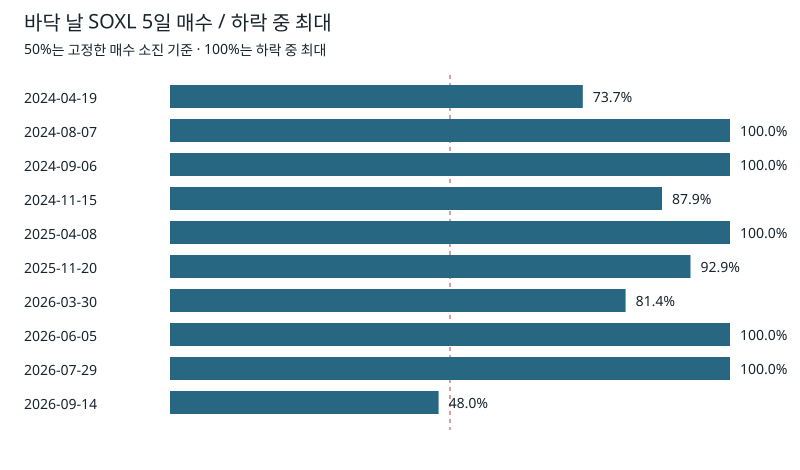

# 수급·필터 결합으로 바닥 근처 고르기 — 과제 A

**대표 신호3개 이상을 결합해도 2026 바닥 근처 진입은 더 잘 고르지 못했다: K≥3은 28.6%(7건), 가격 짝은 42.9%다. 매수가 말랐다는 가설도 바닥10개의 공통 모습은 아니었다.**

| 시험 범위 | 개수 |
|---|---|
| 하락 단일 | 19 |
| 하락 결합 | 8 |
| 고점 보조 | 7 |
| 합계 | 34 |
| 판정 밖 X1 민감도 | 30%·70% 두 칸 |

## 2026 주 검정 7칸

Z는 진입 시가 대비 진입 포함20세션 최저 종가가 −5% 이상인 비율이다. 이미5% 넘게 하락한 미완성 창은 실패에 포함한다. 나머지 미완성 창은 분모에서 뺀다. 가격 짝과 같은 수로 제한한 ON을 별도 열에 둔다.

| 신호 | ON Z | 가격 짝 Z | OFF Z | 짝 있는 ON Z | 짝 대비 차이 | 이동 p | Holm7 |
|---|---|---|---|---|---|---|---|
| S1L | 37.8% (37건; 미정1) | 32.4% (37건; 미정0) | 30.8% (39건; 미정3) | 37.8% (37건; 미정0) | 5.4% | 0.34 | 1.00 |
| X2 | 53.8% (13건; 미정0) | 15.4% (13건; 미정0) | 30.8% (65건; 미정4) | 53.8% (13건; 미정0) | 38.5% | 0.16 | 1.00 |
| T5L | 100.0% (1건; 미정0) | 0.0% (1건; 미정0) | 33.8% (77건; 미정4) | 100.0% (1건; 미정0) | 100.0% | 0.32 | 1.00 |
| G25 | 20.0% (10건; 미정2) | 30.0% (10건; 미정0) | 35.2% (71건; 미정2) | 20.0% (10건; 미정0) | -10.0% | 0.69 | 1.00 |
| M200 | 0.0% (4건; 미정4) | 75.0% (4건; 미정0) | 34.6% (78건; 미정0) | 0.0% (4건; 미정0) | -75.0% | 0.76 | 1.00 |
| NR | 34.1% (44건; 미정0) | 42.9% (28건; 미정0) | 42.9% (28건; 미정0) | 32.1% (28건; 미정0) | -10.7% | 0.64 | 1.00 |
| K3 | 28.6% (7건; 미정0) | 42.9% (7건; 미정0) | 35.2% (71건; 미정1) | 28.6% (7건; 미정0) | -14.3% | 0.58 | 1.00 |

원형 이동 p는 같은 해 전체 세션 신호를10,000회 이동한 단측 ON−OFF 차이의 참고값이다. 가격 짝의 p가 아니다. Holm은 이7칸만 보정한다. p 하나로 합격·탈락을 정하지 않는다.

## 근거와 해석

- SOXS 매수 몫이 낮은 S1L은2026 일별37.8% 대 가격 짝32.4%, 사건50.0% 대30.0%다. 바닥 구역9/10에 켜졌지만 사건 정밀도는33.3%이고2025에는 가격 짝보다 낮았다.
- 전체 Top50 순매수5일 합이 음수인 X2는 일별53.8%(13건) 대 짝15.4%다. 그러나 사건5건에서는 양쪽40.0%로 같아 일별 반복과 구간 의존성이 크다.
- K≥3은28.6% 대 짝42.9%, 사건도25.0% 대50.0%다. K≥2의 작은 차이와 일부2건짜리 결합을 함께 보아도 강한 결합 우위라고 하기 어렵다.
- T5L의100%는1/1이다. 공포≤25·200일선 아래·R 뉴스 대표는2026 가격 짝보다 낮았다. Holm7은 모두1.0이지만 이것만으로 효과를0이라고 단정하지 않는다.
- SOXL5일 매수가 하락 중 최대의50% 이하이고 저가 근처인 X1은2026 Z가0/4다. 실제 바닥10개에서도 매수가 말랐던 경우는1개뿐이었다.

계열 대표는2024~2025 결과만으로 골랐다. 선택 때 가격 결과도2025-12-31에 잘랐다. 대표는 S=S1L, X=X2, T=T5L, G=G25, M=M200, N=NR다.

2026 결과 계산 전 freeze 커밋은 `9167123bfa91b8a1dc685ee57f0918f1e30a831a`다. 원응답5040개의 Git 보존은 `8ee41fde9280c9377cb51e1eb1133497cbc22a48`에서 완료했다. 동결 뒤 변경은 [기록](results/postfreeze_changes_A.json)에 적었다.

일별 창은 서로 겹치고,10세션 간격 사건도 같은 하락 국면에 속할 수 있다. 가격 짝이 부족한 칸은 짝 있는 ON과 대조한다. 2026은 앞선 연구에서 본 자료여서 새 홀드아웃이 아니다.

## 시기별 방향 — 대표와 K3

| 신호 | 기간 | ON Z | 가격 짝 Z | OFF Z | 짝 차이 | ON20일 수익 |
|---|---|---|---|---|---|---|
| S1L | 2024 | 73.1% (26건; 미정0) | 53.8% (26건; 미정0) | 50.0% (40건; 미정0) | 19.2% | 4.2% |
| S1L | 2025 | 34.5% (29건; 미정0) | 54.5% (22건; 미정0) | 54.5% (22건; 미정0) | -40.9% | 3.3% |
| S1L | 2026H1 | 100.0% (3건; 미정0) | 0.0% (3건; 미정0) | 25.0% (4건; 미정0) | 100.0% | 26.2% |
| S1L | 2026H2 | 32.4% (34건; 미정1) | 32.4% (34건; 미정0) | 31.4% (35건; 미정3) | 0.0% | 1.2% |
| S1L | 2026 | 37.8% (37건; 미정1) | 32.4% (37건; 미정0) | 30.8% (39건; 미정3) | 5.4% | 3.7% |
| S1L | all | 46.7% (92건; 미정1) | 44.7% (85건; 미정0) | 43.6% (101건; 미정3) | -2.4% | 3.7% |
| X2 | 2024 | 46.7% (15건; 미정0) | 53.3% (15건; 미정0) | 62.7% (51건; 미정0) | -6.7% | -0.5% |
| X2 | 2025 | 100.0% (5건; 미정0) | 40.0% (5건; 미정0) | 37.0% (46건; 미정0) | 60.0% | 13.2% |
| X2 | 2026H1 | 50.0% (2건; 미정0) | 50.0% (2건; 미정0) | 66.7% (6건; 미정0) | 0.0% | 6.3% |
| X2 | 2026H2 | 54.5% (11건; 미정0) | 18.2% (11건; 미정0) | 27.1% (59건; 미정4) | 36.4% | 4.1% |
| X2 | 2026 | 53.8% (13건; 미정0) | 15.4% (13건; 미정0) | 30.8% (65건; 미정4) | 38.5% | 4.4% |
| X2 | all | 57.6% (33건; 미정0) | 36.4% (33건; 미정0) | 42.6% (162건; 미정4) | 21.2% | 3.5% |
| T5L | 2024 | 100.0% (10건; 미정0) | 40.0% (10건; 미정0) | 51.8% (56건; 미정0) | 60.0% | 4.9% |
| T5L | 2025 | 33.3% (3건; 미정0) | 33.3% (3건; 미정0) | 43.8% (48건; 미정0) | 0.0% | -11.8% |
| T5L | 2026H1 | — (0건; 미정0) | — (0건; 미정0) | 62.5% (8건; 미정0) | — | — |
| T5L | 2026H2 | 100.0% (1건; 미정0) | 0.0% (1건; 미정0) | 30.4% (69건; 미정4) | 100.0% | 12.5% |
| T5L | 2026 | 100.0% (1건; 미정0) | 0.0% (1건; 미정0) | 33.8% (77건; 미정4) | 100.0% | 12.5% |
| T5L | all | 85.7% (14건; 미정0) | 35.7% (14건; 미정0) | 42.0% (181건; 미정4) | 50.0% | 1.9% |
| G25 | 2024 | 66.7% (6건; 미정0) | 100.0% (6건; 미정0) | 60.9% (69건; 미정0) | -33.3% | 1.4% |
| G25 | 2025 | 34.2% (38건; 미정0) | 72.2% (18건; 미정0) | 72.2% (18건; 미정0) | -72.2% | 2.7% |
| G25 | 2026H1 | 50.0% (4건; 미정0) | 100.0% (3건; 미정0) | 100.0% (3건; 미정0) | -66.7% | 38.6% |
| G25 | 2026H2 | 0.0% (6건; 미정2) | 33.3% (6건; 미정0) | 32.4% (68건; 미정2) | -33.3% | — |
| G25 | 2026 | 20.0% (10건; 미정2) | 30.0% (10건; 미정0) | 35.2% (71건; 미정2) | -10.0% | 38.6% |
| G25 | all | 35.2% (54건; 미정2) | 64.7% (34건; 미정0) | 50.6% (158건; 미정2) | -47.1% | 5.6% |
| M200 | 2024 | 95.5% (22건; 미정0) | 59.1% (22건; 미정0) | 47.2% (53건; 미정0) | 36.4% | 6.0% |
| M200 | 2025 | 43.4% (53건; 미정0) | 100.0% (3건; 미정0) | 100.0% (3건; 미정0) | -66.7% | 3.4% |
| M200 | 2026H1 | — (0건; 미정0) | — (0건; 미정0) | 62.5% (8건; 미정0) | — | — |
| M200 | 2026H2 | 0.0% (4건; 미정4) | 75.0% (4건; 미정0) | 31.4% (70건; 미정0) | -75.0% | — |
| M200 | 2026 | 0.0% (4건; 미정4) | 75.0% (4건; 미정0) | 34.6% (78건; 미정0) | -75.0% | — |
| M200 | all | 55.7% (79건; 미정4) | 65.5% (29건; 미정0) | 41.0% (134건; 미정0) | 10.3% | 4.2% |
| NR | 2024 | 59.1% (22건; 미정0) | 59.1% (22건; 미정0) | 62.3% (53건; 미정0) | 0.0% | 0.6% |
| NR | 2025 | 80.0% (10건; 미정0) | 90.0% (10건; 미정0) | 39.1% (46건; 미정0) | -10.0% | 17.6% |
| NR | 2026H1 | 100.0% (2건; 미정0) | 50.0% (2건; 미정0) | 50.0% (6건; 미정0) | 50.0% | 0.7% |
| NR | 2026H2 | 31.0% (42건; 미정0) | 40.9% (22건; 미정0) | 40.9% (22건; 미정0) | -18.2% | -0.8% |
| NR | 2026 | 34.1% (44건; 미정0) | 42.9% (28건; 미정0) | 42.9% (28건; 미정0) | -10.7% | -0.7% |
| NR | all | 47.4% (76건; 미정0) | 56.7% (60건; 미정0) | 49.6% (127건; 미정0) | -6.7% | 2.3% |
| K3 | 2024 | 86.7% (15건; 미정0) | 66.7% (15건; 미정0) | 51.0% (51건; 미정0) | 20.0% | 2.8% |
| K3 | 2025 | 38.5% (26건; 미정0) | 48.0% (25건; 미정0) | 48.0% (25건; 미정0) | -12.0% | 4.5% |
| K3 | 2026H1 | — (0건; 미정0) | — (0건; 미정0) | 62.5% (8건; 미정0) | — | — |
| K3 | 2026H2 | 28.6% (7건; 미정0) | 42.9% (7건; 미정0) | 31.7% (63건; 미정1) | -14.3% | 7.3% |
| K3 | 2026 | 28.6% (7건; 미정0) | 42.9% (7건; 미정0) | 35.2% (71건; 미정1) | -14.3% | 7.3% |
| K3 | all | 52.1% (48건; 미정0) | 53.2% (47건; 미정0) | 42.9% (147건; 미정1) | -2.1% | 4.1% |

2024·2025의 최종 표는 전체 새 가격판으로 계산했다. 선택 단계 말미의 미완성 창은2025 말에 잘랐으므로 freeze의 선택 통계와 일부 다를 수 있다.

## 반복 신호를 줄인 사건

| 신호 | 2026 ON Z | 가격 짝 Z | OFF Z | 10일 평균 | 20일 평균 | 20일 최저 평균 |
|---|---|---|---|---|---|---|
| S1L | 50.0% (10건; 미정0) | 30.0% (10건; 미정0) | 30.0% (10건; 미정0) | 4.9% | 5.6% | -4.2% |
| X2 | 40.0% (5건; 미정0) | 40.0% (5건; 미정0) | 45.5% (11건; 미정0) | 3.5% | 3.1% | -6.5% |
| T5L | 100.0% (1건; 미정0) | 100.0% (1건; 미정0) | 45.5% (11건; 미정0) | 15.2% | 12.5% | 0.0% |
| G25 | 0.0% (3건; 미정0) | 66.7% (3건; 미정0) | 50.0% (10건; 미정0) | 5.3% | 41.2% | -5.2% |
| M200 | 0.0% (1건; 미정0) | 100.0% (1건; 미정0) | 45.5% (11건; 미정0) | — | — | — |
| NR | 42.9% (7건; 미정0) | 28.6% (7건; 미정0) | 25.0% (8건; 미정0) | 4.7% | -1.6% | -7.9% |
| K3 | 25.0% (4건; 미정0) | 50.0% (4건; 미정0) | 45.5% (11건; 미정0) | 0.8% | 6.7% | -2.9% |

## 바닥10개를 얼마나 잡았나

구역은 기존 B10 바닥 −10~+5세션, 시가≤바닥 종가×1.05이며 하락 상태에 속하는 날이다. 일별 재현율과10세션 사건 재현율을 나눈다. 정밀도는 구역 안 사건/모든 하락 사건이다.

| 신호 | 일별 재현 | 사건 재현 | 사건 정밀도 | 짝 재현 | 짝 정밀도 |
|---|---|---|---|---|---|
| S1L | 9/10 | 7/10 | 8/24 (33.3%) | 3/10 | 3/24 (12.5%) |
| X2 | 1/10 | 1/10 | 1/8 (12.5%) | 1/10 | 1/8 (12.5%) |
| T5L | 2/10 | 2/10 | 2/5 (40.0%) | 2/10 | 2/5 (40.0%) |
| G25 | 4/10 | 1/10 | 1/10 (10.0%) | 1/10 | 1/9 (11.1%) |
| M200 | 4/10 | 3/10 | 3/13 (23.1%) | 2/10 | 2/7 (28.6%) |
| NR | 4/10 | 2/10 | 2/13 (15.4%) | 2/10 | 2/13 (15.4%) |
| K3 | 4/10 | 2/10 | 2/14 (14.3%) | 2/10 | 2/14 (14.3%) |

첫 켜짐 날짜·바닥 대비 세션·가격 차이와27칸 전체는 [바닥별 적중표](results/bottom_hits_A.csv)와 [요약](results/bottom_summary_A.json)에 있다. 사건 간격 때문에 구역 안 일별 신호가 있어도 별도 사건을 못 잡을 수 있다.

바닥 당일 흐름을 알 수 있는 규약상 시점과 그때 이미 오른 폭이다. 실제 게시 로그가 아니다.

| 바닥 | 공개 후 관찰일 | 늦음(세션) | 바닥 종가 대비 시가 |
|---|---|---|---|
| 2024-04-19 | 2024-04-25 | 4 | +4.86% |
| 2024-08-07 | 2024-08-12 | 3 | +6.43% |
| 2024-09-06 | 2024-09-11 | 3 | +3.76% |
| 2024-11-15 | 2024-11-20 | 3 | +0.88% |
| 2025-04-08 | 2025-04-11 | 3 | +7.83% |
| 2025-11-20 | 2025-11-25 | 3 | +4.05% |
| 2026-03-30 | 2026-04-02 | 3 | +4.95% |
| 2026-06-05 | 2026-06-10 | 3 | +2.20% |
| 2026-07-29 | 2026-08-03 | 3 | +5.79% |
| 2026-09-14 | 2026-09-17 | 3 | +3.96% |

## 매수가 말랐을 때인가, 많이 샀을 때인가

바닥 당일5세션 매수 합이 그 하락 중 최대의 절반 이하인 경우는 **1/10**, 최대였던 경우는 **5/10**이다. 바닥 당일 SOXL 순매수는 **10/10**에서 양수였다. 바닥의5일 매수/최대 비율 중앙값은 **96.5%**다. 이 표는 사후 설명이며 바닥 날의 금액을 그날 알았다는 뜻이 아니다.

| 바닥 | 5일 매수 정점 | 정점→바닥 세션 | 바닥5일/최대 | 바닥하루/최대 | 바닥 순매수 USD |
|---|---|---|---|---|---|
| 2024-04-19 | 2024-03-11 | 28 | 73.7% | 89.9% | 52,648,362 |
| 2024-08-07 | 2024-08-07 | 0 | 100.0% | 59.7% | 79,109,562 |
| 2024-09-06 | 2024-09-06 | 0 | 100.0% | 97.6% | 95,376,048 |
| 2024-11-15 | 2024-11-04 | 9 | 87.9% | 51.9% | 83,658,733 |
| 2025-04-08 | 2025-04-08 | 0 | 100.0% | 67.4% | 131,615,138 |
| 2025-11-20 | 2025-11-18 | 2 | 92.9% | 98.4% | 212,711,513 |
| 2026-03-30 | 2026-03-05 | 17 | 81.4% | 90.3% | 386,350,621 |
| 2026-06-05 | 2026-06-05 | 0 | 100.0% | 100.0% | 514,226,128 |
| 2026-07-29 | 2026-07-29 | 0 | 100.0% | 55.8% | 452,905,838 |
| 2026-09-14 | 2026-08-24 | 14 | 48.0% | 61.6% | 434,916,443 |

고점~바닥+10세션의 일별 SOXL 매수·순매수·누적 순매수·보관 좌수·전체 순매수·SOXS 몫은 [설명 원장](results/exhaustion_daily.csv)에 있다. 진행 중인10/05 하락도 포함한다. 하루 SOXX−3% 이하 날만 순서대로 비교한 순매수 변화는 [급락 반응 표](results/crash_response.csv)에 있다.

## 지금 상태

최신 관찰 설정: **2026-11-11**, 직전 종가 DD60 **-25.4%**, 하락 상태에 해당한다. 원거래일 **2026-11-06**, 보관 날짜 **2026-11-09**. 다음 정규장 시가가 아직 없으면 결과는 미채점이다. 뉴스 대표가 결측이므로 K는 확정할 수 없고 켜짐 수 범위는 **1~2**다.

| 신호 | 값 | 백분위 | 상태 |
|---|---|---|---|
| S1H | 0.19 | 58.91 | OFF |
| S1L | 0.19 | 58.91 | OFF |
| S5H | 0.06 | 27.02 | OFF |
| S5L | 0.06 | 27.02 | OFF |
| X1 | 0.53 | — | OFF |
| X2 | 1,303,510,103.00 | — | OFF |
| X3 | 27,089,566.94 | — | OFF |
| T5H | 0.33 | 79.00 | OFF |
| T5L | 0.33 | 79.00 | OFF |
| CH | 0.04 | 75.80 | OFF |
| CL | 0.04 | 75.80 | OFF |
| G25 | 33.86 | — | OFF |
| M50 | -26.14 | — | ON |
| M100 | -31.03 | — | ON |
| M200 | -13.29 | — | ON |
| ND | — | — | UNKNOWN |
| NR | — | — | UNKNOWN |
| NS | — | — | UNKNOWN |
| NT | — | — | UNKNOWN |

뉴스 기존 전수 표본의 마지막 공개 날짜는 **2026-10-22**다. 이후는 기사 없음과 구별해 UNKNOWN으로 둔다. 과제 B의 새 계열은 이번 고정판에 끼우지 않았으며 --news-series로 별도 실행할 수 있다.

## 언제 알 수 있었나

| 변수 | 사용 시점 |
|---|---|
| SOXS·SOXL·Top50 결제 | 원결제표 다음 KSD 영업일09:00 KST 뒤 첫 NYSE 시가; 같은 공개일 최신 원거래일 우선 |
| 보관·보유 좌수 | 보관 날짜 둘째 KSD 영업일09:00 KST 뒤 첫 NYSE; 마지막 공개 관측 유지 |
| CNN·이평선·DD60·직전수익 | 관찰 시작 직전 미국 세션 종가까지 |
| 뉴스 | published_at 다음 정규장부터5세션; 날짜만 있는 경우 그날 장중 사용 안 함 |
| 바닥 날짜·바닥 대비 상승 | 기존 B10 사후 사건표, 설명·재현율 평가에만 사용 |

## 전체 고정 칸과 보조 결과

| 19단일+8결합 | 2026 ON Z | 짝 Z | −3% 지지 | −8% 지지 | 10일 평균 | 20일 평균 | 최저종가 평균 |
|---|---|---|---|---|---|---|---|
| S1H | 33.3% (12건; 미정0) | 16.7% (12건; 미정0) | 25.0% | 58.3% | 6.3% | 7.3% | -6.7% |
| S1L | 37.8% (37건; 미정1) | 32.4% (37건; 미정0) | 32.4% | 48.6% | 1.1% | 3.7% | -6.8% |
| S5H | 100.0% (1건; 미정0) | 0.0% (1건; 미정0) | 100.0% | 100.0% | 15.2% | 12.5% | 0.0% |
| S5L | 38.1% (42건; 미정2) | 34.5% (29건; 미정0) | 23.8% | 54.8% | -0.7% | 1.2% | -7.4% |
| X1 | 0.0% (4건; 미정0) | 25.0% (4건; 미정0) | 0.0% | 0.0% | -9.1% | 8.3% | -8.6% |
| X2 | 53.8% (13건; 미정0) | 15.4% (13건; 미정0) | 30.8% | 84.6% | 4.6% | 4.4% | -4.7% |
| X3 | 50.0% (4건; 미정0) | 25.0% (4건; 미정0) | 25.0% | 50.0% | 5.5% | 1.1% | -7.5% |
| T5H | 34.5% (58건; 미정3) | 35.0% (20건; 미정0) | 24.1% | 52.6% | 0.9% | 3.9% | -7.6% |
| T5L | 100.0% (1건; 미정0) | 0.0% (1건; 미정0) | 100.0% | 100.0% | 15.2% | 12.5% | 0.0% |
| CH | 28.1% (64건; 미정0) | 50.0% (18건; 미정0) | 14.1% | 42.9% | -1.1% | -0.0% | -8.5% |
| CL | 66.7% (3건; 미정0) | 0.0% (3건; 미정0) | 66.7% | 100.0% | 22.7% | 37.8% | 0.2% |
| G25 | 20.0% (10건; 미정2) | 30.0% (10건; 미정0) | 20.0% | 40.0% | 4.8% | 38.6% | -1.2% |
| M50 | 36.2% (69건; 미정4) | 15.4% (13건; 미정0) | 24.6% | 55.9% | 0.9% | 5.8% | -5.7% |
| M100 | 40.5% (37건; 미정4) | 24.3% (37건; 미정0) | 35.1% | 55.6% | 2.7% | 11.5% | -2.3% |
| M200 | 0.0% (4건; 미정4) | 75.0% (4건; 미정0) | 0.0% | 0.0% | — | — | — |
| ND | 29.4% (34건; 미정0) | 47.1% (34건; 미정0) | 14.7% | 41.2% | 0.1% | 4.5% | -9.7% |
| NR | 34.1% (44건; 미정0) | 42.9% (28건; 미정0) | 18.2% | 45.5% | 0.2% | -0.7% | -8.1% |
| NS | 75.0% (4건; 미정0) | 0.0% (4건; 미정0) | 75.0% | 100.0% | 12.6% | 24.5% | -1.1% |
| NT | 69.6% (23건; 미정0) | 39.1% (23건; 미정0) | 43.5% | 87.0% | 3.2% | 4.9% | -3.4% |
| K2 | 42.4% (33건; 미정3) | 36.4% (33건; 미정0) | 30.3% | 51.5% | 2.8% | 4.2% | -6.1% |
| K3 | 28.6% (7건; 미정0) | 42.9% (7건; 미정0) | 28.6% | 42.9% | 1.2% | 7.3% | -2.2% |
| K4 | — (0건; 미정0) | — (0건; 미정0) | — | — | — | — | — |
| S_AND_X | 50.0% (2건; 미정0) | 0.0% (2건; 미정0) | 50.0% | 100.0% | 3.3% | 4.7% | -3.3% |
| S_AND_T | — (0건; 미정0) | — (0건; 미정0) | — | — | — | — | — |
| S_AND_G | 33.3% (6건; 미정0) | 33.3% (6건; 미정0) | 33.3% | 33.3% | 7.9% | 37.0% | 2.8% |
| S_AND_M | 0.0% (2건; 미정1) | 100.0% (2건; 미정0) | 0.0% | 0.0% | — | — | — |
| S_AND_N | 35.0% (20건; 미정0) | 40.0% (20건; 미정0) | 30.0% | 40.0% | -0.6% | 1.4% | -7.7% |

고점권7칸의 결과(+5% 넘게 더 오르지 않음·20일 수익)는 [고점 보조](results/high_aux_A.json), X1의30%·70%는 [민감도](results/sensitivity_A.json)다. 둘 다 대표 선택·주 판정에 쓰지 않는다. 6기간의 모든 일별·사건 통계는 [전체 요약](results/summary_A.json), 각 날짜는 [일별](results/daily_A.csv), [사건](results/events_A.csv), [가격 짝](results/matches_A.csv)에 있다.

## 고점권7칸 — 보조

H는 진입 포함20세션 최고 종가가 진입 시가의+5% 이하인 비율이다. 바닥 쪽 Z와 반대 방향의 질문이다.

| 고점 신호 | 2026 ON H | 가격 짝 H | OFF H | 20일 평균 |
|---|---|---|---|---|
| S1H | 21.1% (19건; 미정0) | 31.6% (19건; 미정0) | 44.0% (50건; 미정0) | 8.5% |
| S1L | 47.4% (19건; 미정0) | 42.1% (19건; 미정0) | 34.0% (50건; 미정0) | 2.4% |
| S5H | 16.7% (12건; 미정0) | 25.0% (12건; 미정0) | 40.0% (55건; 미정0) | 18.3% |
| S5L | 43.5% (23건; 미정0) | 34.8% (23건; 미정0) | 31.8% (44건; 미정0) | 1.9% |
| T5H | 57.6% (33건; 미정0) | 24.2% (33건; 미정0) | 21.6% (37건; 미정0) | 2.3% |
| CH | 25.0% (16건; 미정0) | 18.8% (16건; 미정0) | 39.1% (64건; 미정0) | -0.8% |
| G75 | — (0건; 미정0) | — (0건; 미정0) | 36.2% (80건; 미정0) | — |

## X1 민감도 — 판정 밖

| 매수/진행 최대 문턱 | 2026 ON Z | 가격 짝 Z | OFF Z |
|---|---|---|---|
| X1_30 | 0.0% (1건; 미정0) | 0.0% (1건; 미정0) | 35.1% (77건; 미정4) |
| X1_70 | 30.8% (13건; 미정1) | 30.8% (13건; 미정0) | 35.4% (65건; 미정3) |

## 자료·검증·한계

- 새 SEIBRO 원응답 **5040개**(빈 응답109개), 결제 날짜 2023-01-02~2026-11-11. 날짜별XML gzip을 보존했다. 새 단일 전체 가격 응답3개와 CNN 원응답을 보존했다. SOXX3:1 분할 기준은7/29·10/05·11/05 앵커로 검사했고 섞임이 없었다.
- 빈 응답·Top50 미관측·새 공개 없는 날은0달러·OFF가 아니다. 분모는 Top50 근사이며 전체 한국인 자산/현금을 뜻하지 않는다. 매수 감소가 자금 고갈을 직접 측정하지는 않는다.
- 같은 결제 묶음의 여러 미국 거래일은 균등 배분값이다. 당일 실제 거래액을 식별한 것이 아니다. 보관 좌수는보관금액/평가종가 추정이다. 보관 공시는 늦고 공개 없는 날은 마지막 잔고다.
- 과거 CNN 값이 당시 게시값과 같은지는 확인할 수 없다. 결제·보관 게시 시각도 실측 로그가 아닌 규약이다. 뉴스 표본은 인용·분류와 수집 범위에 의존한다.
- 가격 짝은 연도·상태를 맞춘 최근접3변수 대조다. 다른 교란 요인이나 특정 국면의 차이를 모두 없애지 못한다. greedy 순서와 OFF 부족이 결과에 영향을 줄 수 있다.
- 시가→종가의 SOXX 관찰값이다. 수수료0원·주문 가능 KST08~24시 조건과 별개로 종가 청산, 스프레드·환전·배당·실제 체결을 적용한 전략 수익이 아니다.
- 독립 재계산: **3,947개 비교**, 불일치 **0개**, 통과 **True**. 주7칸의 Z·가격 짝·원형 이동·Holm과27칸×10바닥 적중표를 다른 코드 경로로 재계산했다. [verify_A.json](results/verify_A.json).
- 단위 테스트는 미래 수급·가격·CNN 변조에도 과거19신호 불변,5일 창 결측,미완성 실패,삼값 결합,짝 중복·근접 제외,연도 경계 사건 간격을 확인한다. 전체 결과는 [unittest_A.log](unittest_A.log)에 있다.

## 다음 후보

새 문턱·조합은 이번에 탐색하지 않았다. 과제 B의 공개시점이 확인된 뉴스 계열을 연결하는 별도 재실행만 남긴다. 기존 결과에 맞춰 대표를 다시 고르지 않는다.
