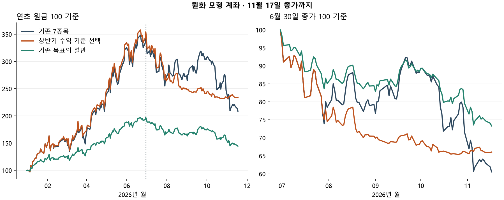

# 7종목 계좌의 시장 이탈·종목 교체 실험

미국 거래일 2026-01-02~2026-11-17의 221거래일을 연속 운용했다. 현행·고정 절반 대조 2개와 후보 301개를 비교했다. 상반기에 최대낙폭이 현행보다 깊지 않은 후보 중 원화 수익률이 가장 높은 규칙을 선택했다. 안정성 우선 선택에서는 같은 낙폭 조건에 상반기 현행 이익의 75%를 지키는 조건을 더하고 그중 낙폭이 가장 얕은 규칙을 골랐다. 낙폭 동률이면 수익이 높은 쪽을 택했다. 두 전체 선택에는 현행도 포함했다. 유형별로 자격을 충족한 후보가 없으면 현행을 표시했다. 수익이 같으면 규칙 이름 오름차순으로 골랐다. 고정 절반은 대조용이다. 각 가격선·재진입·교체 조건은 [실험 방법](methods.md)에서 확인할 수 있다.

현행은 상반기 +245.05%, 7월 이후 -39.45%, 연초부터 누적 +108.93%였다. 수익 우선 규칙 **stock100_cash_SOXX100r1**은 7월 이후 -33.93%, 같은 구간 최대낙폭 -34.62%였다.

## 구간 성과

| 선정 근거 | 규칙 | 상반기 | 7월 이후 | 7월 이후 최대낙폭 | 연초 누적 | 연초 최대낙폭 |
|---|---|---|---|---|---|---|
| 현행 | base | +245.05% | -39.45% | -39.45% | +108.93% | -40.04% |
| 고정 절반 대조 | half | +97.11% | -26.68% | -26.68% | +44.53% | -26.69% |
| 상반기 수익 우선 | stock100_cash_SOXX100r1 | +254.50% | -33.93% | -34.62% | +134.22% | -35.26% |
| 상반기 안정성 우선 | switch_bothA_QQQ50r1 | +217.69% | -37.52% | -38.14% | +98.50% | -38.75% |
| 개별가격선 상반기 선택 | stock100_cash_none | +247.40% | -39.90% | -39.90% | +108.77% | -40.49% |
| 개별가격선+시장이탈 상반기 선택 | stock100_cash_SOXX100r1 | +254.50% | -33.93% | -34.62% | +134.22% | -35.26% |
| 빠른교체 상반기 선택 | fast_none | +209.65% | -40.57% | -40.57% | +84.02% | -41.15% |
| 빠른교체+시장이탈 상반기 선택 | fast_SOXX100r1 | +213.62% | -34.40% | -35.08% | +105.73% | -35.72% |
| 시장이탈 상반기 선택 | weekly_SOXX100r1 | +248.26% | -34.58% | -35.26% | +127.83% | -35.89% |
| 이탈시교체 상반기 선택 | switch_trendA_SOXX50r1 | +237.20% | -44.68% | -44.68% | +86.53% | -45.22% |
| 추세 상반기 선택 | trendA_week_rotate_none | +186.18% | -44.36% | -44.36% | +59.23% | -44.90% |
| 추세+시장이탈 상반기 선택 | trendA_week_rotate_SOXX100r1 | +189.84% | -41.53% | -42.14% | +69.48% | -42.70% |
| 추세와회복 상반기 선택 | bothA_change_rotate_none | +152.03% | -43.18% | -43.75% | +43.20% | -44.75% |
| 추세와회복+시장이탈 상반기 선택 | bothA_change_rotate_SOXX100r1 | +157.45% | -37.02% | -37.67% | +62.15% | -38.78% |
| 회복 상반기 선택 | giantA_change_cash_none | +131.81% | -30.20% | -30.86% | +61.80% | -31.46% |
| 회복+시장이탈 상반기 선택 | giantA_change_cash_SOXX100r1 | +136.80% | -26.85% | -27.61% | +73.22% | -28.24% |
| 7월 이후 수익 사후 1위 | bothA_change_cash_SOXX10r1 | +96.74% | -15.10% | -15.83% | +67.03% | -16.95% |

상반기 낙폭 조건에 든 후보는 300/301개다. 7월 이후 현행 수익과 낙폭을 모두 개선한 후보는 238/301개이고, 거래대금 편도 10bp 비용을 현행과 후보에 함께 적용하면 233개다. 여러 설정이 같은 날짜와 종목을 공유한다. 후보 수를 독립적인 성공 횟수로 해석할 수 없다. 하반기 사후 1위는 전체 탐색의 상단을 보여 준다.

## 약세 구간과 거래 비용

| 규칙 | 7~8월 | 9월 이후 | 7월 이후 투자 비중 평균 | 7월 이후 매수·매도 합계¹ | 7월 이후 10bp 수익 | 7월 이후 10bp 최대낙폭 |
|---|---|---|---|---|---|---|
| base | -20.72% | -23.63% | 82.2% | 3.7배 | -39.67% | -39.67% |
| half | -15.52% | -13.21% | 41.0% | 1.9배 | -26.81% | -26.81% |
| stock100_cash_SOXX100r1 | -29.54% | -6.23% | 37.7% | 6.6배 | -34.37% | -35.05% |
| switch_bothA_QQQ50r1 | -27.00% | -14.41% | 51.4% | 18.9배 | -38.69% | -39.26% |
| stock100_cash_none | -25.74% | -19.08% | 62.6% | 8.3배 | -40.40% | -40.40% |
| fast_none | -20.72% | -25.04% | 82.7% | 4.1배 | -40.81% | -40.81% |
| fast_SOXX100r1 | -27.25% | -9.84% | 42.6% | 6.5배 | -34.83% | -35.50% |
| weekly_SOXX100r1 | -27.25% | -10.08% | 42.1% | 6.5배 | -35.00% | -35.68% |
| switch_trendA_SOXX50r1 | -28.04% | -23.13% | 80.3% | 20.0배 | -45.78% | -45.78% |
| trendA_week_rotate_none | -27.78% | -22.96% | 84.8% | 11.8배 | -45.01% | -45.01% |
| trendA_week_rotate_SOXX100r1 | -33.74% | -11.75% | 46.2% | 11.0배 | -42.17% | -42.77% |
| bothA_change_rotate_none | -27.30% | -21.84% | 36.5% | 12.5배 | -43.88% | -44.40% |
| bothA_change_rotate_SOXX100r1 | -28.16% | -12.33% | 20.9% | 9.4배 | -37.60% | -38.25% |
| giantA_change_cash_none | -21.91% | -10.62% | 26.7% | 4.6배 | -30.52% | -31.17% |
| giantA_change_cash_SOXX100r1 | -22.83% | -5.21% | 15.8% | 3.7배 | -27.12% | -27.88% |
| bothA_change_cash_SOXX10r1 | -11.83% | -3.71% | 11.7% | 4.3배 | -15.46% | -16.16% |

¹ 매일 매수 비중과 매도 비중의 절댓값 합을 누적했다. 수수료 0인 기본 조건과 비교하기 위해 거래대금 편도 0.10%를 적용했다. 표의 구간 수익과 낙폭에는 구간 직전 종가를 포함하며 연초에만 초기 자산 1을 쓴다.

## 같은 금액을 계속 투자했을 때

하반기 각 후보의 평균 투자 비중을 현행의 평균 투자 비중으로 나눈 비율만큼 매일 종가에 현행 모형을 보유하고 나머지를 달러 현금으로 두는 대조다. 하반기를 보고 정한 비율이므로 현금 보유 자체로 설명되는 방어 효과를 가늠하는 사후 계산이다. 대조의 거래 비용은 0이며, 비율이 100%를 넘으면 대조 수익은 비워 둔다.

| 규칙 | 후보 달러 수익 | 비중 맞춘 대조 달러 수익 | 후보 달러 최대낙폭 | 대조 달러 최대낙폭 |
|---|---|---|---|---|
| base | -30.11% | -30.11% | -32.54% | -32.54% |
| half | -15.36% | -15.22% | -17.34% | -17.37% |
| stock100_cash_SOXX100r1 | -23.74% | -14.00% | -23.74% | -16.05% |
| switch_bothA_QQQ50r1 | -27.88% | -19.05% | -28.05% | -21.42% |
| stock100_cash_none | -30.63% | -23.12% | -30.63% | -25.60% |
| fast_none | -31.40% | 해당 없음 | -33.79% | 해당 없음 |
| fast_SOXX100r1 | -24.28% | -15.83% | -24.28% | -18.02% |
| weekly_SOXX100r1 | -24.49% | -15.64% | -24.49% | -17.82% |
| switch_trendA_SOXX50r1 | -36.15% | -29.44% | -36.15% | -31.90% |
| trendA_week_rotate_none | -35.78% | 해당 없음 | -35.78% | 해당 없음 |
| trendA_week_rotate_SOXX100r1 | -32.51% | -17.16% | -32.51% | -19.43% |
| bothA_change_rotate_none | -34.41% | -13.58% | -34.57% | -15.60% |
| bothA_change_rotate_SOXX100r1 | -27.30% | -7.77% | -27.30% | -9.15% |
| giantA_change_cash_none | -19.43% | -9.94% | -19.58% | -11.59% |
| giantA_change_cash_SOXX100r1 | -15.56% | -5.86% | -15.60% | -6.96% |
| bothA_change_cash_SOXX10r1 | -2.01% | -4.34% | -3.63% | -5.19% |

2026년 가격은 기존 연구에서 여러 번 사용했고, 7월 이후 약세를 알고 설계한 실험이다. 상반기만으로 선택해 뒤쪽 성과를 분리했어도 독립적인 실시간 검증은 앞으로 쌓일 거래일에서 가능하다. 각 규칙의 설정과 모든 구간 수익·낙폭은 [전체 후보](candidates.csv), 선택 규칙과 대조군의 일별 자산·매매량은 [일별 원장](selected_daily.csv)에 담았다.

## 추가 진단

상반기 수익 기준 선택과 하반기 평균 주식 비중을 맞추기 위해, 기존 주간 목표를 매주 45.98%로 축소해 같은 시가에 체결했다. 이 고정 배율은 하반기 자료로 맞춘 설명용이다. 거인의 어깨 시장 폭은 전체 AI 종목 중 전고점 10% 안에 있는 비율이다. 19% 미만이면 다음 시가부터 달러 현금, 19% 이상으로 회복하면 다음 시가에 복귀한다. 이 경계는 이미 2~9월 자료로 정해져 두 경로를 앞 구간 선택에서 제외했다.

| 진단 | 상반기 원화 수익 | 7월 이후 원화 수익 | 7월 이후 최대낙폭 | 7월 이후 평균 주식 비중 |
|---|---:|---:|---:|---:|
| 선택 규칙 | +254.50% | -33.93% | -34.62% | 37.66% |
| 같은 평균 비중의 주간 고정 투자 | +88.04% | -25.62% | -25.62% | 37.66% |
| 달러 현금만 보유 | +7.22% | -13.37% | -14.82% | 0.00% |
| 시장 폭 19% + 기존 | +151.53% | -16.31% | -17.18% | 5.62% |
| 시장 폭 19% + 추세 A 이상 | +103.54% | -17.02% | -17.88% | 5.87% |

