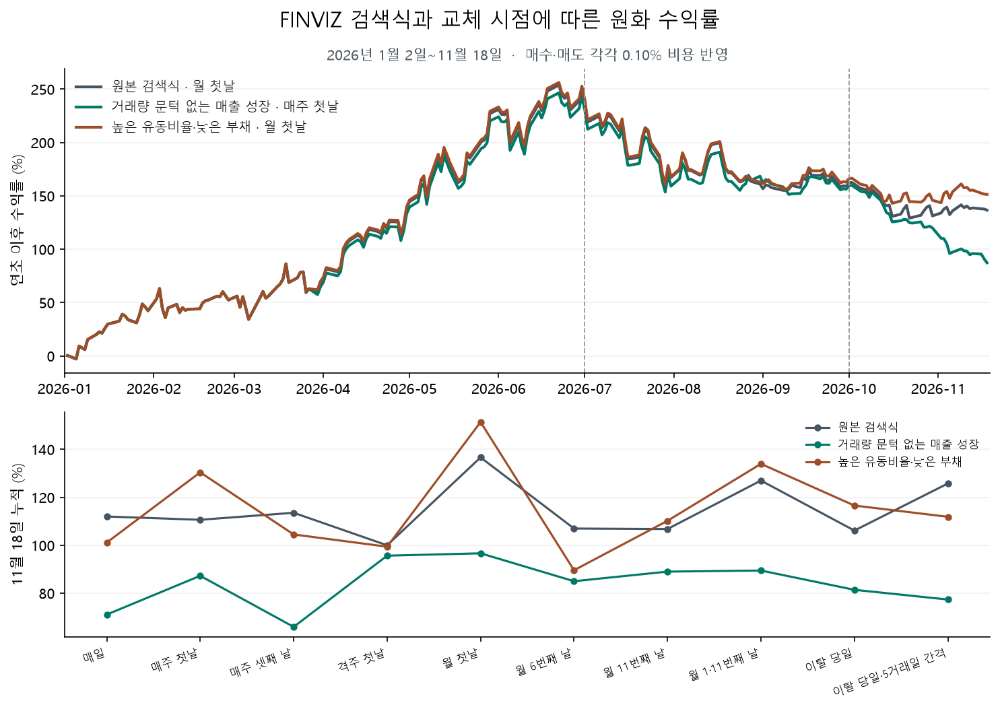

# FINVIZ 검색식과 교체 날짜를 바꾸면 올해 수익이 늘었나

미국 거래일 2026년 1월 2일~11월 18일에 같은 기존 데스크를 운용하고, SOXX가 100일선 아래에 있는 동안 사용할 선별 규칙과 교체 일정만 바꿨다. 주 비교는 원화 가격 수익과 매수·매도 각각 0.10% 비용을 적용한다. 월 첫 거래일 원본 FINVIZ의 기존 연구 222일 원장을 다시 맞췄다.

**다음 모의 비교 후보는 매월 첫 거래일에 갱신하는 재무 강화식이다.** 원본에서 유동비율 > 1.5, 부채/자본 < 0.5 두 조건을 적용했다. 월말 미국 종가 기준 상대거래량 상위 7개로 다음 달 후보 바스켓을 구성했다. SOXX 종가가 100일선 아래로 내려가면 다음 정규장 시가에 그 바스켓으로 전환하고, 선을 회복하면 다음 시가에 기존 데스크로 복귀했다. [FINVIZ에서 후보 검색식 열기](https://finviz.com/screener?v=111&f=cap_midover%2Cfa_curratio_o1.5%2Cfa_debteq_u0.5%2Cgeo_usa%2Csh_avgvol_o500%2Csh_instown_o40%2Csh_price_o10%2Csh_relvol_o1%2Cta_rsi_nos40%2Cta_sma20_sa50%2Cta_sma200_pa%2Cta_sma50_pa&ft=4&ta=0&o=-relativevolume)

전체 기록을 본 후의 연중 1위는 **높은 유동비율·낮은 부채 · 월 첫날**로 +151.40%였다. 원본 월초보다 연중 수익·7월 이후 수익·7월 이후 최대낙폭이 모두 좋아진 조합은 3/170개였다. 서로 같은 48개 이탈 거래일을 여러 규칙이 공유한다.

상반기 자료로 선택한 규칙은 **거래량 문턱 없는 매출 성장 · 매주 첫날**였다. 연중 누적 +87.25%, 7월 이후 −45.42%였다. 기존 월초 검색식은 연중 +136.64%, 7월 이후 −32.47%였다. 7~9월 수익과 최대낙폭 검사 후 10월부터 유지할 후보는 거래량 문턱 없는 매출 성장 · 매주 첫날로 정했다. 이 규칙은 10월 이후 기존보다 손실이 컸다.

## 같은 시장 이탈 신호에서의 성과

| 방법 | 연중 비용 0 | 연중 0.10% | 상반기 | 7월 이후 | 7월 이후 최대낙폭 | 연중 최대낙폭 | 연중 0.25% |
|---|---:|---:|---:|---:|---:|---:|---:|
| 기존 데스크 | +110.60% | +108.49% | +242.88% | −39.19% | −39.67% | −40.27% | +105.37% |
| 이탈 시 달러 현금 | +127.38% | +124.08% | +245.42% | −35.13% | −35.68% | −36.31% | +119.21% |
| 원본 검색식 · 월 첫날 | +143.02% | +136.64% | +250.40% | −32.47% | −34.62% | −35.26% | +127.37% |
| 거래량 문턱 없는 매출 성장 · 매주 첫날 | +92.28% | +87.25% | +243.09% | −45.42% | −45.42% | −45.96% | +79.95% |
| 높은 유동비율·낮은 부채 · 월 첫날 | +158.08% | +151.40% | +252.77% | −28.74% | −31.11% | −31.78% | +141.70% |

세 지표를 모두 개선한 규칙과 이탈 중 투자 비중은 다음과 같다.

| 검색식 · 교체일 | 연중 | 7월 이후 | 7월 이후 최대낙폭 | 이탈 중 평균 종목 수 | 평균 주식 비중 |
|---|---:|---:|---:|---:|---:|
| 높은 유동비율·낮은 부채 · 월 첫날 | +151.40% | −28.74% | −31.11% | 6.42 | 91.95% |
| 상대거래량 2배 · 월 첫날 | +141.07% | −30.37% | −32.43% | 3.35 | 48.12% |
| RSI 50 초과 · 월 첫날 | +137.68% | −32.17% | −34.33% | 6.65 | 95.00% |

이탈 48일을 기준으로 원본 검색식 · 월 첫날은 평균 3.60개 섹터, 한 섹터에 가장 많이 투자한 날의 비중은 64.50%, 높은 유동비율·낮은 부채 · 월 첫날은 평균 3.46개 섹터, 한 섹터에 가장 많이 투자한 날의 비중은 71.33%였다. 후보가 7개에 모자라면 해당 금액은 달러로 남았다.

## 한 섹터에 최대 두 종목만 담으면

사후 분산 점검에서는 매월 상대거래량 순으로 내려가며 이미 두 종목을 채운 섹터를 건너뛰었다. 조건에 맞는 후보가 7개보다 적으면 빈자리는 현금이다. 섹터 수와 최대 섹터 비중은 이탈 48거래일 기준이다.

| 월초 검색식 | 섹터당 종목 수 | 연중 | 7월 이후 | 연중 최대낙폭 | 평균 종목 수 | 평균 섹터 수 | 최대 섹터 비중 |
|---|---:|---:|---:|---:|---:|---:|---:|
| 원본 검색식 | 제한 없음 | +136.64% | −32.47% | −35.26% | 6.65 | 3.60 | 64.50% |
| 원본 검색식 | 최대 2개 | +124.53% | −35.97% | −37.85% | 5.77 | 4.12 | 32.60% |
| 높은 유동비율·낮은 부채 | 제한 없음 | +151.40% | −28.74% | −31.78% | 6.42 | 3.46 | 71.33% |
| 높은 유동비율·낮은 부채 | 최대 2개 | +127.65% | −34.44% | −35.09% | 5.75 | 4.35 | 31.85% |

두 검색식 모두 섹터 집중도는 낮아졌지만 7월 이후 손실과 연중 최대낙폭이 커졌다. 재무 강화식에 섹터 제한을 더하면 이탈 중 평균 주식 비중도 91.95%에서 82.11%로 낮아졌다. [섹터별 종목 수 제한 대조](sector_check.csv)

## Claude가 미리 정한 두 가설

같은 222거래일의 기존 월초 원장을 독립 재현한 뒤, 교체를 줄이는 보유 규칙과 실적 조건을 각각 비교했다. 비용은 편도 0.10%다.

| 선별·교체 규칙 | 연중 | 7월 이후 | 연중 최대낙폭 |
|---|---:|---:|---:|
| 원본 월초 상위 7개 | +136.64% | −32.47% | −35.26% |
| 월초·16일 이후 첫 거래일마다 상위 7개 | +128.87% | −33.18% | −35.02% |
| 같은 월 2회, 보유 종목이 합격 명단 14위 이내면 유지 | +129.65% | −33.68% | −34.33% |
| 월초, 최근 분기 매출 성장·영업흑자 추가 | +122.70% | −36.33% | −38.45% |

두 후보 모두 사전에 정한 채택 기준을 충족하지 못했다. 보유 기준을 완화한 월 2회 방식은 연중 최대낙폭을 조금 줄였지만 원본 월초보다 7월 이후 손실이 컸다. 같은 합격 명단에서 무작위로 뽑은 월초 바스켓 300개의 연중 중앙값은 +116.87%였고, 상대거래량으로 정렬한 원본 월초는 94번째 백분위였다. [Claude의 사전 가설](claude/HYPOTHESIS.md) · [독립 결과와 월 1·2회 무작위 대조 600개](claude/REPORT.md)

## 검색식 변경과 교체 시점의 효과

아래 네 비교는 원래 월초 규칙, 새 검색식만 적용, 날짜만 변경, 두 가지를 함께 변경한 경우다. 같은 비교가 중복되면 한 행만 표시한다.

| 검색식 · 교체일 | 연중 수익 | 7월 이후 | 연중 최대낙폭 | 이탈 중 주식 비중 | 연중 매매대금/자산 |
|---|---:|---:|---:|---:|---:|
| 원본 검색식 · 월 첫날 | +136.64% | −32.47% | −35.26% | 95.0% | 26.6배 |
| 거래량 문턱 없는 매출 성장 · 월 첫날 | +96.64% | −42.41% | −42.98% | 100.0% | 23.2배 |
| 원본 검색식 · 매주 첫날 | +110.62% | −38.49% | −39.09% | 98.5% | 37.1배 |
| 거래량 문턱 없는 매출 성장 · 매주 첫날 | +87.25% | −45.42% | −45.96% | 100.0% | 26.5배 |
| 높은 유동비율·낮은 부채 · 월 첫날 | +151.40% | −28.74% | −31.78% | 92.0% | 26.2배 |

각 날짜는 미국 정규장 거래일 순서다. 아래는 교체 시점만 바꿨을 때의 연중 비용 후 수익이다.

| 점검 일정 | 원본 검색식 | 거래량 문턱 없는 매출 성장 | 높은 유동비율·낮은 부채 |
|---|---:|---:|---:|
| 매일 | +111.99% | +71.08% | +101.12% |
| 매주 첫날 | +110.62% | +87.25% | +130.41% |
| 매주 셋째 날 | +113.55% | +65.94% | +104.49% |
| 격주 첫날 | +99.98% | +95.64% | +99.40% |
| 월 첫날 | +136.64% | +96.64% | +151.40% |
| 월 6번째 날 | +106.97% | +85.00% | +89.58% |
| 월 11번째 날 | +106.77% | +89.00% | +110.19% |
| 월 1·11번째 날 | +126.98% | +89.45% | +133.96% |
| 이탈 당일 | +106.13% | +81.41% | +116.56% |
| 이탈 당일·5거래일 간격 | +125.75% | +77.35% | +111.87% |

같은 상대거래량 내림차순에서 하한만 1배→1.5배·2배로 올리면 순위가 바뀌지 않는다. 상위 7개가 달랐던 110일·193일은 강화된 조건이 7개를 채우지 못한 날이었다. 하한을 아예 없애도 상위 7개는 원본이 7개를 채우지 못한 5일에만 달라졌다. 이 비교는 종목 발굴뿐 아니라 현금 보유 효과를 측정한다.

## 첫 거래일 명단과 실제 체결을 하루 옮겨 본 결과

연중 결과를 본 후 두 검색식의 발표·체결 시차에 대한 민감도를 확인했다. SOXX 시장 전환 시점은 모든 행에서 동일하다. 이 검사는 후보를 다시 고르는 데 사용하지 않았다.

| 선발 및 체결 | 원본 연중 | 재무 강화 연중 | 원본 7월 이후 | 재무 강화 7월 이후 |
|---|---:|---:|---:|---:|
| 월 첫 시가, 직전 종가로 선발 | +136.64% | +151.40% | −32.47% | −28.74% |
| 첫 시가 명단을 고정해 둘째 시가에 체결 | +131.11% | +148.45% | −34.07% | −29.63% |
| 둘째 시가, 직전 종가로 새로 선발 | +111.22% | +115.33% | −36.04% | −36.18% |
| 셋째 시가, 직전 종가로 새로 선발 | +111.06% | +110.40% | −37.23% | −37.80% |

재무 강화식과 매월 같은 수의 투자 자리를 쓰게 한 원본 검색식은 연중 +133.02%, 7월 이후 −33.50%였다. 이탈 중 평균 주식 비중은 해당 대조 90.21%, 재무 강화식 91.95%였다. 현금 비중을 비슷하게 맞춰도 이번 표본에서는 재무 강화식이 앞섰다. [체결 지연·현금 비중 대조](sensitivity.csv)

## 앞 구간으로 선택하고 뒤 구간으로 확인

상반기 SOXX 이탈은 2일이었다. 별도 상시 FINVIZ 계좌에서 8개 일정의 상반기 성과를 같은 일정의 원본 검색식과 비교했다. 평균 투자 비중과 낙폭 기준은 사전 설계를 따랐다. 7~9월 두 기준 통과 여부는 **통과**였다. 이 판단에 10월 이후 성과를 쓰지 않았다.

| 조건부 계좌 | 7~9월 수익 | 7~9월 최대낙폭 | 10월~11월 18일 수익 | 10월 이후 최대낙폭 |
|---|---:|---:|---:|---:|
| 원본 검색식 · 월 첫날 | −26.08% | −27.22% | −8.64% | −12.73% |
| 거래량 문턱 없는 매출 성장 · 매주 첫날 | −25.30% | −26.73% | −26.94% | −27.92% |
| 높은 유동비율·낮은 부채 · 월 첫날 | −25.47% | −27.50% | −4.38% | −8.80% |

## 다섯 번의 시장 이탈

각 칸은 같은 구간 원본 월초 전략 대비 상대 자산 수익이다. 예컨대 +2%는 원본의 같은 구간 말 자산보다 2% 많았다는 뜻이다. 이탈 직전 종가부터 복귀일 종가까지이며, 마지막 구간은 연구 종료일 종가까지다.

| 이탈일 | 마지막 이탈일 | 이탈 거래일 | 거래량 문턱 없는 매출 성장 · 매주 첫날 | 높은 유동비율·낮은 부채 · 월 첫날 |
|---|---:|---:|---:|---:|
| 2026-03-30 | 2026-03-31 | 2 | −2.09% | +0.68% |
| 2026-07-30 | 2026-07-30 | 1 | −0.92% | −0.33% |
| 2026-08-25 | 2026-08-27 | 3 | +3.59% | +0.31% |
| 2026-08-31 | 2026-09-21 | 15 | −1.53% | +0.85% |
| 2026-10-13 | 2026-11-18 | 27 | −20.03% | +4.65% |

사후 1위가 원본 월초를 앞선 이탈은 4/5회다. 가장 유리한 한 구간을 제외할 때 나머지의 원본 대비 누적 상대 수익은 +1.51%다. 다섯 번 중 네 번 이상 앞선 조합은 2개였다.

## 11월 19일 추가 종가

11월 18일 종가 보유 수량을 그대로 유지해, 선발에 쓰지 않은 다음 거래일의 종가와 환율로 평가했다. 이미 마감한 하루이며 19일 신규 주문은 포함하지 않는다.

| 전략 | 추가 하루 수익 | 동결 보유 연장 시 연초 누적 | 그날 종목 점검 |
|---|---:|---:|---:|
| 기존 데스크 | −0.84% | +106.74% | 예정된 보유 유지 |
| 이탈 시 달러 현금 | −0.20% | +123.64% | 예정된 보유 유지 |
| 원본 검색식 · 월 첫날 | −1.79% | +132.39% | 예정된 보유 유지 |
| 거래량 문턱 없는 매출 성장 · 매주 첫날 | −2.48% | +82.60% | 예정된 보유 유지 |
| 높은 유동비율·낮은 부채 · 월 첫날 | −1.80% | +146.88% | 예정된 보유 유지 |

## 실제 검색식과 재현 범위

모두 미국기업·중형주 이상·가격 10달러 등 원래 조건을 출발점으로 한다. 링크는 해당 조건을 FINVIZ에서 여는 용도다. 클릭 시점의 결과 목록과 과거 연구 표본은 달라질 수 있다. 필터별 변경 사항은 아래와 같다.

- 원본 검색식 — 원본 12개 조건, 상대거래량 내림차순. [설정 열기](https://finviz.com/screener?v=111&f=cap_midover%2Cfa_curratio_o1%2Cfa_debteq_u1%2Cgeo_usa%2Csh_avgvol_o500%2Csh_instown_o40%2Csh_price_o10%2Csh_relvol_o1%2Cta_rsi_nos40%2Cta_sma20_sa50%2Cta_sma200_pa%2Cta_sma50_pa&ft=4&ta=0&o=-relativevolume)
- 상대거래량 1.5배 — 상대거래량 > 1.5. [설정 열기](https://finviz.com/screener?v=111&f=cap_midover%2Cfa_curratio_o1%2Cfa_debteq_u1%2Cgeo_usa%2Csh_avgvol_o500%2Csh_instown_o40%2Csh_price_o10%2Csh_relvol_o1.5%2Cta_rsi_nos40%2Cta_sma20_sa50%2Cta_sma200_pa%2Cta_sma50_pa&ft=4&ta=0&o=-relativevolume)
- 상대거래량 2배 — 상대거래량 > 2. [설정 열기](https://finviz.com/screener?v=111&f=cap_midover%2Cfa_curratio_o1%2Cfa_debteq_u1%2Cgeo_usa%2Csh_avgvol_o500%2Csh_instown_o40%2Csh_price_o10%2Csh_relvol_o2%2Cta_rsi_nos40%2Cta_sma20_sa50%2Cta_sma200_pa%2Cta_sma50_pa&ft=4&ta=0&o=-relativevolume)
- RSI 50 초과 — RSI(14) > 50. [설정 열기](https://finviz.com/screener?v=111&f=cap_midover%2Cfa_curratio_o1%2Cfa_debteq_u1%2Cgeo_usa%2Csh_avgvol_o500%2Csh_instown_o40%2Csh_price_o10%2Csh_relvol_o1%2Cta_rsi_nos50%2Cta_sma20_sa50%2Cta_sma200_pa%2Cta_sma50_pa&ft=4&ta=0&o=-relativevolume)
- 하루 평균 100만 주 — 3개월 평균 거래량 > 100만 주. [설정 열기](https://finviz.com/screener?v=111&f=cap_midover%2Cfa_curratio_o1%2Cfa_debteq_u1%2Cgeo_usa%2Csh_avgvol_o1000%2Csh_instown_o40%2Csh_price_o10%2Csh_relvol_o1%2Cta_rsi_nos40%2Cta_sma20_sa50%2Cta_sma200_pa%2Cta_sma50_pa&ft=4&ta=0&o=-relativevolume)
- 높은 유동비율·낮은 부채 — 유동비율 > 1.5, 부채/자본 < 0.5. [설정 열기](https://finviz.com/screener?v=111&f=cap_midover%2Cfa_curratio_o1.5%2Cfa_debteq_u0.5%2Cgeo_usa%2Csh_avgvol_o500%2Csh_instown_o40%2Csh_price_o10%2Csh_relvol_o1%2Cta_rsi_nos40%2Cta_sma20_sa50%2Cta_sma200_pa%2Cta_sma50_pa&ft=4&ta=0&o=-relativevolume)
- 기관 지분 60% 초과 — 기관 지분 > 60%. [설정 열기](https://finviz.com/screener?v=111&f=cap_midover%2Cfa_curratio_o1%2Cfa_debteq_u1%2Cgeo_usa%2Csh_avgvol_o500%2Csh_instown_o60%2Csh_price_o10%2Csh_relvol_o1%2Cta_rsi_nos40%2Cta_sma20_sa50%2Cta_sma200_pa%2Cta_sma50_pa&ft=4&ta=0&o=-relativevolume)
- 분기 매출 10% 성장 — 최근 분기 매출 전년 동기 대비 > 10%. [설정 열기](https://finviz.com/screener?v=111&f=cap_midover%2Cfa_curratio_o1%2Cfa_debteq_u1%2Cgeo_usa%2Csh_avgvol_o500%2Csh_instown_o40%2Csh_price_o10%2Csh_relvol_o1%2Cta_rsi_nos40%2Cta_sma20_sa50%2Cta_sma200_pa%2Cta_sma50_pa%2Cfa_salesqoq_o10&ft=4&ta=0&o=-relativevolume)
- 분기 매출 25% 성장 — 최근 분기 매출 전년 동기 대비 > 25%. [설정 열기](https://finviz.com/screener?v=111&f=cap_midover%2Cfa_curratio_o1%2Cfa_debteq_u1%2Cgeo_usa%2Csh_avgvol_o500%2Csh_instown_o40%2Csh_price_o10%2Csh_relvol_o1%2Cta_rsi_nos40%2Cta_sma20_sa50%2Cta_sma200_pa%2Cta_sma50_pa%2Cfa_salesqoq_o25&ft=4&ta=0&o=-relativevolume)
- 1개월 수익률 순 — 원본 조건을 통과한 종목 중 21거래일 수익률 내림차순. [설정 열기](https://finviz.com/screener?v=111&f=cap_midover%2Cfa_curratio_o1%2Cfa_debteq_u1%2Cgeo_usa%2Csh_avgvol_o500%2Csh_instown_o40%2Csh_price_o10%2Csh_relvol_o1%2Cta_rsi_nos40%2Cta_sma20_sa50%2Cta_sma200_pa%2Cta_sma50_pa&ft=4&ta=0&o=-perf4w)
- 3개월 수익률 순 — 원본 조건을 통과한 종목 중 63거래일 수익률 내림차순. [설정 열기](https://finviz.com/screener?v=111&f=cap_midover%2Cfa_curratio_o1%2Cfa_debteq_u1%2Cgeo_usa%2Csh_avgvol_o500%2Csh_instown_o40%2Csh_price_o10%2Csh_relvol_o1%2Cta_rsi_nos40%2Cta_sma20_sa50%2Cta_sma200_pa%2Cta_sma50_pa&ft=4&ta=0&o=-perf13w)
- 1개월 10% 상승 — 상대거래량 조건 해제, 21거래일 수익률 > 10%, 같은 수익률 내림차순. [설정 열기](https://finviz.com/screener?v=111&f=cap_midover%2Cfa_curratio_o1%2Cfa_debteq_u1%2Cgeo_usa%2Csh_avgvol_o500%2Csh_instown_o40%2Csh_price_o10%2Cta_rsi_nos40%2Cta_sma20_sa50%2Cta_sma200_pa%2Cta_sma50_pa%2Cta_perf_4w10o&ft=4&ta=0&o=-perf4w)
- 3개월 10% 상승 — 상대거래량 조건 해제, 63거래일 수익률 > 10%, 같은 수익률 내림차순. [설정 열기](https://finviz.com/screener?v=111&f=cap_midover%2Cfa_curratio_o1%2Cfa_debteq_u1%2Cgeo_usa%2Csh_avgvol_o500%2Csh_instown_o40%2Csh_price_o10%2Cta_rsi_nos40%2Cta_sma20_sa50%2Cta_sma200_pa%2Cta_sma50_pa%2Cta_perf_13w10o&ft=4&ta=0&o=-perf13w)
- 상승 추세의 RSI 눌림 — RSI(14) < 50, 상대거래량 조건 해제, 63거래일 수익률 내림차순. [설정 열기](https://finviz.com/screener?v=111&f=cap_midover%2Cfa_curratio_o1%2Cfa_debteq_u1%2Cgeo_usa%2Csh_avgvol_o500%2Csh_instown_o40%2Csh_price_o10%2Cta_rsi_nob50%2Cta_sma20_sa50%2Cta_sma200_pa%2Cta_sma50_pa&ft=4&ta=0&o=-perf13w)
- 52주 고가 5% 이내 — 종가가 최근 52주 장중 최고가의 95% 이상. [설정 열기](https://finviz.com/screener?v=111&f=cap_midover%2Cfa_curratio_o1%2Cfa_debteq_u1%2Cgeo_usa%2Csh_avgvol_o500%2Csh_instown_o40%2Csh_price_o10%2Csh_relvol_o1%2Cta_rsi_nos40%2Cta_sma20_sa50%2Cta_sma200_pa%2Cta_sma50_pa%2Cta_highlow52w_b0to5h&ft=4&ta=0&o=-relativevolume)
- 상대거래량 문턱 해제 — 상대거래량 하한 해제, 상대거래량 내림차순. [설정 열기](https://finviz.com/screener?v=111&f=cap_midover%2Cfa_curratio_o1%2Cfa_debteq_u1%2Cgeo_usa%2Csh_avgvol_o500%2Csh_instown_o40%2Csh_price_o10%2Cta_rsi_nos40%2Cta_sma20_sa50%2Cta_sma200_pa%2Cta_sma50_pa&ft=4&ta=0&o=-relativevolume)
- 거래량 문턱 없는 매출 성장 — 상대거래량 하한 해제, 분기 매출 전년 동기 대비 > 10%, 63거래일 수익률 내림차순. [설정 열기](https://finviz.com/screener?v=111&f=cap_midover%2Cfa_curratio_o1%2Cfa_debteq_u1%2Cgeo_usa%2Csh_avgvol_o500%2Csh_instown_o40%2Csh_price_o10%2Cta_rsi_nos40%2Cta_sma20_sa50%2Cta_sma200_pa%2Cta_sma50_pa%2Cfa_salesqoq_o10&ft=4&ta=0&o=-perf13w)

월별 대형주 명단과 연초 전 고정 중형주 401개를 사용했다. SEC·13F는 당시 알려진 데이터로 반영했고, FINVIZ의 기관보유율·장중 시간조정 상대거래량은 종가 자료로 근사했다. 후보 부족·종료 종목 자리는 달러 현금이다. 환율, 교체 전날 밤의 가격 변동, 편도 비용을 반영했고 배당·현금 이자·세금은 제외했다. 가격이 비슷하게 움직이는 규칙이 많아 170개 비교를 독립된 증거로 볼 수 없다. [FINVIZ 정의](https://finviz.com/help/screener) · [SEC 데이터](https://www.sec.gov/search-filings/edgar-application-programming-interfaces)

상시 FINVIZ 단독은 별도 대조다. 같은 후보를 연중 계속 보유하는 것과 시장 이탈 기간에만 보유하는 결과를 구분했다. 상시 단독 원본 월초는 연중 −22.15%, 상반기 선택 규칙은 +29.65%, 조건부 사후 1위의 같은 검색식·같은 일정은 +3.19%였다. 조건부 전략의 연중 수익에는 기존 계좌로 보낸 174거래일의 수익이 포함된다.

저장된 입력으로 이 폴더에서 research.py를 실행한 뒤 forward.py, sensitivity.py, sector_check.py를 실행한다. Claude의 계산은 claude/code/run.py와 claude/code/diagnose.py로 재현할 수 있다. 마지막에 display.py를 실행하면 이 보고서와 그래프가 생성된다. [사전 설계](protocol.md) · [조건부 170개](switch_results.csv) · [상시 136개](always_results.csv) · [상반기 선발 원장](training.csv) · [구간별 상대성과](episodes.csv)
