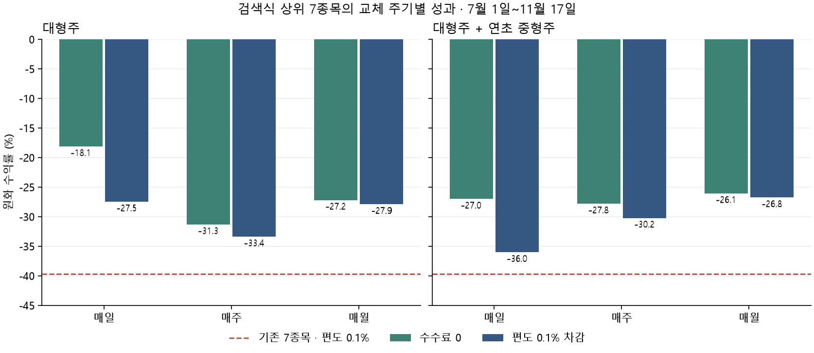

# FINVIZ 조건으로 종목을 교체한 2026년 모형 성과

중형주까지 포함해 매일 7종목을 바꿨을 때 상반기는 +77.24%, 7월 이후는 -27.01%, 연초 누적은 +29.37%였다. 기존 전략은 같은 순서로 +245.05%, -39.45%, +108.93%였다. 하반기 편도 10bp 차감 수익은 매일 -36.03%, 매월 -26.76%였다. 빈번한 교체의 이득은 모집단과 거래비용에 민감했다.

1월 2일~11월 17일 221거래일, 후보 54개와 대조 5개를 비교했다. 당시 미국 중대형주 전체의 FINVIZ 일별 합격 명단은 확보하지 못했다. 아래 숫자는 복원한 대형주·TIME 모집단에서의 원화 모형 수익률이다. 가격 신호를 마감 때 확정하고 다음 정규장 시가에 거래했다. 날짜별 상대거래량은 직전 63거래일 평균 대비 거래량이다.

상반기 낙폭이 기존 이내인 후보에서 거래금액 편도 10bp를 차감한 상반기 수익으로 고른 결과는 **SOXX 이탈 때 대형주로 교체 · 가격·거래량·재무·기관 근사 · 매월**다. 이 규칙은 7월 이후 -32.07%, 10bp 차감 후 -33.20%였다. 같은 기간 기존 원화 수익은 -39.45%였다. 뒤 구간의 수익과 낙폭을 모두 개선한 후보는 기본 수수료에서 48개, 10bp를 적용하면 46개였다. 후보들은 같은 종목·날짜를 공유한다.

## 원래 검색식에 가장 가깝게 복원한 대형주 조건

| 전략 | 상반기 | 7월 이후 | 7월 이후 최대낙폭 | 연초 누적 | 7월 이후 주식비중 | 7월 이후 누적 거래대금/자산 | 7월 이후 10bp 차감 |
|---|---:|---:|---:|---:|---:|---:|---:|
| 기존 데스크 7종목 | +245.05% | -39.45% | -39.45% | +108.93% | 82.2% | 3.7배 | -39.67% |
| S&P 500 ETF 보유 | +16.77% | -15.03% | -15.35% | -0.78% | 100.0% | 0.0배 | -15.03% |
| 달러 현금 | +7.22% | -13.37% | -14.82% | -7.11% | 0.0% | 0.0배 | -13.37% |
| 기존 + SOXX 100일선 대피 | +248.26% | -34.58% | -35.26% | +127.83% | 42.1% | 6.5배 | -35.00% |
| 대형주에서 상대거래량 순 · 가격·거래량·재무·기관 근사 · 매일 | +93.60% | -18.11% | -25.78% | +58.53% | 97.4% | 121.3배 | -27.47% |
| 대형주에서 상대거래량 순 · 가격·거래량·재무·기관 근사 · 매주 | +97.14% | -31.32% | -32.15% | +35.39% | 93.9% | 30.5배 | -33.39% |
| 대형주에서 상대거래량 순 · 가격·거래량·재무·기관 근사 · 매월 | +1.62% | -27.19% | -30.47% | -26.01% | 95.5% | 9.9배 | -27.91% |

## 같은 재무 조건을 유지하고 두 방식 혼합

| 전략 | 상반기 | 7월 이후 | 7월 이후 최대낙폭 | 연초 누적 | 7월 이후 주식비중 | 7월 이후 누적 거래대금/자산 | 7월 이후 10bp 차감 |
|---|---:|---:|---:|---:|---:|---:|---:|
| 기존 120일 순위에 자격 조건 추가 · 가격·거래량·재무·기관 근사 · 매일 | +140.01% | -30.88% | -30.90% | +65.88% | 14.8% | 18.8배 | -32.17% |
| 기존 120일 순위에 자격 조건 추가 · 가격·거래량·재무·기관 근사 · 매주 | +171.86% | -30.33% | -30.33% | +89.41% | 21.7% | 6.2배 | -30.76% |
| 기존 120일 순위에 자격 조건 추가 · 가격·거래량·재무·기관 근사 · 매월 | +133.80% | -22.60% | -23.22% | +80.97% | 14.2% | 1.9배 | -22.74% |
| TIME 안에서 상대거래량 순 · 가격·거래량·재무·기관 근사 · 매일 | +110.09% | -23.79% | -23.85% | +60.12% | 8.5% | 10.7배 | -24.60% |
| TIME 안에서 상대거래량 순 · 가격·거래량·재무·기관 근사 · 매주 | +112.15% | -25.26% | -25.26% | +58.56% | 12.6% | 3.4배 | -25.52% |
| TIME 안에서 상대거래량 순 · 가격·거래량·재무·기관 근사 · 매월 | +88.57% | -19.18% | -19.43% | +52.40% | 8.0% | 1.1배 | -19.27% |
| 기존과 대형주 검색식 절반씩 · 가격·거래량·재무·기관 근사 · 매일 | +164.53% | -28.52% | -28.59% | +89.08% | 89.8% | 63.0배 | -32.89% |
| 기존과 대형주 검색식 절반씩 · 가격·거래량·재무·기관 근사 · 매주 | +165.73% | -34.80% | -34.80% | +73.26% | 88.0% | 17.1배 | -35.91% |
| 기존과 대형주 검색식 절반씩 · 가격·거래량·재무·기관 근사 · 매월 | +91.83% | -32.69% | -33.24% | +29.12% | 88.8% | 7.1배 | -33.17% |
| 대형주 검색식에 SOXX 대피 추가 · 가격·거래량·재무·기관 근사 · 매일 | +95.37% | -20.42% | -21.25% | +55.48% | 52.2% | 65.7배 | -25.48% |
| 대형주 검색식에 SOXX 대피 추가 · 가격·거래량·재무·기관 근사 · 매주 | +102.29% | -32.56% | -33.26% | +36.43% | 50.0% | 23.7배 | -34.14% |
| 대형주 검색식에 SOXX 대피 추가 · 가격·거래량·재무·기관 근사 · 매월 | +1.40% | -29.88% | -32.04% | -28.90% | 51.9% | 12.7배 | -30.77% |
| SOXX 이탈 때 대형주로 교체 · 가격·거래량·재무·기관 근사 · 매일 | +245.10% | -32.69% | -38.99% | +132.30% | 87.3% | 67.9배 | -37.11% |
| SOXX 이탈 때 대형주로 교체 · 가격·거래량·재무·기관 근사 · 매주 | +239.38% | -33.38% | -34.18% | +126.10% | 86.0% | 25.5배 | -35.06% |
| SOXX 이탈 때 대형주로 교체 · 가격·거래량·재무·기관 근사 · 매월 | +249.03% | -32.07% | -34.76% | +137.10% | 85.7% | 16.7배 | -33.20% |

## 월별·일별 교체에서 단계별 필터 효과

| 전략 | 상반기 | 7월 이후 | 7월 이후 최대낙폭 | 연초 누적 | 7월 이후 주식비중 | 7월 이후 누적 거래대금/자산 | 7월 이후 10bp 차감 |
|---|---:|---:|---:|---:|---:|---:|---:|
| 대형주에서 상대거래량 순 · 이평선 3개 · 매일 | +61.92% | -25.83% | -31.33% | +20.10% | 99.6% | 149.6배 | -36.14% |
| 대형주에서 상대거래량 순 · 이평선 3개 · 매주 | +74.62% | -21.42% | -28.06% | +37.23% | 98.3% | 36.4배 | -24.23% |
| 대형주에서 상대거래량 순 · 이평선 3개 · 매월 | +17.60% | -25.03% | -25.04% | -11.83% | 92.7% | 9.8배 | -25.76% |
| 대형주에서 상대거래량 순 · 가격·거래량·RSI 포함 · 매일 | +49.13% | -25.14% | -30.77% | +11.63% | 99.6% | 147.7배 | -35.43% |
| 대형주에서 상대거래량 순 · 가격·거래량·RSI 포함 · 매주 | +80.25% | -20.14% | -27.38% | +43.95% | 98.3% | 36.4배 | -22.99% |
| 대형주에서 상대거래량 순 · 가격·거래량·RSI 포함 · 매월 | +9.77% | -24.72% | -24.74% | -17.37% | 92.7% | 9.8배 | -25.46% |
| 대형주에서 상대거래량 순 · 가격·거래량·재무 · 매일 | +89.30% | -17.85% | -24.84% | +55.50% | 97.4% | 121.3배 | -27.24% |
| 대형주에서 상대거래량 순 · 가격·거래량·재무 · 매주 | +90.16% | -30.44% | -31.27% | +32.28% | 93.9% | 30.7배 | -32.55% |
| 대형주에서 상대거래량 순 · 가격·거래량·재무 · 매월 | +0.82% | -27.19% | -30.47% | -26.60% | 95.5% | 9.9배 | -27.91% |
| 대형주에서 상대거래량 순 · 가격·거래량·재무·기관 근사 · 매일 | +93.60% | -18.11% | -25.78% | +58.53% | 97.4% | 121.3배 | -27.47% |
| 대형주에서 상대거래량 순 · 가격·거래량·재무·기관 근사 · 매주 | +97.14% | -31.32% | -32.15% | +35.39% | 93.9% | 30.5배 | -33.39% |
| 대형주에서 상대거래량 순 · 가격·거래량·재무·기관 근사 · 매월 | +1.62% | -27.19% | -30.47% | -26.01% | 95.5% | 9.9배 | -27.91% |

## 상반기에 고른 규칙과 뒤 구간

| 전략 | 상반기 | 7월 이후 | 7월 이후 최대낙폭 | 연초 누적 | 7월 이후 주식비중 | 7월 이후 누적 거래대금/자산 | 7월 이후 10bp 차감 |
|---|---:|---:|---:|---:|---:|---:|---:|
| 기존 데스크 7종목 | +245.05% | -39.45% | -39.45% | +108.93% | 82.2% | 3.7배 | -39.67% |
| 기존 목표 절반 | +97.11% | -26.68% | -26.68% | +44.53% | 41.0% | 1.9배 | -26.81% |
| SOXX 이탈 때 대형주로 교체 · 가격·거래량·재무·기관 근사 · 매월 | +249.03% | -32.07% | -34.76% | +137.10% | 85.7% | 16.7배 | -33.20% |
| 대형주에서 상대거래량 순 · 가격·거래량·재무·기관 근사 · 매주 | +97.14% | -31.32% | -32.15% | +35.39% | 93.9% | 30.5배 | -33.39% |
| TIME 안에서 상대거래량 순 · 이평선 3개 · 매주 | +207.74% | -37.85% | -37.85% | +91.26% | 93.4% | 16.5배 | -38.87% |
| 기존 120일 순위에 자격 조건 추가 · 이평선 3개 · 매주 | +232.25% | -40.43% | -40.43% | +97.94% | 94.6% | 10.6배 | -41.05% |
| 기존과 대형주 검색식 절반씩 · 가격·거래량·재무·기관 근사 · 매주 | +165.73% | -34.80% | -34.80% | +73.26% | 88.0% | 17.1배 | -35.91% |
| 대형주 검색식에 SOXX 대피 추가 · 가격·거래량·재무·기관 근사 · 매주 | +102.29% | -32.56% | -33.26% | +36.43% | 50.0% | 23.7배 | -34.14% |

상반기 낙폭 기준에 맞는 후보가 없는 유형은 기존 전략으로 돌아간다. 선택 결과는 [유형별 선택](selection.csv)에 있다. 최종 우열은 7~8월과 9~11월의 일관성, 달러 성과와 투자 비중 차이까지 함께 봐야 한다. 당시 신고·발표 시점을 보존했어도 이미 여러 번 본 2026년 자료에 대한 재분석이다.

## 재현 자료

- [사전 비교 방법](protocol.md) · [전체 성과와 비용 민감도](results.csv) · [거래일별 선정 근거](decisions.csv) · [원화·달러 일별 자산](daily.csv)
- [월초 모집단 원자료와 공개 시각](broad_sources.json) · [기술 지표 출처 및 종목별 누락](technical_inputs/sources.json)
- 저장소에서 `py data/derived/analysis/finviz_rotation_20261119/compare.py`로 재계산한다.
- [시점별 SEC 재무 자료·부채비율 정의](fundamental_inputs/method.json)
- [거래 중단·합병 처리 근거](technical_inputs/terminal_events.csv)
- [ownership_period.json](ownership_period.json)

## 이탈 후 재배치 기회와 7월 이후 월별 손익

SOXX 100일선 아래에서 운용 방식이 갈린 날은 상반기 2거래일, 7월 이후 45거래일이었다. 상반기에서 이탈 때의 교체 주기를 고를 기회가 많지 않았다.

| 전략 | 7월 | 8월 | 9월 | 10월 | 11월 17일까지 |
|---|---:|---:|---:|---:|---:|
| 기존 데스크 7종목 | -21.50% | +0.99% | +11.23% | -18.77% | -15.47% |
| 기존 + SOXX 100일선 대피 | -26.74% | -0.69% | -3.15% | -6.99% | -0.17% |
| S&P 500 ETF 보유 | -7.82% | -0.46% | -2.50% | -1.82% | -3.25% |
| SOXX 이탈 때 대형주로 교체 · 가격·거래량·재무·기관 근사 · 매월 | -25.51% | -1.76% | -1.49% | -6.97% | +1.29% |
| 대형주에서 상대거래량 순 · 가격·거래량·재무·기관 근사 · 매일 | -13.23% | +0.30% | -5.06% | -3.71% | +2.92% |
| 대형주에서 상대거래량 순 · 가격·거래량·재무·기관 근사 · 매주 | -25.45% | -0.32% | -2.38% | -4.01% | -1.37% |
| 대형주에서 상대거래량 순 · 가격·거래량·재무·기관 근사 · 매월 | -24.08% | -4.34% | -2.73% | +1.76% | +1.29% |
| SOXX 이탈 때 대형주로 교체 · 가격·거래량·재무·기관 근사 · 매일 | -26.50% | +1.35% | -7.73% | -4.84% | +2.92% |
| SOXX 이탈 때 대형주로 교체 · 가격·거래량·재무·기관 근사 · 매주 | -27.03% | +1.40% | -2.78% | -6.11% | -1.37% |

## 이평선과 기관 지분 조건의 기여

아래는 같은 대형주 명단·상대거래량 순위·주문 시각으로 조건 하나를 바꿨을 때의 7월 이후 원화 수익이다. 기관 기준 해제는 기관 지분 자체가 확인되는 종목 안에서 문턱만 없앴다. 부채비율 대안은 FINVIZ 도움말의 유동부채/자본 식이다.

| 교체 | 전체 근사 | 이평선 3개 해제 | 기관 40% 문턱 해제 | 도움말 부채비율 |
|---|---:|---:|---:|---:|
| 매일 | -18.11% | -8.43% | -18.28% | -27.05% |
| 매주 | -31.32% | -27.77% | -31.05% | -29.95% |
| 매월 | -27.19% | -16.81% | -27.19% | -28.41% |

SOXX 이탈 시 교체 모형의 기본값은 미리 갱신해 온 검색식 바스켓의 그날 시가 비중을 인수한다. 다른 실행 해석으로, 이탈 당일에도 직전 종가로 검색을 새로 실시하고 그 뒤 정기일에 갱신했다. 월간 방식의 7월 이후 원화 수익은 미리 갱신한 경우 -32.07%, 이탈 시 즉시 다시 검색한 경우 -32.89%였다.

7월 이후 대형주 매일·매주 교체의 원화 수익이 같아지는 편도 거래비용은 약 19.3bp였다. 실제 비용을 추정한 값이 아니라 모형 거래금액으로 역산한 경계다.

## 7월 이후에 실제로 고를 수 있었던 종목 수

| 후보 모집단 | 거래일 수 | 통과 종목 중앙값 | 통과 0개인 날 | 7개 미만인 날 |
|---|---:|---:|---:|---:|
| 대형주에서 상대거래량 순 | 98 | 14 | 0 | 9 |
| TIME 안에서 상대거래량 순 | 98 | 0 | 57 | 98 |

## 시작 당시 S&P 400 중형주까지 포함한 교차 확인

위 대형주 모집단에 연초 기준 중형주 명단을 합쳐 비교했다. 아래 행의 상대거래량 순위는 이 합집합 안의 순위다. 이 추가 표는 상반기 후보 선택과 별도로 계산했다. 월중 상장폐지·합병 처리와 가격 누락은 중형주 연구 기록을 따른다.

| 전략 | 상반기 | 7월 이후 | 7월 이후 최대낙폭 | 연초 누적 | 7월 이후 주식비중 | 7월 이후 누적 거래대금/자산 | 7월 이후 10bp 차감 |
|---|---:|---:|---:|---:|---:|---:|---:|
| 대·중형주에서 상대거래량 순 · 가격·거래량·재무·기관 근사 · 매일 | +77.24% | -27.01% | -33.53% | +29.37% | 99.3% | 131.8배 | -36.03% |
| 대·중형주에서 상대거래량 순 · 가격·거래량·재무·기관 근사 · 매주 | +71.23% | -27.82% | -28.06% | +23.60% | 97.4% | 33.8배 | -30.22% |
| 대·중형주에서 상대거래량 순 · 가격·거래량·재무·기관 근사 · 매월 | +7.75% | -26.06% | -28.84% | -20.33% | 95.5% | 9.6배 | -26.76% |
| 기존과 대·중형주 검색식 절반씩 · 가격·거래량·재무·기관 근사 · 매일 | +153.36% | -32.47% | -32.68% | +71.09% | 90.7% | 68.3배 | -36.93% |
| 기존과 대·중형주 검색식 절반씩 · 가격·거래량·재무·기관 근사 · 매주 | +147.67% | -33.08% | -33.08% | +65.74% | 89.7% | 18.8배 | -34.33% |
| 기존과 대·중형주 검색식 절반씩 · 가격·거래량·재무·기관 근사 · 매월 | +96.92% | -32.30% | -32.94% | +33.32% | 88.8% | 6.9배 | -32.77% |
| SOXX 이탈 때 대·중형주로 교체 · 가격·거래량·재무·기관 근사 · 매일 | +250.71% | -34.64% | -40.48% | +129.24% | 87.9% | 70.5배 | -39.09% |
| SOXX 이탈 때 대·중형주로 교체 · 가격·거래량·재무·기관 근사 · 매주 | +245.90% | -36.12% | -36.25% | +120.95% | 87.3% | 26.9배 | -37.82% |
| SOXX 이탈 때 대·중형주로 교체 · 가격·거래량·재무·기관 근사 · 매월 | +253.99% | -31.04% | -33.64% | +144.10% | 85.7% | 16.4배 | -32.17% |

확대 모집단의 15개 선별 방식·6개 혼합을 재계산하려면 같은 폴더의 `add_midcaps.py`를 먼저 실행한다. [확대 모집단별 전체 성과](midcaps/results.csv) · [연초 중형주 명단 근거](midcaps/membership_source.json)

