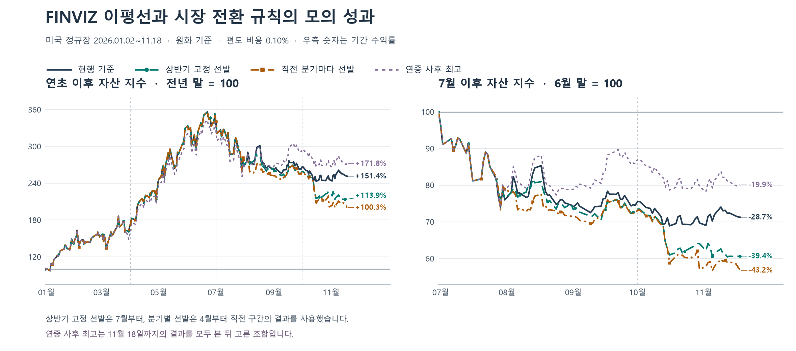

# FINVIZ 종목 이평선과 SOXX 시장 이탈 기준 비교

**현재 수동 주문 초안의 SOXX 100일선을 유지하는 쪽이 전방 검증에서 유리했다.** 종목선과 시장선을 직전 분기 성적으로 매번 다시 고른 전략은 7월 이후 −43.23%, 현행은 −28.74%였다. 시장선은 고정하고 종목 선별만 분기마다 바꾸면 같은 기간 −27.85%로 소폭 앞섰다. 다만 10월 1일~11월 18일에는 −5.52%로 현행 −4.38%를 밑돌았다. 상반기만 보고 고른 조합은 미리 정한 우선 후보 판정 기준을 통과하지 못했다.

비교 기간은 2026년 1월 2일~11월 18일 미국 정규장 222거래일이다. 평소에는 기존 주간 데스크, SOXX 이탈 중에는 새 조건으로 고른 FINVIZ 바스켓을 따른다. 표는 매수·매도 각각 매매대금의 0.10%를 차감한 원화 모의 가격 수익률이다. 종목 조건은 직전 확정 종가까지 계산하고 다음 정규장 시가로 체결했다. 빈자리는 달러 현금, 배당·세금·현금 이자는 제외했다. [사전 비교 절차](protocol.md) · [전체 일별 수익곡선](selected_curves.csv)



## 원금과 낙폭에 어떤 차이가 났나

| 적용 방법 | 연초 이후 | 7월 이후 | 7월 이후 최대낙폭 | 10/1~11/18 | 연중 최대낙폭 |
|---|---:|---:|---:|---:|---:|
| 현행 20·50·200일 / SOXX 100일 | +151.40% | −28.74% | −31.11% | −4.38% | −31.78% |
| 현행에서 단기선만 25일 | +147.70% | −29.79% | −31.11% | −5.79% | −31.78% |
| 상반기 선발 후 7월부터 종목·시장 규칙 고정 | +113.90% | −39.37% | −39.56% | −16.36% | −40.15% |
| 직전 분기로 종목·시장 규칙을 함께 교체 | +100.26% | −43.23% | −43.36% | −21.40% | −43.92% |
| 직전 분기로 종목 규칙만 교체, SOXX 100일 유지 | +154.54% | −27.85% | −29.14% | −5.52% | −29.84% |
| 직전 분기 선발안에서 시장 규칙만 교체, 종목은 현행 | +121.98% | −37.08% | −39.04% | −16.26% | −39.64% |
| 전체 기간을 본 뒤의 연중 1위 | +171.79% | −19.93% | −26.10% | −6.78% | −26.83% |

최근 분기에는 3분기 성적으로 선택했던 **SOXX 150일선**이 문제였다. 현행 종목 규칙을 고정한 대조에서도 시장선만 100일에서 150일로 늘리면 연초 이후 +153.02%, 7월 이후 −26.21%였으나 10/1~11/18 수익은 **−16.26%**까지 떨어졌다. 더 짧은 SOXX 25일선은 이탈 상태가 97거래일·12회로 현행 48거래일·5회보다 잦았고, 연초 이후 +99.55%, 7월 이후 −32.56%였다. 100일선 이탈 후 달러 현금을 보유하는 대조는 같은 두 기간 각각 +124.08%, −35.13%였다. [13개 시장 신호와 현금 대조](gate_results.csv) · [기존 바스켓 고정 시장 신호 전방 비교](gate_forward.csv)

## 25일선은 어느 조합에서 달랐나

중기선·장기선·재무·정렬·일정·시장선이 모두 같은 14,976쌍에서 단기 20일과 25일만 바꿨다. 연초 이후 25일선이 앞선 경우 5,620쌍, 동률 4,295쌍, 뒤진 경우 5,061쌍이었다. **연초 이후, 7월 이후, 4분기 관측분 모두 수익률 차이의 중앙값은 0%p였다.**

현행 20·50·200에서 25·50·200으로 바꾸면 11차례 월초 바스켓의 구성 종목이 달라진 달은 4월·5월·11월뿐이었다. 현행 SOXX 이탈 5회 중 처음 네 번의 전환안 상대 손익은 같았다. 마지막 이탈 기간인 10/13~11/18에 25일선 계좌의 상대 자산이 1.47% 뒤졌다. 이 비교의 연중 차이는 11월 월초 바스켓에서 달라진 한 자리(EW와 FAST)까지 좁혀진다. 25일선이 포함된 연중 최고는 **25·40·150일 정배열, 현행 재무와 상대거래량 순위, 월초 교체, SOXX 100일**의 +165.61%였다. 똑같은 조합에 20일선을 쓰면 +165.99%였다. [20일선·25일선 짝 비교](paired_short.csv) · [Claude의 독립 종목·기간 대조](claude_check.csv)

## 연중 1위와 손실 방어를 같이 만족한 후보

연중 사후 1위는 **15·40·150일 정배열**, 현행 재무 조건, 상대거래량 순위, 월초 교체였다. SOXX는 100일선 이탈과 회복을 각각 종가 2회 연속 확인했다. 정시 체결로 +171.79%였지만, 직전 분기 자료로 이 조합을 고른 경우는 없었다. 같은 신호·명단을 한 거래일 늦게 체결하면 연초 이후 +141.07%로 지연 현행 +147.88%보다 낮았다. 7월 이후 지연 성과는 −23.73%로 현행 −25.95%보다 앞섰지만 최근 분기는 −14.85% 대 −5.85%로 뒤졌다. 이 성과에는 기존 주간 데스크가 포함된다. 연중 1위의 FINVIZ 종목만 상시 보유하면 +8.30%, 현행 FINVIZ만 상시 보유하면 +3.19%였다.

89,856개 중 연초 이후 수익이 현행보다 높은 조합은 1,089개였다. 이 중 **연초 수익, 7월 이후 수익·최대낙폭, 4분기 관측분 수익·최대낙폭의 다섯 지표가 모두 개선된 조합은 8개**였다. 이 8개를 결과 확인 후 진단했다.

| 다섯 지표를 모두 개선한 사후 후보의 예 | 연초 이후 | 7월 이후 | 10/1~11/18 | 7월 이후 최대낙폭 | 한 거래일 지연 시 연초 이후 |
|---|---:|---:|---:|---:|---:|
| 현행 | +151.40% | −28.74% | −4.38% | −31.11% | +147.88% |
| 15·60·100 정배열, 현행 재무, 월 2회, SOXX 100일선 이틀 확인 | +161.57% | −23.56% | −2.82% | −27.21% | +129.49% |
| 30·40·175 기본 추세, 부채 상한 1배, 월초, SOXX 100일선 | +160.02% | −26.18% | −1.86% | −30.42% | +145.86% |

연중 최고 수익과 다섯 지표 동시 개선은 다른 기준이다. 두 번째 표의 두 후보는 모두 상대거래량 순이다. 정시 체결에 편도 비용을 0.25%로 높이면 8개 중 6개가 여전히 다섯 지표에서 현행보다 좋았다. 월별·주별 바스켓 체결과 시장 이탈·회복을 함께 한 거래일 늦추면 지연 현행 대비 다섯 지표를 모두 개선한 후보는 **0개**였다. [8개 후보의 지연·수수료·인접 이평선 대조](finalists.csv)

## 무엇을 비교했고, 언제 고를 수 있었나

- 종목선은 단기 10·15·20·25·30·35일, 중기 40·50·60·75·100일, 장기 100·125·150·175·200일의 144개 조합이다. 기본 추세는 단기선 > 중기선이고 종가가 중기·장기선 위에 있어야 한다. 정배열형은 중기선 > 장기선도 요구한다. 통상의 정배열에서 종가 > 단기선까지 추가하는 방식과 차이가 있다.
- 재무·거래량·RSI는 현행, 유동비율 1.25배·부채/자본 0.75배의 중간값, 유동비율 1.5배·부채/자본 1배, 현행 재무에 상대거래량 1.25배·RSI 45 기준을 추가한 4묶음이다. 상대거래량 또는 종가/장기선으로 정렬한 뒤 월초·월 첫째와 열한째 거래일·주초 중 한 일정으로 7칸을 갱신한다. 시총은 앞 연구의 20억 달러 초과를 유지했다. [시총·재무 분리 대조](../finviz_size_20261120/report.md)
- SOXX 25·50·75·100·125·150·200일선과, 75·100·125일선에 이틀 연속 확인 또는 ±1% 완충을 적용한 시장 신호 13개를 교차했다. 6,912개 종목 규칙·일정에서 실제 일정과 7개 순위 목록이 구별되는 경우는 6,080개였다. 같은 원화 수익이나 같은 시장 상태가 다시 나타날 수 있어 89,856번을 독립 실험으로 셀 수 없다. [전체 종목 규칙·상시 성과](screen_results.csv) · [시장 신호별 전체 격자](market_grid) · [사후 집계](grid_summary.json)
- 상반기에는 현행 시장 이탈이 2일뿐이었다. 각 학습 구간에서 FINVIZ만 상시 운용한 수익, 투자 비중, 낙폭과 인접 이평선 조합의 수익 중앙값을 먼저 비교했다. 종목 규칙을 고른 뒤 해당 기간의 전환 수익과 낙폭으로 시장선을 골랐다. 다음 구간 첫 시가 거래 전에 기존 실제 보유분이 겪은 밤사이 손익과 시가 거래비용까지 이월했다. 이전 연도 가격은 이동평균 예열에만 사용했다.

| 선택에 쓴 자료 → 적용 구간 | 종목 규칙 | 시장 신호 | 적용 수익 | 같은 기간 현행 |
|---|---|---|---:|---:|
| 상반기 → 7/1~11/18 | 35·100·125 기본, 현행 재무, 종가/장기선 순, 주초 | 75일 ±1% | −39.37% | −28.74% |
| 1분기 → 2분기 | 15·75·100 정배열, 부채 완화, 상대거래량 순, 주초 | 100일 | +107.79% | +107.79% |
| 2분기 → 3분기 | 25·100·175 정배열, 거래활동 강화, 종가/장기선 순, 월초 | 75일 | −27.78% | −25.47% |
| 3분기 → 10/1~11/18 | 35·40·150 기본, 부채 완화, 상대거래량 순, 월 2회 | 150일 | −21.40% | −4.38% |

2분기에는 해당 시장선 이탈 거래일이 0일이었다. 더 중요한 한계는 4분기용으로 뽑힌 **SOXX 150일선이 학습 구간인 3분기에도 한 번도 이탈하지 않았다**는 점이다. 학습 수익 −11.88%는 그 분기 기존 주간 데스크만 보유했을 때의 성적이다. 시장을 떠나는 능력을 검증할 사례가 없었던 신호도 이번 선발 조건을 통과할 수 있었다. 상시 FINVIZ 성적으로 선택한 종목이 시장 이탈 시에도 같은 효과를 낸다는 보장도 없다. 2026년 자료는 앞선 연구에서 이미 사용했으므로 시간순으로 선발 절차를 재현해도 새 시장 데이터에서 얻은 독립 실적은 아니다. [시점별 선택과 선발 점수](selection.csv) · [비용별·기간별 검증 결과](selected_results.csv) · [Claude 독립 점검](claude_check.csv)

이 문제를 확인한 후, 학습 구간에서 이탈 상태가 5거래일 이상이고 새 이탈이 2회 이상 시작된 시장선만 남기는 사후 진단을 추가했다. 종목 선발을 고정하고 통과선이 없으면 현행 100일선을 사용했다. 분기별 교체 수익은 7월 이후 −43.23%에서 **−35.62%**, 최근 분기 −21.40%에서 **−15.70%**로 개선됐지만 두 기간 모두 현행보다 낮았다. 지연 체결의 하반기 역시 −36.11%로 지연 현행 −25.95%에 뒤졌다. 5일·2회는 이 진단을 위해 정한 값이다. [이탈 사례 수를 제한한 사후 비교](gate_evidence.csv)

11월 19일 종가도 별도로 확인했다. 여섯 비교안 모두 시장 전환이나 종목 교체가 없는 날이었다. 해당일까지 원화 누적은 현행 **+146.88%**, 25일선만 변경 **+142.85%**, 연중 사후 최고 **+166.01%**, 상반기 선발 **+110.96%**, 분기마다 종목·시장선 선발 **+95.77%**, 분기마다 종목만 선발 **+148.84%**였다. 이 하루는 이전 연구에서도 관찰한 거래일이며 격자 선발에 사용하지 않았다. [11월 19일 보유·환율 평가](mark_next.csv)

## 시점과 데이터 확인

월별 대형주와 2025년 12월에 고정한 중형주 401개에서 시총·당시 공시·가격·거래량·기관 지분 조건을 먼저 적용했다. 원래 20·50·200일선을 적용하기 전 58개 점검일의 14,163개 종목·일 관측(311개 티커)을 복원했다. 신규·비지수 종목이 빠질 수 있고 13F 기관 보유율은 공시 시차가 있는 추정치다. 매출, 개별 주식 이탈 매도, 지수 자체 교체, 매일 재선발, 지수 이동평균(EMA)까지 교차하지는 않았다. 표준 FINVIZ의 SMA 필터는 20·50·200일이므로 25일선 등은 가격 자료로 별도 계산해야 한다. [FINVIZ 검색기 정의](https://finviz.com/help/screener) · [기존 검색식·일정 170개 비교](../finviz_recipes_20261120/report.md)

기존 원본·재무 강화 스크린의 2,983개 순위 항목을 재현했다. 25·75·150일선을 적용하면 기존 20·50·200일선 밖에 있던 169개 티커가 한 번 이상 후보가 됐다(기존 비기술·거래량·RSI 조건 기준). 주식 분할을 반영하고 필요한 거래일이 부족한 종목은 해당 이평선에서 제외했다. 200일선이 없던 12개 종목·일은 짧은 장기선에서는 후보가 될 수 있어 상장 이력 차이도 반영된다. Claude가 종목 이평선 15종, 재무 플래그 14,163행, SOXX 13개 신호 222일과 월초 체결 시점을 독립 대조했다. 고속 계산의 순자산·거래대금·주식 비중은 7,992개 일별 사례에서 기존 원장과 대조했다. [재계산 코드](engine.py) · [입력·시장 신호 독립 검증](claude_check.csv)

저장소 루트에서 다음 순서로 재현한다. 저장한 입력으로 실험을 실행할 수 있다. 시세에서 입력을 다시 만드는 명령은 `features.py --freeze`다.

```powershell
py data/derived/analysis/finviz_trends_20261120/features.py
py data/derived/analysis/finviz_trends_20261120/gates.py
py data/derived/analysis/finviz_trends_20261120/engine.py
py data/derived/analysis/finviz_trends_20261120/experiment.py
py data/derived/analysis/finviz_trends_20261120/finalists.py
py data/derived/analysis/finviz_trends_20261120/gate_evidence.py
py data/derived/analysis/finviz_trends_20261120/mark_next.py
py data/derived/analysis/finviz_trends_20261120/plot_results.py
```
