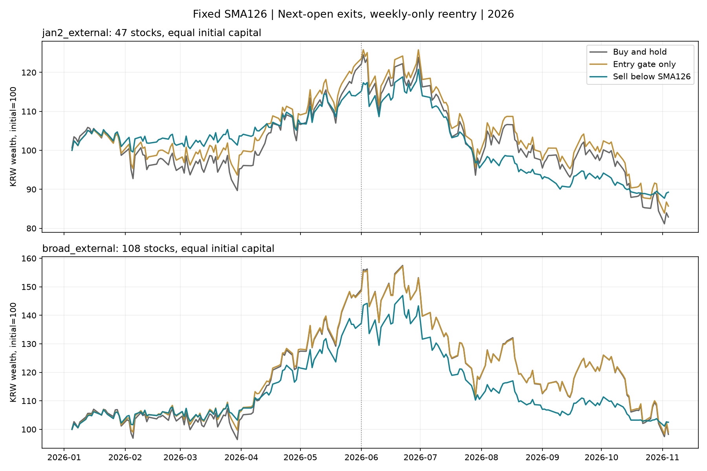

# 고정126일선, 다른 미국 종목의2026년 적용성 재검증

원래7종목 포트폴리오를 넘어 **138종목**을 같은 조건으로 비교했다. 종목당15설정(매수보유·신규보류126·전량매도SMA120~132), 총2070경로. 126일은 이전 결과에서 발견한 값을 고정했으며 이번 성적에 맞춰 바꾸지 않았다. 이웃13기간은 민감도 확인이다.

## 주 비교: 6/1~11/4

시초집단은1/2 TIME·KoAct 미국종목 합집합, 최초 거래는1/5. external은 이전400설정에서 실제 편입된 종목을 모두 제외한 군, overlap은 그 중복군이다. ai는 현재 AI목록이고 broad는 두 목록 합집합이다. 아래 수익·낙폭은 같은 초기금액으로 나눈 종목별 자산의 합(원화)이며, 주간에 종목 간 자금을 재배분하지 않는다.

| 집단 | 종목수 | 매수보유: 뒤 수익 | SMA126: 뒤 수익 | 매수보유: 뒤 낙폭 | SMA126: 뒤 낙폭 | 종목별 수익차 중앙값 | 수익·낙폭 동시개선 |
|---|---:|---:|---:|---:|---:|---:|---:|
| jan2_all | 63 | -36.89% | -26.12% | -40.98% | -32.62% | +4.90%p | 40/63 |
| jan2_external | 47 | -31.20% | -21.69% | -34.83% | -27.39% | +3.14%p | 27/47 |
| jan2_overlap | 16 | -45.14% | -32.58% | -51.16% | -41.23% | +13.66%p | 13/16 |
| ai_all | 113 | -34.79% | -27.24% | -41.27% | -35.54% | +4.02%p | 70/113 |
| ai_external | 88 | -33.90% | -25.91% | -39.85% | -33.61% | +3.93%p | 56/88 |
| broad_all | 138 | -35.17% | -26.50% | -40.22% | -33.48% | +4.09%p | 85/138 |
| broad_external | 108 | -32.97% | -24.32% | -38.12% | -31.19% | +3.61%p | 66/108 |
| broad_overlap | 30 | -39.83% | -30.98% | -45.11% | -38.11% | +10.87%p | 19/30 |

## 상승 구간의 대가·전체 결과

| 집단 | 매수보유: 앞 구간 | 126일: 앞 구간 | 매수보유: 전체 | 126일: 전체 | 126일: 뒤 평균투자비중 |
|---|---:|---:|---:|---:|---:|
| jan2_all | +51.84% | +43.31% | -4.17% | +5.88% | 54.0% |
| jan2_external | +20.48% | +13.98% | -17.10% | -10.74% | 47.2% |
| broad_all | +68.94% | +57.67% | +9.52% | +15.88% | 59.4% |
| broad_external | +46.58% | +35.43% | -1.75% | +2.49% | 55.3% |

## 같은 평균 투자비중 대조: 사후 진단

각 종목에서 그 기간의 전략 평균 투자비중만큼 매수보유 일별수익에 일정하게 노출한 USD 대조다. 바스켓 대조의 시작 종목별 자금은 실제 전략의 해당 구간 시작자산과 같게 맞췄다. 그 기간 평균 비중은 사후에만 알 수 있으므로 실행전략·확정 가능한 대안이 아니다. 현금 증가의 효과와 매도 시점 효과를 구분하는 설명용 비교다.

| 집단 | 구간 | 126일 USD수익 | 같은 평균비중 대조 USD수익 | 전략−대조 |
|---|---|---:|---:|---:|
| jan2_external | front | +10.04% | +19.05% | -9.01%p |
| jan2_external | back | -12.80% | -3.97% | -8.83%p |
| jan2_external | full | -4.04% | +4.94% | -8.99%p |
| broad_external | front | +30.75% | +37.31% | -6.56%p |
| broad_external | back | -15.73% | -7.27% | -8.46%p |
| broad_external | full | +10.18% | +13.82% | -3.65%p |
| broad_all | front | +52.23% | +55.75% | -3.52%p |
| broad_all | back | -18.16% | -9.36% | -8.80%p |
| broad_all | full | +24.58% | +22.38% | +2.19%p |

## 126일 고정과 이웃 기간

| 기간 | 시초 외부군: 뒤 수익 | 뒤 낙폭 | 확대 외부군: 뒤 수익 | 뒤 낙폭 |
|---|---:|---:|---:|---:|
| SMA120 | -21.58% | -27.16% | -24.19% | -31.08% |
| SMA121 | -21.66% | -27.32% | -24.39% | -31.31% |
| SMA122 | -21.36% | -26.98% | -24.36% | -31.22% |
| SMA123 | -21.39% | -26.96% | -24.20% | -31.06% |
| SMA124 | -21.52% | -27.11% | -24.51% | -31.36% |
| SMA125 | -21.81% | -27.40% | -24.41% | -31.28% |
| SMA126 | -21.69% | -27.39% | -24.32% | -31.19% |
| SMA127 | -21.76% | -27.61% | -24.39% | -31.32% |
| SMA128 | -22.07% | -27.85% | -24.60% | -31.50% |
| SMA129 | -22.20% | -27.95% | -24.75% | -31.62% |
| SMA130 | -22.22% | -27.97% | -24.74% | -31.63% |
| SMA131 | -22.40% | -28.12% | -24.99% | -31.81% |
| SMA132 | -22.47% | -28.09% | -24.90% | -31.71% |

## 126일 전량매도 종목별 차이

뒤 구간 수익 차이순 상·하위 각10종목(전체는per_stock.csv). 이 표의 종목은 사후 설명용으로 골랐다.

| 종목 | 섹터 | 발견 중복 | 매수보유 수익 | 126일 수익 | 수익 차이 | 낙폭 차이 | 뒤 투자비중 | 전체 매도 |
|---|---|---|---:|---:|---:|---:|---:|---:|
| EOSE | 원자력/에너지 | False | -77.20% | -10.19% | +67.01%p | +69.99%p | 0.0% | 1 |
| SERV | 전기차/자율주행 | False | -74.55% | -10.19% | +64.35%p | +61.59%p | 0.0% | 1 |
| DRUG | 미분류 | False | -80.67% | -19.03% | +61.64%p | +60.36%p | 6.4% | 5 |
| FLNC | 원자력/에너지 | True | -71.17% | -10.71% | +60.47%p | +49.21%p | 12.7% | 4 |
| OKLO | 원자력/에너지 | False | -70.30% | -10.19% | +60.11%p | +58.28%p | 0.0% | 1 |
| SMR | 원자력/에너지 | False | -63.64% | -10.19% | +53.45%p | +52.35%p | 0.0% | 0 |
| ASTS | 우주/방산 | True | -71.79% | -29.68% | +42.11%p | +38.93%p | 6.4% | 3 |
| ALNY | 미분류 | False | -52.09% | -10.19% | +41.90%p | +42.43%p | 0.0% | 0 |
| MOD | 미분류 | False | -68.26% | -33.17% | +35.10%p | +30.61%p | 28.2% | 3 |
| ONDS | 미분류 | False | -64.20% | -29.92% | +34.28%p | +32.08%p | 5.5% | 6 |
| TEM | 헬스케어 AI | True | +34.54% | -8.27% | -42.81%p | +0.02%p | 66.4% | 2 |
| FSLY | 미분류 | False | +6.34% | -34.91% | -41.25%p | -12.20%p | 69.1% | 8 |
| P | AI 인프라 | False | +26.25% | -6.13% | -32.38%p | -8.98%p | 85.5% | 4 |
| AMZN | 빅테크 | False | -11.72% | -39.35% | -27.62%p | -19.16%p | 60.0% | 6 |
| MDB | 엔터프라이즈 SW | False | -12.11% | -36.57% | -24.46%p | -12.24%p | 72.7% | 7 |
| ROP | 엔터프라이즈 SW | False | +35.80% | +13.59% | -22.21%p | +0.29%p | 65.5% | 3 |
| IBM | 엔터프라이즈 SW | False | -23.30% | -43.32% | -20.02%p | -6.05%p | 29.1% | 3 |
| ADI | AI 반도체 | False | -11.84% | -30.38% | -18.53%p | -7.76%p | 63.6% | 3 |
| BE | 원자력/에너지 | True | -36.85% | -55.22% | -18.37%p | -9.46%p | 57.3% | 6 |
| ENTG | 미분류 | False | -7.55% | -25.55% | -18.00%p | -0.35%p | 69.1% | 5 |

## 해석·재현

- 원래7종목의순위·버퍼·상한을 제거하고 종목당 동일 초기자금으로 이탈/회복 조건 자체를 비교한 실험이다. 이 결과를7종목 포트폴리오 수익이라고 부르지 않는다.
- 전일 확정 종가<MA이면 다음 정규장 시가에 그 종목 슬리브 전체를 매도한다. 밤사이 갭을 먼저 부담한다. 재편입은 주간 첫미국세션에서 전일Close>=MA일 때만 가능하다. 주중 즉시 반등 재진입은 시험하지 않았다.
- 매수보유는공통첫날시가100%편입. 신규보류126은 최초편입조건만제한하고 편입뒤MA이탈로팔지않는다. 슬리브별 현금은USD다.
- 매수보유와 전략의5월말상태를그대로이어 뒤구간수익을 계산한다. 바스켓은원금동일 NAV평균으로 계산하므로 뒤구간은5월말의종목별자산차이를물려받는다. per_stock.csv의중앙값·개선비율은종목별동일가중이고 바스켓과다른통계다.
- 평균투자비중은 시가NAV로가중한다. basket 곡선은종가NAV로표시한다. CSV의USD동일평균노출대조는그기간평균투자비중을사후에알고줄인설명용대조이며 실행가능한사전규칙이아니다.
- 2026 앞/뒤구간을 나눠고정126의성적을모두보이며, 이번자료로다른기간을다시고르지않는다. 현재AI목록·후일수집한과거PDF·상장생존및연중미보유조건에선택편향이남는다. 시장상관이있어여러종목을독립실험으로세지않는다.
- 전체시초집단·중복군·외부군·섹터별·섹터하나씩뺀값을같이공개해대상선택과큰기여종목의영향을확인한다. 누락/신규상장은inputs/universe.csv의제외사유를보존한다.
- contributions.csv는전체구간USD기준 원금동일 슬리브의기말자산차 기여이며 뒤구간수익률이나원화기여가아니다. 같은기말FX계수를곱하면원화기말자산차로바꿀수있다.
- 수수료0, 배당현금 미반영 가격수익. 호가·환전·세금·현금이자제외. 5/10bp 비용표는회전율비례차감의가상민감도이며실제호가추정이아니다. 원화와USD를동시에보존한다.
- 전체표aggregate.csv·per_stock.csv, 섹터sector.csv·leave_one_sector_out.csv, 민감도neighbors.csv, 일별basket_curves.csv·primary_stock_curves.csv, 실제판단signals.csv를보존한다. 입력은inputs/input_meta.json의출처·SHA로확인한다.

재현: `py data/derived/analysis/ma_entry_filter_20261108/prepare_cross_stock.py` → `py data/derived/analysis/ma_entry_filter_20261108/cross_stock_review.py` → 독립검산. 이미동결한입력이있으면첫단계생략. 운용·주문·Pine는변경하지않았다.
