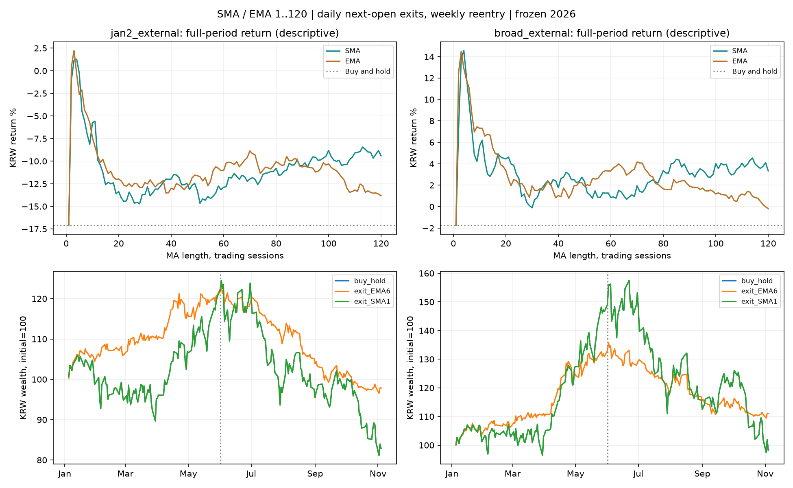

# SMA·EMA 1~120일: 여러 종목2026 재탐색

**이번 범위에서는 단기3~6일선이 고정126일선보다 나은 방어 후보였다.** 앞 구간만으로 고른 exit_EMA6는 확대외부108종목에서 전체 수익 +11.07%, 뒤 수익 -15.14%, 뒤 낙폭 -19.35%였다. 고정126의 같은 값은 +2.49%, -24.32%, -31.19%다. 전체를 본 사후1위는 exit_SMA4이며 앞 구간 선택값과 구분한다.

6일이라는 정확한 값의 우위를 확정한 것은 아니다. 연초외부47에서 EMA2·3·6의 앞 수익은20.69~20.82%로 비슷했고 매수보유20.48%와도 가깝다. 확대외부108의 앞 구간 수익으로 고르면 무필터인SMA1이 선택된다. 종목군에 따라 상승장에서 짧은 이평선의 기회비용이 커진다. 다만47에서 고른EMA6를 추가61에 그대로 적용했을 때도 뒤 손실·낙폭과 전체 수익이 개선됐다.

138종목 × 240설정 = 33,120후보경로 + 매수보유138경로. 기존과 같은 동결입력, 동일초기자금 종목별독립계좌. 전일종가 신호→다음 정규장시가 전량매도, 주간 첫 미국세션만 재진입. 수수료0, 배당현금 미반영 가격수익. 아래 표는 원화환산이며 앞1/5~5/29, 뒤6/1~11/4, 전체1/5~11/4. 2025는 예열만.

앞 구간만으로 선택: 주 선택 **exit_EMA6**, 낙폭제약 보조 **exit_EMA6**, 확대군 선택 **exit_SMA1**.

|집단|설정|선택 구분|앞 수익|뒤 수익|뒤 최대낙폭|전체 수익|뒤 평균투자비중|뒤10bp수익|
|---|---|---|---:|---:|---:|---:|---:|---:|
|jan2_external|buy_hold|매수보유 대조|+20.48%|-31.20%|-34.83%|-17.10%|100.0%|-31.20%|
|jan2_external|exit_EMA6|연초47 앞선택|+20.82%|-19.00%|-22.04%|-2.13%|27.9%|-20.13%|
|jan2_external|exit_SMA1|확대108 앞선택·무필터|+20.48%|-31.20%|-34.83%|-17.10%|100.0%|-31.20%|
|jan2_external|exit_EMA3|각 집단 전체 사후1위|+20.69%|-15.28%|-17.74%|+2.25%|23.2%|-16.70%|
|jan2_external|exit_SMA120|장기선 대조|+15.52%|-21.58%|-27.16%|-9.41%|46.5%|-21.86%|
|jan2_external|exit_EMA120|장기선 대조|+14.94%|-25.03%|-29.45%|-13.82%|47.7%|-25.40%|
|additional_external|buy_hold|매수보유 대조|+66.69%|-33.96%|-40.42%|+10.08%|100.0%|-33.96%|
|additional_external|exit_EMA6|연초47 앞선택|+38.66%|-12.56%|-17.58%|+21.24%|30.3%|-13.86%|
|additional_external|exit_SMA1|확대108 앞선택·무필터|+66.69%|-33.96%|-40.42%|+10.08%|100.0%|-33.96%|
|additional_external|exit_SMA4|각 집단 전체 사후1위|+39.54%|-10.55%|-15.44%|+24.81%|26.4%|-12.21%|
|additional_external|exit_SMA120|장기선 대조|+52.31%|-25.71%|-33.88%|+13.16%|58.3%|-25.97%|
|additional_external|exit_EMA120|장기선 대조|+52.59%|-27.70%|-35.42%|+10.32%|59.3%|-28.04%|
|broad_external|buy_hold|매수보유 대조|+46.58%|-32.97%|-38.12%|-1.75%|100.0%|-32.97%|
|broad_external|exit_EMA6|연초47 앞선택|+30.90%|-15.14%|-19.35%|+11.07%|29.4%|-16.38%|
|broad_external|exit_SMA1|확대108 앞선택·무필터|+46.58%|-32.97%|-38.12%|-1.75%|100.0%|-32.97%|
|broad_external|exit_SMA4|각 집단 전체 사후1위|+30.08%|-11.92%|-15.73%|+14.57%|25.4%|-13.51%|
|broad_external|exit_SMA120|장기선 대조|+36.30%|-24.19%|-31.08%|+3.33%|53.9%|-24.46%|
|broad_external|exit_EMA120|장기선 대조|+36.21%|-26.72%|-33.02%|-0.19%|55.1%|-27.07%|
|broad_all|buy_hold|매수보유 대조|+68.94%|-35.17%|-40.22%|+9.52%|100.0%|-35.17%|
|broad_all|exit_EMA6|연초47 앞선택|+38.56%|-15.99%|-19.96%|+16.40%|29.1%|-17.20%|
|broad_all|exit_SMA1|확대108 앞선택·무필터|+68.94%|-35.17%|-40.22%|+9.52%|100.0%|-35.17%|
|broad_all|exit_EMA3|각 집단 전체 사후1위|+37.45%|-12.48%|-16.21%|+20.29%|24.8%|-13.97%|
|broad_all|exit_SMA120|장기선 대조|+58.59%|-27.27%|-34.18%|+15.34%|57.8%|-27.53%|
|broad_all|exit_EMA120|장기선 대조|+59.01%|-29.64%|-36.12%|+11.88%|59.3%|-29.96%|

주 표의 각 집단에서 주·보조·확대 선택 외에 추가한 최고값은 각 집단의 전체 구간 사후최고다. 전체/뒤 구간 최고값은 주 선택에 사용하지 않았다. 전체240후보의 수익·낙폭 동시개선 개수는 results.json에, 전 기간·집단·종목 결과는 CSV에 모두 저장했다.

외부108의 뒤 구간에서는238개 비자명 후보 모두 매수보유보다 바스켓 수익·낙폭이 개선됐다(나머지2개는1일 무필터 대조). 종목별로는 EMA6가81/108종목에서 뒤 수익·낙폭을 함께 개선했고, 전체 구간 동시개선은71/108이다. 바스켓 개선과 모든 개별종목 개선을 구분한다.

## 기존7종목 모델과의 구분

**여러 종목의 단기 방어 결과를 우리7종목의 전량매도 규칙으로 그대로 옮기면 안 된다.** 아래는 이미검산한 이전7종목 연구의 기록이다. 이번138종목 실험과 달리 실제 순위·상한·주간교체를 유지하며1/2~11/4를 평가했다.

|기존7종목 설정|앞 수익|뒤 수익|뒤 낙폭|전체 수익|
|---|---:|---:|---:|---:|
|baseline|+221.83%|-27.81%|-33.69%|+132.33%|
|EMA6|+108.87%|-31.14%|-32.86%|+43.83%|
|EMA90|+225.57%|-30.25%|-36.74%|+127.09%|
|SMA126|+216.02%|-24.26%|-31.31%|+139.36%|

기존7종목의2~120일238개 중 전체 수익이 현행을 넘은 것은0개였다. 1일선2개는 현행과 같다. 이전400격자에서 범위를1~120으로 제한한 기록을 확인한 것이며 이번138종목 결과로 재선택한 모델이 아니다. EMA6는 상승 구간 수익을 크게 줄여 전체 결과가 나빠졌다. 따라서 EMA6는 개별종목 방어지표의 연구 후보이며 기존7종목 모델의 개선안으로 채택할 근거는 없다.

## 사후 동일투자비중 USD대조

|집단|설정|구간|실제USD수익|같은 평균비중 대조|차이|
|---|---|---|---:|---:|---:|
|jan2_external|exit_EMA6|front|+16.65%|+9.09%|+7.56%p|
|jan2_external|exit_EMA6|back|-9.80%|-4.78%|-5.02%p|
|jan2_external|exit_EMA6|full|+5.21%|+0.41%|+4.81%p|
|jan2_external|exit_SMA1|front|+16.32%|+16.32%|+0.00%p|
|jan2_external|exit_SMA1|back|-23.39%|-23.39%|-0.00%p|
|jan2_external|exit_SMA1|full|-10.88%|-10.88%|+0.00%p|
|additional_external|exit_EMA6|front|+33.87%|+27.77%|+6.09%p|
|additional_external|exit_EMA6|back|-2.64%|-4.74%|+2.11%p|
|additional_external|exit_EMA6|full|+30.34%|+12.01%|+18.33%p|
|additional_external|exit_SMA1|front|+60.93%|+60.93%|+0.00%p|
|additional_external|exit_SMA1|back|-26.47%|-26.47%|-0.00%p|
|additional_external|exit_SMA1|full|+18.33%|+18.33%|+0.00%p|
|broad_external|exit_EMA6|front|+26.37%|+19.64%|+6.73%p|
|broad_external|exit_EMA6|back|-5.52%|-4.76%|-0.76%p|
|broad_external|exit_EMA6|full|+19.40%|+6.96%|+12.44%p|
|broad_external|exit_SMA1|front|+41.52%|+41.52%|-0.00%p|
|broad_external|exit_SMA1|back|-25.37%|-25.37%|+0.00%p|
|broad_external|exit_SMA1|full|+5.62%|+5.62%|+0.00%p|

## 조건·해석 한계

- 연초외부47은 과거7종목400설정 편입과 겹치지 않는 TIME·KoAct 연초보유군. 추가외부61은 그47을 제외한 확대군이다. 확대108은47을 포함하며 독립검증군이 아니다. 전체138에는 과거발견중복30이 포함된다.
- 1일선은 전일Close와 동일하므로 이탈이 없고 매수보유 대조와 같다. 240개에는 이 무필터 대조2개도 포함된다.
- 독립검산에서 수학적으로 같은 평균이1.42e-14USD 차이로 매도되던 ARM/SMA3 사례를 발견해 잠정값을 폐기하고 전 후보를 다시 계산했다. 상대차이1e-12 이하는 동등값으로 보아 진입·매도에 공통 적용한다. 실제가격 이탈과 수치상 반올림오차를 구분하는 회귀검증을 추가했으며 후보·기간·선택기준은 유지했다.
- 현재 AI목록·생존·완전한2026가격 조건에 따른 선택편향과 종목간 시장상관이 남는다. 이미관찰한2026을 추가탐색하므로 새로운 독립표본으로 부르지 않는다. 개별종목별 최적기간을 고르지 않았다.
- 동일평균비중 대조의 비중은 기간이 끝나야 아는 사후값이다. 현금축소 효과를 살피는 설명용이며 실행규칙이 아니다. 앞수익·뒤수익·최대낙폭·비중을 함께 판단한다.
- 5/10bp는 전체편도회전율에 대한 비례차감 민감도이며 실제슬리피지 추정이 아니다. 환전·세금·현금이자 제외. 시가갭은 먼저 부담한다.
- 기존7종목 순위·배분을 제거한 조건이식 실험이다. 기존7종목 모델 성과로 부르지 않으며 운영·주문·Pine기본값은 바꾸지 않는다.

재현: `py data/derived/analysis/ma_entry_filter_20261108/cross_stock_grid.py` 후 `py data/derived/analysis/ma_entry_filter_20261108/audit_grid_cross_stock.py`. 입력은 이전연구의 동결파일을 재사용한다. 캐시npz는Git제외, 생성CSV는 종류·평가구간별10MB미만으로 나눈다.
