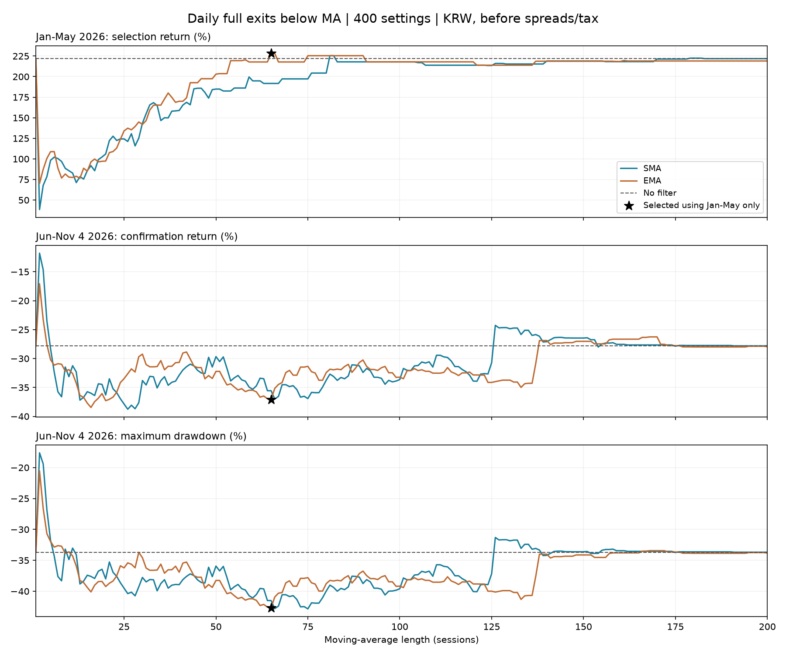

# 종목별 이평선 아래 전량매도: 1~200일 전수 비교

2026-11-09 사용자 추가 가설. 종목이 이평선 아래이면 **그 종목 보유분 전체**를 판다. 한 종목 이탈로 계좌 전체를 파는 조건은 아니다. 이번 SMA·EMA 각200개=400후보+현행1, 이전 신규 편입 보류400개까지 누적800개 규칙·기간 조합이다.

## 앞 구간으로 고르고 뒤 구간 확인

1/2~5/29 원화 수익으로만 고른 후보를 6/1~11/4에서 확인한다. 이미 본2026자료 재사용이므로 독립 새 검증은 아니다. 전일 완성 종가로 판단하고 다음 정규장 시가에 가상 체결한다.

| 설정 | 앞1~5월 수익 | 뒤6~11/4 수익 | 뒤 최대낙폭 | 전체 수익 | 뒤 투자비중 | MA 전량매도 |
|---|---:|---:|---:|---:|---:|---:|
| baseline | +221.83% | -27.81% | -33.69% | +132.33% | 81.4% | 0 |
| EMA65 | +228.15% | -37.07% | -42.67% | +106.49% | 66.8% | 39 |
| SMA81 | +225.57% | -32.69% | -39.01% | +119.13% | 65.7% | 32 |

앞 구간 선택 **EMA65**의 뒤 구간 수익 개선은 -9.26%p, 최대낙폭 개선은 -8.98%p다. 앞 구간 수익 1위 동률 2개. 뒤 구간 수익과 최대낙폭 모두 현행보다 좋은 후보는 75/400개다.

## 같은 이평선으로 신규 편입만 보류했을 때와 비교

| 설정 | 신규보류만: 뒤 수익 | 전량매도: 뒤 수익 | 신규보류만: 뒤 최대낙폭 | 전량매도: 뒤 최대낙폭 |
|---|---:|---:|---:|---:|
| EMA65 | -28.76% | -37.07% | -34.56% | -42.67% |
| SMA2 | -31.62% | -11.78% | -36.52% | -17.61% |
| SMA126 | -27.81% | -24.26% | -33.69% | -31.31% |
| SMA23 | -27.70% | -35.91% | -33.54% | -37.60% |
| SMA18 | -28.46% | -34.37% | -33.54% | -36.76% |
| SMA51 | -28.08% | -30.53% | -33.82% | -36.71% |

## 사후 최고값과 이웃 기간

뒤 구간·전체 구간을 보고 고른 최고값은 사후 발견이다. 사전에 선택한 성적이나 최적값으로 쓰지 않는다.

| 설정 | 앞1~5월 수익 | 뒤6~11/4 수익 | 뒤 최대낙폭 | 전체 수익 | 뒤 투자비중 | MA 전량매도 |
|---|---:|---:|---:|---:|---:|---:|
| baseline | +221.83% | -27.81% | -33.69% | +132.33% | 81.4% | 0 |
| SMA2 | +38.45% | -11.78% | -17.61% | +22.15% | 16.5% | 161 |
| SMA126 | +216.02% | -24.26% | -31.31% | +139.36% | 81.0% | 15 |

뒤 수익 사후1위 주변 ±5일:

| 설정 | 앞1~5월 수익 | 뒤6~11/4 수익 | 뒤 최대낙폭 | 전체 수익 | 뒤 투자비중 | MA 전량매도 |
|---|---:|---:|---:|---:|---:|---:|
| SMA1 | +221.83% | -27.81% | -33.69% | +132.33% | 81.4% | 0 |
| SMA2 | +38.45% | -11.78% | -17.61% | +22.15% | 16.5% | 161 |
| SMA3 | +67.90% | -14.65% | -19.40% | +43.30% | 20.6% | 149 |
| SMA4 | +78.39% | -23.47% | -26.81% | +36.51% | 24.0% | 136 |
| SMA5 | +98.29% | -28.28% | -31.76% | +42.21% | 27.2% | 129 |
| SMA6 | +102.14% | -32.33% | -34.30% | +36.78% | 29.4% | 118 |
| SMA7 | +100.40% | -35.75% | -37.61% | +28.76% | 31.1% | 116 |

전체 수익 사후1위 주변 ±5일. 투자비중을 줄인 효과와 기간 경계의 민감도를 같이 본다:

| 설정 | 앞1~5월 수익 | 뒤6~11/4 수익 | 뒤 최대낙폭 | 전체 수익 | 뒤 투자비중 | MA 전량매도 |
|---|---:|---:|---:|---:|---:|---:|
| SMA121 | +213.87% | -33.92% | -40.07% | +107.40% | 81.4% | 21 |
| SMA122 | +213.87% | -32.69% | -38.95% | +111.27% | 81.8% | 20 |
| SMA123 | +213.87% | -32.61% | -38.88% | +111.53% | 81.9% | 20 |
| SMA124 | +213.49% | -32.66% | -38.93% | +111.10% | 82.0% | 21 |
| SMA125 | +213.49% | -30.72% | -37.16% | +117.19% | 82.5% | 19 |
| SMA126 | +216.02% | -24.26% | -31.31% | +139.36% | 81.0% | 15 |
| SMA127 | +216.02% | -24.70% | -31.70% | +137.98% | 81.2% | 15 |
| SMA128 | +216.02% | -24.65% | -31.66% | +138.12% | 81.5% | 14 |
| SMA129 | +215.33% | -24.65% | -31.66% | +137.60% | 81.5% | 14 |
| SMA130 | +215.33% | -24.85% | -31.84% | +136.98% | 81.5% | 15 |
| SMA131 | +215.33% | -24.72% | -31.73% | +137.37% | 81.6% | 15 |

## 거래 빈도와 가상 호가비용 민감도

수수료는 사용자 조건인0. 아래5·10bp는 실제 호가 추정이 아닌 가상 조건이다. 매일 시가 전후 비중 차이의 절댓값 합(부분 재조정 포함)에 비용률을 곱해 자산을 비례 차감한다. 매수·매도 양방향을 포함하며 동일 회전율 계산을 현행에도 적용한다. 비중의 비용 피드백·실제 체결 슬리피지를 재현하는 시뮬레이터는 아니다.

| 설정 | 전체 신규편입 | 전체 청산 | 그중 MA청산 | 전체 단방향 회전율 | 뒤 수익 5bp | 뒤 수익 10bp |
|---|---:|---:|---:|---:|---:|---:|
| baseline | 27 | 20 | 0 | 9.18배 | -27.94% | -28.08% |
| EMA65 | 51 | 49 | 39 | 15.08배 | -37.35% | -37.63% |
| SMA2 | 161 | 161 | 161 | 45.19배 | -12.60% | -13.42% |
| SMA126 | 31 | 25 | 15 | 9.99배 | -24.44% | -24.61% |

## 계산 경계·검증

- 기존 7종목 순위·PDF 시점·상한·원화 환산과 현금 정의를 유지한다. MA 예열만 2025년을 쓰고 성과는2026만 평가한다. 입력 SHA를 확인해 앞선 신규보류 연구와 같은 자료로 비교한다.
- 밤사이 갭 손익을 반영한 다음 매도한다. 종가나 이평선 가격으로 팔았다고 가정하지 않는다. 종가<MA가 조건이며 같으면 유지한다.
- 매도분은 현금으로 두고 주중 즉시 재매수하지 않는다. 팔린 이름은 유지 버퍼에서 제거하며 청산 당일 임의 대체·재배분하지 않는다. 정기 주간에는 기존 규칙으로 종목을 재선택하며 회복 종목도 이때만 재편입할 수 있다.
- MA·종가 결측은 매도 근거 부족으로 유지하되 신규 편입은 보류한다. 실제 보유 신호 결측은 0건이다. 모든 의도한 체결의 양수 시가를 확인했다.
- 수익·낙폭 감소와 평균 투자비중 감소를 함께 본다. 결과 JSON의 USD 동일 평균노출 대조는 사후 설명용으로, 미리 알 수 있는 매매 규칙이 아니다.
- 400설정 선택편향·인접 기간 동일 거래·기존 모델 선택편향이 겹친다. 이미 본 자료를 앞뒤로 나누었으므로 앞으로 종이 기록으로 확인해야 한다. 운용·주문·계좌·Pine 기본값은 바꾸지 않았다.
- summary.csv 전체401행, monthly.csv 월별, curves_krw.csv 일별, entry_decisions.csv 신규 판단, exits.csv 전량매도, turnover.csv 회전율을 보존한다. unknown_held_signals.csv는 결측 판단 기록이며 0건이면 헤더만 있다.
- audit_exit.py는 다른 MA 구현으로 모든 매도 시점·값과 주요 경로를 재생한다. audit.json에 검산 결과, 전체 unittest와 desk validate는 저장소 검증에서 확인한다.

재현: `py data/derived/analysis/ma_entry_filter_20261108/exit_review.py` → `py data/derived/analysis/ma_entry_filter_20261108/audit_exit.py`. 기존 grid_1_200의 예열 입력을 사용하며 가격을 재수집하지 않는다.
