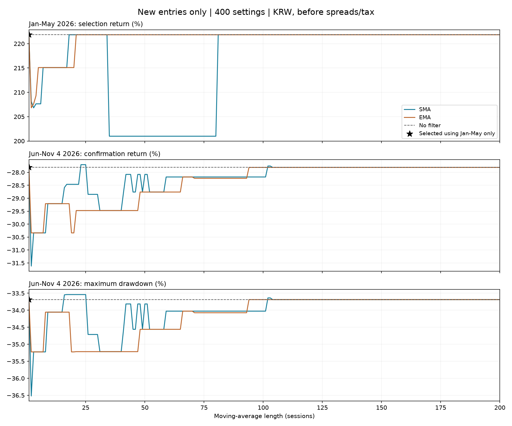

# 신규 편입 이평선 필터: 1~200일 전수 비교

사용자 요청대로 SMA·EMA 각각 1~200일을 1일 간격으로 모두 계산했다. 이번 400후보+현행1이며, 기존6개를 포함한 고유 누적400후보다(새 조합394개). 종목마다 다른 기간을 고르거나 손절을 붙이는 조합은 시험하지 않았다.

## 먼저 고르고 뒤에서 확인

2026년 1/2~5/29 수익률로만 고른 후보를 6/1~11/4에서 확인했다. 기존에 본 2026 자료를 더 촘촘히 탐색했으므로 독립 새 검증은 아니다. 비용 전 원화·정규장 시가 가정 체결이며 실계좌 성과가 아니다.

| 설정 | 1~5월 수익 | 6~11/4 수익 | 뒤 최대낙폭 | 전체 수익 | 뒤 평균투자비중 | 보류 시도 |
|---|---:|---:|---:|---:|---:|---:|
| baseline | +221.83% | -27.81% | -33.69% | +132.33% | 81.4% | 0 |
| SMA1 | +221.83% | -27.81% | -33.69% | +132.33% | 81.4% | 0 |
| EMA1 | +221.83% | -27.81% | -33.69% | +132.33% | 81.4% | 0 |

앞 구간 최고 수익은 +221.83%로 **319개가 동률**이다. 사전에 고정한 동률 처리(종류 SMA 우선·짧은 기간 우선)로 1일선이 선택됐다. 1일선은 종가 자신과 비교하므로 필터 효과가 없는 대조다. 앞 구간만으로 23일선을 특정할 근거는 없다.

앞 구간 선택은 **SMA1**. 뒤 구간 현행 대비 수익 차이는 **+0.00%p**, 최대낙폭 차이는 **+0.00%p**다.

400개 중 뒤 구간 수익이 현행보다 높은 후보는 **5/400**, 뒤 최대낙폭도 함께 나아진 후보는 **5/400**, 앞·뒤 수익이 모두 현행보다 높은 후보는 **0/400**이다.

## 결과를 보고 고른 최고값 — 사후 발견

아래는 뒤 구간과 전체 구간 결과를 보고 고른 값이다. 실제로 그 전에 선택했을 성적이나 검증된 최적 기간으로 해석하지 않는다.

| 설정 | 1~5월 수익 | 6~11/4 수익 | 뒤 최대낙폭 | 전체 수익 | 뒤 평균투자비중 | 보류 시도 |
|---|---:|---:|---:|---:|---:|---:|
| baseline | +221.83% | -27.81% | -33.69% | +132.33% | 81.4% | 0 |
| SMA23 | +221.83% | -27.70% | -33.54% | +132.67% | 78.6% | 8 |

사후 최고인 SMA23도 뒤 수익 개선은 +0.1057%p, 뒤 최대낙폭 개선은 +0.1477%p다. 이번 표본에서 약간 나은 기간은 있지만, 큰 하락을 줄이는 개선책으로 볼 정도의 차이는 확인되지 않았다.

### 뒤 구간 수익 상위10 (사후)

| 설정 | 1~5월 수익 | 6~11/4 수익 | 뒤 최대낙폭 | 전체 수익 | 뒤 평균투자비중 | 보류 시도 |
|---|---:|---:|---:|---:|---:|---:|
| SMA23 | +221.83% | -27.70% | -33.54% | +132.67% | 78.6% | 8 |
| SMA24 | +221.83% | -27.70% | -33.54% | +132.67% | 78.6% | 8 |
| SMA25 | +221.83% | -27.70% | -33.54% | +132.67% | 78.6% | 8 |
| SMA102 | +221.83% | -27.76% | -33.64% | +132.50% | 81.0% | 1 |
| SMA103 | +221.83% | -27.76% | -33.64% | +132.50% | 81.0% | 1 |
| EMA1 | +221.83% | -27.81% | -33.69% | +132.33% | 81.4% | 0 |
| EMA94 | +221.83% | -27.81% | -33.69% | +132.33% | 81.4% | 0 |
| EMA95 | +221.83% | -27.81% | -33.69% | +132.33% | 81.4% | 0 |
| EMA96 | +221.83% | -27.81% | -33.69% | +132.33% | 81.4% | 0 |
| EMA97 | +221.83% | -27.81% | -33.69% | +132.33% | 81.4% | 0 |

### 전체 구간 수익 상위10 (사후)

| 설정 | 1~5월 수익 | 6~11/4 수익 | 뒤 최대낙폭 | 전체 수익 | 뒤 평균투자비중 | 보류 시도 |
|---|---:|---:|---:|---:|---:|---:|
| SMA23 | +221.83% | -27.70% | -33.54% | +132.67% | 78.6% | 8 |
| SMA24 | +221.83% | -27.70% | -33.54% | +132.67% | 78.6% | 8 |
| SMA25 | +221.83% | -27.70% | -33.54% | +132.67% | 78.6% | 8 |
| SMA102 | +221.83% | -27.76% | -33.64% | +132.50% | 81.0% | 1 |
| SMA103 | +221.83% | -27.76% | -33.64% | +132.50% | 81.0% | 1 |
| EMA1 | +221.83% | -27.81% | -33.69% | +132.33% | 81.4% | 0 |
| EMA94 | +221.83% | -27.81% | -33.69% | +132.33% | 81.4% | 0 |
| EMA95 | +221.83% | -27.81% | -33.69% | +132.33% | 81.4% | 0 |
| EMA96 | +221.83% | -27.81% | -33.69% | +132.33% | 81.4% | 0 |
| EMA97 | +221.83% | -27.81% | -33.69% | +132.33% | 81.4% | 0 |

## 사후 뒤 구간 1위 주변 ±5일

하루 차이의 인접 기간은 같은 거래를 많이 공유한다. 최고값의 주변이 같이 좋은지 보는 민감도이며 추가 독립 검증은 아니다.

| 설정 | 1~5월 수익 | 6~11/4 수익 | 뒤 최대낙폭 | 전체 수익 | 뒤 평균투자비중 | 보류 시도 |
|---|---:|---:|---:|---:|---:|---:|
| SMA18 | +221.83% | -28.46% | -33.54% | +130.23% | 78.1% | 9 |
| SMA19 | +221.83% | -28.46% | -33.54% | +130.23% | 78.1% | 9 |
| SMA20 | +221.83% | -28.46% | -33.54% | +130.23% | 78.1% | 9 |
| SMA21 | +221.83% | -28.46% | -33.54% | +130.23% | 78.1% | 9 |
| SMA22 | +221.83% | -28.46% | -33.54% | +130.23% | 78.1% | 9 |
| SMA23 | +221.83% | -27.70% | -33.54% | +132.67% | 78.6% | 8 |
| SMA24 | +221.83% | -27.70% | -33.54% | +132.67% | 78.6% | 8 |
| SMA25 | +221.83% | -27.70% | -33.54% | +132.67% | 78.6% | 8 |
| SMA26 | +221.83% | -28.85% | -34.71% | +128.98% | 79.3% | 6 |
| SMA27 | +221.83% | -28.85% | -34.71% | +128.98% | 79.3% | 6 |
| SMA28 | +221.83% | -28.85% | -34.71% | +128.98% | 79.3% | 6 |

## 해석·재현

- 개별 종목의 신규 편입만 전일 확정 종가로 판정한다. 기존 보유는 면제하며 보류 배분은 현금, 대체·재정규화 없음. 주중 회복해도 다음 주간 재조정까지 기다린다.
- 기존 매매·순위·환율·PDF 입력은 그대로다. MA 계산에만 2025년 초 Close를 보완했다. 200일선의 가짜 이력 부족을 피하고, 실제 상장 이력 부족·결측은 차단 사유로 따로 센다. 2025년 수익은 평가하지 않았다.
- EMA는 첫 유효 가격 시드여서 더 긴 예열로 이전6후보와 초기값 영향이 달라질 수 있다. 결과 JSON의 legacy_comparison에 차이를 공개한다. 같은 입력·같은 길이의 SMA20·60·120과 현행 곡선은 이전 결과를 재현해야 한다.
- 차단 시도에는 다음 주 같은 종목 재심사가 포함된다. 고유 사건 수가 아니다. 수익 개선 개수도 독립400개의 증거가 아니다.
- 400개에서 최고값을 고르는 선택편향과 기존 7종목 모델의 선택편향이 겹친다. 운용 설정·주문·Pine 기본값은 변경하지 않는다.
- 사용자 수수료0. 호가·환전·세금·현금이자 제외. 기존 엔진의 원화 환산·현금 정의도 유지한다.
- 모든 기간은 summary.csv, 월별은 monthly.csv, 일별 원화 곡선은 curves_krw.csv, 차단 원장은 entry_decisions.csv, 예열 출처와 겹침 대조는 inputs/warmup_meta.json에 있다.

독립 검산: `py data/derived/analysis/ma_entry_filter_20261108/audit_grid.py` → `audit.json`. 400개 전체 수익·최대낙폭·월별 산술·차단 원장과 주요 후보의 별도 이평선 계산·곡선 재생을 확인한다. Python 단위검증은 `py -m unittest`로 실행한다.

재현: 연구 선택 의존성(`pip install -e ".[research]"`, matplotlib 포함)을 설치한 뒤 `py data/derived/analysis/ma_entry_filter_20261108/fetch_warmup.py` → `py data/derived/analysis/ma_entry_filter_20261108/grid_review.py`. 동결 예열을 그대로 쓸 때는 첫 명령을 생략한다. 예열 재수집은 새 파일·시각·지문으로 취급한다.
