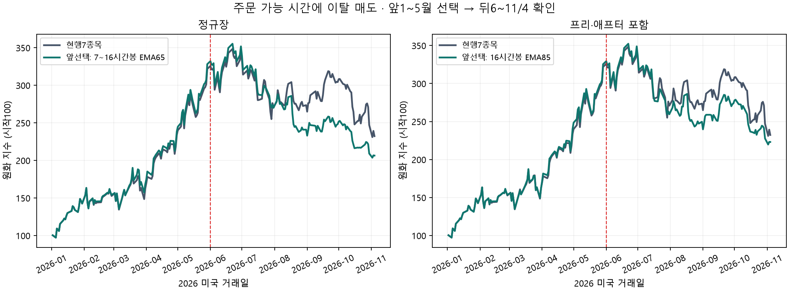

# 4~16시간봉 이평선 이탈 매도 — 2026 7종목 모델

**전체 수익이 현행보다 높은 활성 매도규칙은 0/4,046개다.** 이는 무효 대조N1과 정규장 중복 시간봉을 제외한 주문 가능 시간 조건이다. 뒤 하락 구간만 덜 잃는 경우와 전체 전략의 개선을 구분한다.

평가: **2026-01-02~11-04 미국 정규장 종가**. 1~5월 성적으로 고르고 6~11월을 확인한다. 이미 여러 번 본2026자료의 재사용이며 새로운 독립 검증은 아니다. 2025-06-02부터는 지표 예열만 쓴다.

대상은 **83개 후보에서 원래 규칙대로 고르는 동적7종목 모델**이다. 현행이 실제 보유했던 종목은27개, 주간 상위12위에 든 합집합은53개이며 모두 원본을 확보했다. 이전138종목 독립 슬리브 실험의 성적과 구분한다.

## 앞 구간에서 고른 뒤 확인한 결과

| 조건·선택 | 1~5월 수익 | 6~11/4 수익 | 뒤 최대낙폭 | 전체 수익 | 뒤 수익10bp | 뒤 투자비중 |
|---|---:|---:|---:|---:|---:|---:|
| 현행7종목 | +221.83% | -27.81% | -33.69% | +132.33% | -28.08% | 81.4% |
| 정규장 · 앞선택 7~16시간봉 EMA65 | +228.15% | -37.07% | -42.67% | +106.49% | -37.63% | 66.8% |
| 프리·애프터 포함 · 앞선택 16시간봉 EMA85 | +225.38% | -31.44% | -37.62% | +123.10% | -32.00% | 73.1% |

주 비교는 한국시간08:00 이상24:00 미만에 주문할 수 있는 조건이다. 수면 중 이탈했다가 회복하면 최신 완성봉을 다시 확인해 매도하지 않는다. 주중 재매수는 없으며 다음 주간 재편입 시점까지 현금으로 기다린다.

- 정규장 앞선택 **7~16시간봉 EMA65**: 뒤 수익 차이 -9.26%p, 뒤 낙폭 차이 -8.98%p, 전체 수익 차이 -25.84%p.
- 프리·애프터 포함 앞선택 **16시간봉 EMA85**: 뒤 수익 차이 -3.63%p, 뒤 낙폭 차이 -3.93%p, 전체 수익 차이 -9.23%p.

두 시장세션을 함께 앞 수익으로 선택하면 **정규장 · 7~16시간봉 EMA65**이다. 이는 뒤 구간 최고값을 골랐다는 뜻이 아니다.

## 앞 구간 낙폭 제한을 추가한 보조 선택

앞 구간 최대낙폭이 현행보다 나쁘지 않은 후보 중 앞 수익 최대를 고른다. 뒤 성적을 보면서 조건을 바꾸지 않는다.

| 조건·선택 | 1~5월 수익 | 6~11/4 수익 | 뒤 최대낙폭 | 전체 수익 | 뒤 수익10bp | 뒤 투자비중 |
|---|---:|---:|---:|---:|---:|---:|
| 정규장 · 7~16시간봉 EMA65 | +228.15% | -37.07% | -42.67% | +106.49% | -37.63% | 66.8% |
| 프리·애프터 포함 · 16시간봉 EMA85 | +225.38% | -31.44% | -37.62% | +123.10% | -32.00% | 73.1% |

## 수면 제한 없이 바로 체결한 이론 비교

신호를 확인한 뒤 시장세션 안의 다음 유효30분봉 시가에서 체결한다. 잠든 동안에도 이탈 조건을 실시간으로 만들어 실행할 수 있다고 둔 민감도이며, 사용자 증권사에서 검증한 자동주문 기능은 아니다.

| 조건·선택 | 1~5월 수익 | 6~11/4 수익 | 뒤 최대낙폭 | 전체 수익 | 뒤 수익10bp | 뒤 투자비중 |
|---|---:|---:|---:|---:|---:|---:|
| 현행7종목 | +221.83% | -27.81% | -33.69% | +132.33% | -28.08% | 81.4% |
| 정규장 · 앞선택 7~16시간봉 EMA65 | +228.15% | -37.07% | -42.67% | +106.49% | -37.63% | 66.8% |
| 프리·애프터 포함 · 앞선택 16시간봉 EMA85 | +225.38% | -31.44% | -37.62% | +123.10% | -32.00% | 73.1% |

## 시간봉별 앞 선택과 뒤 확인

각 시간봉 안에서 종류·N을 앞 구간으로만 고른 표다. 이 표에서 다시 뒤 성적1위를 고르면 사후 선택이다.

| 시장세션 | 시간봉 | 앞에서 고른 선 | 앞 수익 | 뒤 수익 | 뒤 낙폭 | 전체 수익 |
|---|---:|---|---:|---:|---:|---:|
| 정규장 | 4시간 | SMA1 | +221.83% | -27.81% | -33.69% | +132.33% |
| 정규장 | 5시간 | SMA1 | +221.83% | -27.81% | -33.69% | +132.33% |
| 정규장 | 6시간 | SMA1 | +221.83% | -27.81% | -33.69% | +132.33% |
| 정규장 | 7~16시간 | EMA65 | +228.15% | -37.07% | -42.67% | +106.49% |
| 프리·애프터 포함 | 4시간 | SMA1 | +221.83% | -27.81% | -33.69% | +132.33% |
| 프리·애프터 포함 | 5시간 | SMA1 | +221.83% | -27.81% | -33.69% | +132.33% |
| 프리·애프터 포함 | 6시간 | SMA1 | +221.83% | -27.81% | -33.69% | +132.33% |
| 프리·애프터 포함 | 7시간 | SMA1 | +221.83% | -27.81% | -33.69% | +132.33% |
| 프리·애프터 포함 | 8시간 | SMA1 | +221.83% | -27.81% | -33.69% | +132.33% |
| 프리·애프터 포함 | 9시간 | SMA1 | +221.83% | -27.81% | -33.69% | +132.33% |
| 프리·애프터 포함 | 10시간 | SMA1 | +221.83% | -27.81% | -33.69% | +132.33% |
| 프리·애프터 포함 | 11시간 | SMA1 | +221.83% | -27.81% | -33.69% | +132.33% |
| 프리·애프터 포함 | 12시간 | SMA1 | +221.83% | -27.81% | -33.69% | +132.33% |
| 프리·애프터 포함 | 13시간 | SMA1 | +221.83% | -27.81% | -33.69% | +132.33% |
| 프리·애프터 포함 | 14시간 | SMA1 | +221.83% | -27.81% | -33.69% | +132.33% |
| 프리·애프터 포함 | 15시간 | SMA1 | +221.83% | -27.81% | -33.69% | +132.33% |
| 프리·애프터 포함 | 16시간 | EMA85 | +225.38% | -31.44% | -37.62% | +123.10% |

## 전체를 본 뒤 발견한 최고값

**아래 값은 운용 후보를 미리 선택한 성적이 아니다.** 대량 탐색에서 보이는 상한으로 공개한다.

| 조건·선택 | 1~5월 수익 | 6~11/4 수익 | 뒤 최대낙폭 | 전체 수익 | 뒤 수익10bp | 뒤 투자비중 |
|---|---:|---:|---:|---:|---:|---:|
| 정규장 · 뒤 수익 사후1위 6시간봉 SMA5 | +60.14% | -12.32% | -16.59% | +40.41% | -13.96% | 19.9% |
| 정규장 · 전체 수익 사후1위 4시간봉 SMA1 (무효 대조) | +221.83% | -27.81% | -33.69% | +132.33% | -28.08% | 81.4% |
| 프리·애프터 포함 · 뒤 수익 사후1위 7시간봉 SMA2 | +37.28% | -10.89% | -20.78% | +22.33% | -12.95% | 10.1% |
| 프리·애프터 포함 · 전체 수익 사후1위 4시간봉 SMA1 (무효 대조) | +221.83% | -27.81% | -33.69% | +132.33% | -28.08% | 81.3% |

## 앞에서 선택한 선의 ±5 이웃

종류·시간봉은 고정하고 이미 시험한N±5를 그대로 공개한다. 이 표에서 기간을 다시 고르지 않는다.

| 시장세션 | 선 | 앞 수익 | 뒤 수익 | 뒤 낙폭 | 전체 수익 |
|---|---|---:|---:|---:|---:|
| 정규장 | EMA60 | +217.82% | -35.48% | -41.22% | +105.07% |
| 정규장 | EMA61 | +217.82% | -35.76% | -41.47% | +104.17% |
| 정규장 | EMA62 | +217.82% | -36.67% | -42.31% | +101.26% |
| 정규장 | EMA63 | +217.82% | -36.95% | -42.56% | +100.38% |
| 정규장 | EMA64 | +217.82% | -36.95% | -42.56% | +100.38% |
| 정규장 | EMA65 (선택) | +228.15% | -37.07% | -42.67% | +106.49% |
| 정규장 | EMA66 | +228.15% | -34.75% | -40.55% | +114.11% |
| 정규장 | EMA67 | +217.82% | -34.48% | -40.31% | +108.23% |
| 정규장 | EMA68 | +217.82% | -34.15% | -40.22% | +109.28% |
| 정규장 | EMA69 | +217.82% | -32.43% | -38.65% | +114.76% |
| 정규장 | EMA70 | +217.82% | -32.04% | -38.30% | +115.99% |
| 프리·애프터 포함 | EMA80 | +216.98% | -32.26% | -38.40% | +114.72% |
| 프리·애프터 포함 | EMA81 | +216.98% | -32.26% | -38.40% | +114.72% |
| 프리·애프터 포함 | EMA82 | +216.98% | -31.24% | -37.48% | +117.94% |
| 프리·애프터 포함 | EMA83 | +216.98% | -31.25% | -37.48% | +117.94% |
| 프리·애프터 포함 | EMA84 | +216.98% | -31.45% | -37.64% | +117.28% |
| 프리·애프터 포함 | EMA85 (선택) | +225.38% | -31.44% | -37.62% | +123.10% |
| 프리·애프터 포함 | EMA86 | +223.95% | -31.27% | -37.47% | +122.64% |
| 프리·애프터 포함 | EMA87 | +223.95% | -30.72% | -36.97% | +124.44% |
| 프리·애프터 포함 | EMA88 | +223.95% | -31.49% | -37.67% | +121.95% |
| 프리·애프터 포함 | EMA89 | +223.95% | -31.51% | -37.69% | +121.86% |
| 프리·애프터 포함 | EMA90 | +223.95% | -31.51% | -37.69% | +121.86% |

## 선택한 선의 실제 시간과 거래량

같은20선이어도 같은 기간이 아니다. 빈봉은 관측에서 빼고 거래시계는 압축하지 않는다. 각 종목의 실제봉을 사용한2026분포를 합쳐 중앙값을 냈다. EMA의 N봉 포함 시간은 명목값이며 EMA 자체에는 무한 꼬리가 있어 가중 평균시차를 함께 본다.

| 조건 | 최근N봉 포함 시간 중앙값 | 가중 평균시차 중앙값 | 전량매도 | 신규 차단 | 전체 편도 회전율 |
|---|---:|---:|---:|---:|---:|
| 정규장 · 주문 가능 시간 · 7~16시간봉 EMA65 | 422.5시간 | 207.8시간 | 39 | 37 | 15.08배 |
| 정규장 · 수면 제한 없는 이론 비교 · 7~16시간봉 EMA65 | 422.5시간 | 207.8시간 | 39 | 37 | 15.08배 |
| 프리·애프터 포함 · 주문 가능 시간 · 16시간봉 EMA85 | 1360.0시간 | 669.9시간 | 33 | 23 | 13.71배 |
| 프리·애프터 포함 · 수면 제한 없는 이론 비교 · 16시간봉 EMA85 | 1360.0시간 | 669.9시간 | 33 | 23 | 13.71배 |

투자비중은 각 시장세션 안의 시간 가중 평균이다. 건수·회전율·투자비중의 front/back는 미국 세션 날짜로 묶고, 수익·낙폭·비용 수익은 정규장 종가 경계로 나눈다. 따라서5/29 장후매도 건수는 front에, 그 장후 이후의 손익·비용은 뒤 구간 수익에 반영된다. 6/1에 자산·보유를 새로 시작하지 않는다.

## 현금을 더 보유한 효과와 비교

아래는 설명용USD대조다. 해당 구간의 실제 평균투자비중/현행 평균투자비중 비율만큼 현행의 매일 수익률을 줄인 일정비율 대조와 비교한다. 이 평균비중은 사후값이므로 미리 실행할 수 있었던 전략의 성적이 아니다. 원화표와 통화가 다르다.

| 조건 | 구간 | 실제USD수익 | 노출맞춘현행USD대조 | 차이 |
|---|---|---:|---:|---:|---:|
| 정규장 · 7~16시간봉 EMA65 | 뒤 | -29.93% | -15.66% | -14.27%p |
| 정규장 · 7~16시간봉 EMA65 | 전체 | +121.10% | +132.86% | -11.76%p |
| 프리·애프터 포함 · 16시간봉 EMA85 | 뒤 | -23.65% | -17.36% | -6.30%p |
| 프리·애프터 포함 · 16시간봉 EMA85 | 전체 | +138.88% | +139.77% | -0.89%p |

## 탐색 범위·시점·가격

- 4~16시간을1시간 간격13개 × SMA/EMA2개 ×1~120선120개 = **시장세션당3,120설정**. 정규장·연장시간 합계6,240명목설정이며 수면 제한/무제한 두 체결조건으로12,480명목 비교다.
- 정규장7~16시간은 하루 한 봉으로 중복된다. 이를 한 번씩 계산하면 정규4시간봉종류×240=960, 연장13시간봉종류×240=3,120으로 체결조건당4,080설정, 두 조건8,160설정과 현행4경로다. SMA1/EMA1도 수학적 무효 대조이므로 실제 서로 다른 거래 경로 수는 더 작다.
- 세션 시작09:30/04:00에 맞춰 봉을 만들고 세션 종료16:00/20:00에 잔여봉을 확정한다. 예: 정규4시간봉은09:30~13:30(4h)와13:30~16:00(2.5h), 연장5시간봉은04~09/09~14/14~19/19~20이다. 조기폐장은 정규13:00/연장17:00으로 단축한다. [TradingView 봉 구성 원칙](https://www.tradingview.com/support/solutions/43000796857/) · [NYSE 거래시간](https://www.nyse.com/markets/hours-calendars).
- 원본은 Alpaca SIP split-adjusted30분봉821,505개다. 가격단위·중복·거래일·상장 첫날 공백은 `coverage.csv`와`input_metadata.json`에 저장했다. 미체결·빈봉을 가격으로 채우지 않는다. [Alpaca historical bars](https://docs.alpaca.markets/us/reference/stockbars).
- 봉의 마지막30분 원본까지 확정된 뒤에만 신호를 쓴다. 신호 시각<=체결 시각이며 경계에서는 막 끝난 봉 Close와 다음30분봉 Open을 구분한다. 세션 종료 신호를 그 종료가격에 체결하지 않는다. 무지연 다음 시가 근사이며 실제 지연·호가 간격·유동성까지 검증한 체결값은 아니다.
- 주간 매매 시가는 동결 Yahoo Open, 평가 기준점은 동결 Yahoo Close다. 봉 신호와 중간 매도는 독립 SIP30분봉이다. SIP 마지막분봉 Close와 공식 일봉 Close가 다를 수 있으며 실제 기본보유27종목의 최대 차이는1.43%, 상위12합집합53종목에서는2.05%, 전체83종목에서는4.45%였다. 미래 일봉으로 이전 분봉을 고치지 않았다. TradingView 공급자의 완전 동일값으로 부르지 않는다.
- 이번 연구 안에서 정규7~16시간봉은 동일한 하루1봉이다. 이전 일봉 연구는 Yahoo Close·2025-01 예열, 이번 시간봉 신호는 SIP집계·2025-06 예열이므로 MA 입력과EMA시드가 달라 이전의 같은N 성적과 완전히 같다고 주장하지 않는다. 무필터N1의 기준 자산곡선은 동일하다.
- 종가<MA일 때 그 종목만 전량매도한다. 상대1e-12 이내 동률은 유지한다. 최신 완성봉이 회복했으면 수면 중 과거 이탈을 잠가 매도하지 않는다. 자료가 부족하면 신규는 보류·보유는 유지하고 기록한다.
- 재편입은 매주 첫 미국 거래일09:30만 가능하다. 전일 일별120일 모멘텀·이전 날짜TIME PDF·선택 버퍼·상한을 기존 정본으로 계산한다. 매도 몫은USD현금이며 즉시 대체·재분배하지 않는다.
- 수수료0. 표의5/10bp는 부분 재조정을 포함한 편도 회전율에 비례해 자산을 차감한 가상 민감도다. 실측 스프레드·가격 충격·환전·세금·배당 현금·현금 이자를 포함한 성적은 아니다.
- 최대낙폭은 일별 정규장 종가 기준이며 장중 최대 손실은 반영하지 않는다.

## 검증·파일

- 필터 없는 확장 경로4개와 모든SMA1/EMA1은 기존 동결7종목 일별곡선과 일치한다. 기존 자산 계산`desk.strategies.run_model`을 그대로 쓰고 시각·지표·주간 일정 연결만 연구 어댑터로 바꾼다.
- 별도`audit_intraday.py`가 원본 봉 집계, 스칼라SMA/EMA, 현금·주식 수 원장, 선택된 주요경로와 저장된 전 후보 수익·낙폭을 검산한다. 상세 통과 항목은`audit.json`을 확인한다.
- 전체표`summary_unique.csv`, 전명목별칭`candidate_aliases.csv`, 시장세션/체결조건별`curves_*.csv`, 주요경로`*_entries.csv`·`*_exits.csv`에 판단과 체결을 남긴다. `parts/`는 다시 생성하는 각 시간봉별 중간캐시로 Git에서 제외한다.
- 운영 설정·주문·개인 계좌·Pine기본값은 바꾸지 않는다. 추가 과거연도로 정당화하지 않고 새 확인은 앞으로 쌓이는 종이 기록으로 해야 한다.

재실행: `py intraday_inputs.py` → `py intraday_review.py --workers 6` → `py audit_intraday.py` → `py report_intraday.py` (모두 이 폴더의 상위소스 디렉터리).
