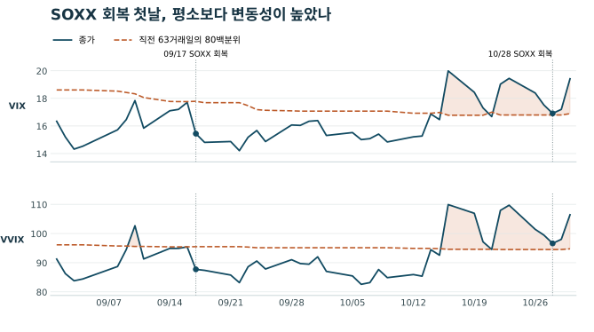

# 반도체 킬스위치에 VIX를 더하면 무엇이 달라지는가

2026-11-22 · 클로드 지표 기존 9종목과 별도 비교 10종목 · 미국장 11월 20일 마감까지

**SOXX 경고는 유지하고, 반도체가 회복했는데도 VVIX가 평소보다 높은 날을 차트에 표시하는 안을 관찰 후보로 둔다.** 6월 이후 VIX 25 이상, 30일·3개월 변동성 역전, VX 선물 최근월·차근월 역전은 SOXX가 이미 막고 있던 날에만 나타났다. 반면 상대적으로 높은 VVIX는 10월 말 MU 등 5건의 손실을 피했고 9월에는 2건의 이익을 놓쳤다. 78개 VIX 결합법 중 기존 9종목과 비교 10종목 **양쪽에서** 종목별 수익 개선의 중앙값이 양수였던 방식은 0개였다. VIX 경보를 통한 기존 보유 일괄 청산은 채택 보류다.

VIX는 S&P 500의 향후 30일 예상 변동폭을 나타낸다. VVIX는 VIX 옵션 가격에서 추출한 향후 30일의 VIX 변동성 지표다. VIX9D·VIX·VIX3M은 각각 9일·30일·3개월의 S&P 500 내재변동성이고, VX 최근월·차근월은 별개로 거래되는 표준 월물 선물의 정산가다. 네 종류의 숫자는 각각 공포의 수준, 변화, 예상 기간, VIX 자체의 불안정을 살펴보는 데 썼다. [Cboe VIX 설명](https://www.cboe.com/tradable-products/volatility-trading/) · [VVIX 정의](https://www.cboe.com/us/indices/dashboard/vvix/) · [Cboe 만기 구조](https://www.cboe.com/tradable_products/vix/term_structure)

## SOXX가 다시 허용한 날

1~5월 원래 9종목에서 고른 방식은 **VVIX가 직전 63거래일 종가의 80백분위 이상이면 신규 진입을 쉬고, 경보가 사라진 종가가 이틀 연속 나온 뒤 새 종목 진입 신호를 허용**하는 것이다. SOXX 약세 때의 신규 대기는 계속 적용하고, 기존 보유는 종목 원 지표가 청산한다. 63일 기준에는 오늘 종가를 넣지 않는다.

| 신호를 판단한 미국장 종가 | VIX / 직전 63일 80백분위 | VVIX / 직전 63일 80백분위 | 다음 개장 이후 달라진 점 |
|---|---:|---:|---|
| 9/17 SOXX 회복 | 15.44 / 17.79 | 87.72 / 95.49 | MU의 9/18~10/9 거래를 허용해 비용 후 +6.84%를 보존 |
| 10/28 SOXX 회복 | 16.91 / 16.79 | 96.61 / 94.53 | 10/29 MU·WDC·AVGO·MRVL 재진입을 보류. MU −8.19%를 포함해 네 건의 비용 후 손실 평균 −6.49%를 피함 |
| 10/29 SOXX 허용 유지 | 17.20 / 16.79 | 98.01 / 94.53 | 10/30 ASML 진입도 보류해 −0.88%를 피함 |
| 11/20 SOXX 약세 유지 | 35.89 / 19.37 | 138.03 / 104.92 | 13개 VIX 계열 경보 전부 켜짐. 기존 SOXX 신규 대기와 겹침. 다음 개장 체결은 평가 기간 밖 |

6월 이후 고정 선택이 추가로 막은 거래는 19종목에서 7건, 신호일은 3일이었다. 5건의 회피는 10/28~29에 몰렸다. 9/11에는 VVIX가 그날 기준 아래로 내려왔지만 전날 경보 때문에 이틀 해제가 끝나지 않아 SOXL +2.79%, TXN +2.72%를 놓쳤다. 그래서 MU 한 종목은 6월 이후 +6.71%에서 +16.23%로 나아졌고, SOXL은 −10.59%에서 −13.02%가 됐다. [비용 후 차단 거래 및 차이가 난 구간](intervals.csv)

## 앞에서 고른 규칙이 뒤에서도 통했나

각 칸은 종목별 **기간 순수익률 중앙값 / 최대낙폭 중앙값**이며 단위는 %다. 고정 선택은 6월 첫 개장 직전까지 기존 SOXX 보유를 승계했다. 아래 두 방식의 수익률 중앙값을 뺀 숫자는 개별 종목별 개선폭의 중앙값과 다를 수 있다.

| 집단과 방식 | 1/2~5/29 앞 구간 | 6/1~11/20 뒤 구간 | 최근 3개월 8/20~11/20 |
|---|---:|---:|---:|
| 기존 9종목 · SOXX만 | +151.26 / −18.49 | −6.04 / −27.97 | −2.88 / −14.69 |
| 기존 9종목 · VVIX 대기 | +151.36 / −18.17 | −6.04 / −27.97 | 0.00 / −13.91 |
| 비교 10종목 · SOXX만 | +19.71 / −13.85 | −5.98 / −20.68 | +0.60 / −8.91 |
| 비교 10종목 · VVIX 대기 | +26.19 / −10.95 | −6.15 / −18.45 | +0.60 / −8.38 |

- **선택과 이동 전방 검증**. 앞 구간에서 VVIX 대기의 종목별 순수익 개선폭 중앙값은 기존 +6.45%p, 비교 +3.34%p였다. 뒤 구간은 두 집단 모두 0.00%p였다. 기존 9종목은 개선 2개·악화 1개·동일 6개, 비교 10종목은 개선 3개·악화 1개·동일 6개였다. 직전 완결 3개월로 매달 다시 고르면 6~11월 여섯 번 모두 기존 SOXX 대기를 골랐다. 최근 3개월 이동 적용 성적은 기존 −2.88 / −14.69%, 비교 +0.60 / −8.91%였다. [월별 선택](choices.csv) · [종목별 수익과 낙폭](scores.csv)
- **큰 손실을 막았는가**. 각 집단의 개별 모의계좌를 구간 첫날 같은 금액으로 합산해 6월 이후 경로를 따로 계산했다. VVIX 대기로 기존 9종목 합산 수익은 −5.97%에서 −4.69%, 비교 10종목은 −3.06%에서 −2.19%가 됐다. 합산 최대낙폭은 각각 −24.56%에서 −24.55%, −13.50%에서 −13.49%였다. 최악의 하루도 각각 −9.72%, −6.87%로 같았다. 가장 중요한 하락일의 방어는 개선되지 않았다. 최근 3개월로 좁히면 합산 최대낙폭은 기존 −9.07%에서 −7.59%, 비교 −7.41%에서 −6.19%로 줄었다. [같은 6월 시작 보유로 비교한 합산 위험과 하위 5% 일간 수익](common_start.csv)

## 어떤 종류의 경보가 새 정보를 보탰나

아래는 6/1~11/20 **122개 체결 가능 거래일**이다. 각 거래일에는 직전 거래일까지 확정된 경보만 배정했다. 예를 들어 11/20 종가의 VIX 35.89는 그날 시가에 쓸 수 없으므로 이 표의 경보 일수에 포함되지 않는다.

| 전날 종가 경보 | 경보가 있던 개장일 | 이미 SOXX가 막은 날 | SOXX가 허용하던 원 지표 신규 진입 중 차단 건수 |
|---|---:|---:|---:|
| VIX ≥20 / ≥25 / ≥30 | 11 / 4 / 0 | 11 / 4 / 0 | 0 / 0 / 0 |
| VIX 하루 +10% 이상 / +20% 이상 | 16 / 3 | 14 / 3 | 0 / 0 |
| VIX 5거래일 +25% 이상 | 10 | 9 | 7건, 1일 |
| VIX가 직전 63거래일의 상위 20% | 26 | 24 | 5건, 2일 |
| VIX9D > VIX | 15 | 13 | 7건, 1일 |
| VIX > VIX3M | 5 | 5 | 0 |
| VX 최근월 > 차근월 | 13 | 13 | 0 |
| VVIX가 직전 63거래일의 상위 20% | 28 | 26 | 5건, 2일 |

이 표의 차단 건수는 **해당 경보가 켜진 당일만** 신규를 제한했을 때의 값이다. 선택된 VVIX 정책은 해제에도 이틀을 요구해 7건이 됐다. 9일 변동성이 30일을 웃돌아 놓친 7건 중 6건은 상승, 1건은 하락이었다. 6월부터 시작한 이 방식은 기존 9종목의 합산 최대낙폭을 −24.56%에서 −16.87%로 줄이는 대신 합산 수익을 −5.97%에서 −8.04%로 낮췄다. [13개 경보별 중복과 신규 건수](signal_overlap.csv)

**보유까지 청산하는 선택**도 성격이 달랐다. VIX 하루 +10% 급등에 기존 보유까지 정리한 경우, 6월 첫 개장 직전 보유를 동일하게 맞춘 기존 9종목의 순수익 개선폭 중앙값은 +7.82%p, 최대낙폭 개선폭 중앙값은 +7.02%p였다. 비교 10종목은 각각 −0.38%p, 0.00%p였고, 최근 3개월에는 두 집단 모두 기준과 같았다. SOXX 약세여도 VIX 25 이상일 때만 신규를 막도록 완화하면 뒤 구간 순수익 차이 중앙값이 기존 −1.47%p·비교 −6.07%p였다. 이 표본에서는 반도체 자체 경고를 해제할 근거로 쓰기 어려웠다. [행동별 동일 출발 비교](common_start.csv)

## 결과가 바뀌는 조건

- **기간과 임계값**. 본 비교가 끝난 뒤 상대 경보의 창을 42·63·84거래일, 백분위를 75·80·85로 한 칸씩 바꿨다. VIX 종가만으로 신규를 막으면 9개 중 2개에서만 10월 MU 손실을 피했다. 이틀 해제 VVIX는 9개 모두 그 손실을 피했고 6개가 9월 MU 상승도 보존했다. 두 집단의 뒤 구간 순수익 개선 중앙값이 모두 양수였던 경우는 추가 비교 18개 중 0개였다. 18칸 중 2칸은 본 시험과 겹치며, 이 검사는 정책 선정에 쓰지 않았다. [모든 주변값 결과](nearby.csv)
- **체결비용과 정보 지연**. 편도 로그비용을 0·0.001·0.0025로 바꾸거나 VIX만 한 거래일 더 늦게 반영해도 고정 선택의 뒤 구간 수익·낙폭 차이 중앙값은 두 집단 모두 0이었다. 기준 정책의 일별 순수익에 각 실험의 평균 보유 수준을 곱한 동일 노출 비교에서도 고정 선택의 종목별 수익 차이 중앙값은 양쪽 모두 0이었다. 동일 노출은 창이 끝난 후 구한 진단값이며, 매일 노출을 맞추는 추가 거래비용은 제외했다. [민감도](sensitivity.csv) · [종목별 노출 대조](scores.csv)
- **우연한 날짜 일치**. 뒤 구간 122거래일에서 VIX 계열 경보 전체를 모든 종목에 같은 간격으로 회전시켰다. SOXX와 종목 가격·신호는 원래 날짜에 두고, 실제 시험과 위약 모두 6월 전까지 같은 SOXX 보유로 시작했다. VVIX 고정 선택의 실제 종목별 수익 개선 중앙값과 같거나 더 높았던 이동은 기존 9종목 106/121개, 비교 10종목 101/121개였다. 같은 값이 많고 날짜 사이에도 의존성이 있다. [날짜 이동 결과](phase_shift.csv)

## 자료와 재현

2026년 1~5월 선택 102거래일, 6/1~11/20 확인 122거래일, 최근 3개월 66거래일, 10/15 이후 27거래일을 사용했다. SOXX와 종목 신호는 앞 연구와 같다. 시장 상태와 종목 일봉은 미국 정규장 마감 후, VIX·VVIX 등은 Cboe의 당일 최종 지수값이 나온 뒤 사용 가능하다. VX는 같은 날짜의 CFE 정산가를 사용하고 오전에 만료된 월물은 그날 오후 최근월에서 제외했다. 11/20의 12월물 28.4582, 이듬해 1월물 26.2462는 일별 CFE 정산표와 일치했다. Cboe 지수와 두 월물의 공통 372거래일에 누락이 없었다. FRED가 수록한 2026-01-02~11-19의 VIX 종가 223개도 Cboe 자료와 전부 일치했다. [Cboe 지수 원자료](https://www.cboe.com/tradable_products/vix/vix_historical_data) · [CFE 월물별 시세](https://www.cboe.com/markets/us/futures/market-statistics/historical-data/futures) · [11월 20일 CFE 정산표](https://www-api.cboe.com/us/futures/market_statistics/settlement/csv?dt=2026-11-20) · [FRED VIX](https://fred.stlouisfed.org/series/VIXCLS)

실행은 다음 정규장 시가로 제한했다. 한국 22:30 또는 23:30이고 편도 로그비용은 0.001(약 0.10%), 수수료는 0원이다. 미국 달러 가격 수익으로 배당·세금·환율·현금이자를 제외했다. 최대낙폭은 매일 시가·종가에서 평가해 장중 저점의 낙폭과 차이가 있을 수 있다. 2025년은 초기 상태와 백분위 계산 준비에만 사용했다. 9종목과 10종목은 시장 날짜를 공유한다. 10월 MU 사건은 설계 전에 알려져 있었고 확인 구간은 역사적 재생이다.

손익 계산 전에 경보 13개 × 행동 6개와 대조 3개, 총 81개를 고정했다(커밋 `acc181a4`). 그중 선택 후보는 SOXX 기준과 더 엄격한 네 가지 행동 52개였고, 나머지는 진단 대조였다. 앞 구간과 각 이동 창에서 기준 대비 실제 보유 차이가 시작된 구간이 세 번 이상이고 종목별 낙폭 차이 중앙값이 음수가 아닌 후보 중 수익 차이 중앙값 1위를 골랐다. 기준도 후보이고 동률이면 기준을 우선했다. 고정 81개와 선택 경로의 종목·구간 성적 6,270건을 현금·주식 수 원장으로 따로 계산해 대조했다. 앞 연구의 대조 228건과 일치했고 4개 날짜에서 그 뒤 자료를 제거해도 과거 경보 13개가 같았다. [사전 설계](protocol.md) · [앞 연구의 종목·가격 규칙](../reentry/report.md)

저장소 루트에서 `py data/derived/analysis/mu_40m_market_exit_20261122/vix/backtest.py`로 재생한다. `plot.py`는 위 그림을 생성한다. [고정 지수·선물 입력](market_vol.csv) · [전체 요약](summary.csv) · [종목별 결과](scores.csv)
