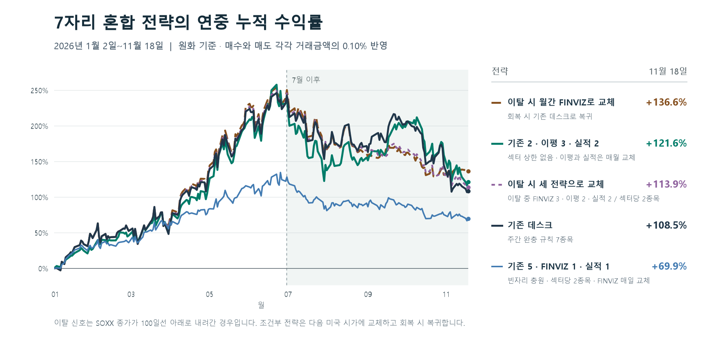

# 올해 7자리를 기존 전략·이평선·실적으로 나누면 어땠나

미국 정규장 2026년 1월 2일~11월 18일, 222거래일을 하나의 원화 평가 계좌로 이어서 계산했다. 6월 말에 원금을 초기화하지 않았다. ‘7월 이후’는 6월 30일 종가 대비 수익, ‘연중 최대낙폭’은 연초부터의 종가 고점 대비 최저점이다. 표의 비용 후 성과는 매수·매도 각각 거래대금의 0.10%를 차감한 값이다. 사용자의 실제 수수료 조건은 0이며 호가·환전 비용은 체결마다 달라질 수 있다.

**수익과 낙폭을 함께 보면, FINVIZ의 첫 활용처는 SOXX 100일선 이탈 때만 가동하는 월간 대체 바스켓이었다.** 기존 계좌의 비용 후 누적 +108.49%와 연중 최대낙폭 −40.27%가 각각 +136.64%, −35.26%가 됐다. 실적 자리를 꼭 포함하고 싶다면 이탈 때만 FINVIZ 3·이평선 2·실적 2로 전환해 섹터당 두 자리로 제한한 경우가 +113.91%, −38.77%였다. 이탈 기간에 평균 4.48개 섹터를 보유했고 기존 주간 전략을 그대로 둔 날은 174거래일이었다.

**연중 항상 섞고 손실 완화를 더 중시할 때**에는 기존 5·일간 FINVIZ 1·월간 실적 1에 다른 섹터 후보로 빈자리를 채운 규칙이 관심 대상이다. 7월 이후 −25.54%, 연중 최대낙폭 −28.89%로 손실을 줄였고, 비용 후 누적 +69.89%로 기존보다 수익은 낮았다. 연중 항상 섞으면서 누적에서도 기존을 이긴 기존 2·월간 이평선 3·월간 실적 2는 5월에 16거래일 내내 한 섹터에 전액 집중했다. 어느 목표를 우선하느냐에 따라 서로 다른 조합이 남았다.

## 같은 돈으로 종목을 어떻게 섞었나

| 선정 방식 | 해당 자리를 채우는 기준 |
|---|---|
| 기존 | 내 계좌·주문의 완충 규칙을 거친 실제 주간 7개 안에서 120거래일 모멘텀 순. 기존 전략 대조군은 원래 금액 비중, 혼합 전략은 자리당 월초 1/7 |
| 이평선 | 종가가 50일선·200일선 위이며 20일선이 50일선 위인 기업 중 종가가 200일선보다 높은 비율 순 |
| FINVIZ | 보내준 검색식 전체. 이평선 외에도 RSI(14)>40, 주가·거래량·시총·미국 기업·유동비율·부채비율·기관 지분 조건을 충족한 종목 중 상대거래량 순 |
| 실적 | 최신 분기 매출 전년비 증가 및 영업흑자를 확인한 기업. 최근 분기 매출 증가율에 직전 분기 대비 성장률 변화의 절반을 더해 순위 산출 |

선정에는 그날까지 공시된 값만 사용했다. 종가 신호를 다음 정규장 시가에 반영했다. 실적에 주가·이평선은 들어가지 않는다. 당시 SEC 공시 제출일 다음 달력일부터 신호에 사용할 수 있게 했다. 당해·전년의 독립 분기 매출을 맞췄으며 4분기 숫자를 직접 제공하지 않으면 연간에서 9개월 누계를 뺐다. SEC 907개 발행사의 5,249개 공시일 기록에서 일별 모집단 소속까지 확인한 실적 후보는 508~556개였다. [SEC 공시 자료 설명](https://www.sec.gov/search-filings/edgar-application-programming-interfaces)

일·주·월 중 각 방식이 맡은 주기에만 종목을 바꿨다. 한 달의 첫 거래일 시가에 각 자리의 자본을 다시 1/7로 맞췄고, 교체일 사이에는 가격에 따라 비중이 움직였다. 같은 회사 복수 주식종류는 중복 편입하지 않았다. 섹터 상한은 종목 수를 제한하므로 평가액 상한과 다르다. 대형주와 중형주의 섹터는 해당 월까지 알 수 있던 기록을, 지수 밖 TIME 종목 일부는 당시 사업분류에 대응한 대분류를 썼다.

## 연중 누적과 하반기 검증

| 방법 | 연중 수익·비용 0 | 연중 수익·비용 후 | 상반기·비용 후 | 7월 이후·비용 후 | 7월 이후 최대낙폭·비용 후 | 연중 최대낙폭·비용 후 |
|---|---:|---:|---:|---:|---:|---:|
| 기존 계좌 7종목 그대로 | +110.60% | +108.49% | +242.88% | −39.19% | −39.67% | −40.27% |
| 기존, SOXX 100일선 이탈 시 달러 현금 | +127.38% | +124.08% | +245.42% | −35.13% | −35.68% | −36.31% |
| 기존, 이탈 시 월간 FINVIZ로 교체 | +143.02% | +136.64% | +250.40% | −32.47% | −34.62% | −35.26% |
| 기존 3·주간 이평선 2·월간 실적 2, 섹터당 2 | −2.32% | −3.99% | +53.52% | −37.46% | −38.07% | −45.19% |
| 기존 3·주간 FINVIZ 2·월간 실적 2, 섹터당 2 | +13.80% | +10.17% | +85.69% | −40.67% | −41.89% | −43.03% |
| 기존 5·일간 FINVIZ 1·월간 실적 1, 섹터당 2 | +57.76% | +49.58% | +122.48% | −32.77% | −33.66% | −34.69% |
| 기존 5·월간 FINVIZ 1·월간 실적 1, 섹터당 2 | +53.38% | +52.00% | +107.32% | −26.68% | −27.50% | −28.14% |
| 기존 3·월간 이평선 3·월간 실적 1, 섹터 상한 없음 | +125.43% | +122.44% | +266.86% | −39.37% | −40.70% | −43.93% |
| 기존 2·월간 이평선 3·월간 실적 2, 섹터 상한 없음 | +124.10% | +121.62% | +241.62% | −35.13% | −36.70% | −39.57% |

원래 정한 584개 배분·주기·상한 조합 중 기존·실적·기술적 선정 방식을 모두 포함하고 섹터당 두 자리로 제한한 조합은 175개였다. 143개가 기존의 상반기 최대낙폭 기준을 통과했다. 그 안에서 상반기 수익만으로 선택한 조합은 기존 5·일간 FINVIZ 1·월간 실적 1이었다. 7월 이후 −32.77%로 기존보다 손실이 6.42%p 작았으나 누적 수익은 +49.58%였다. 하반기 수익과 하반기 최대낙폭을 모두 개선한 조합은 130/175, 연중 수익까지 기존을 앞선 조합은 0/175였다.

연중 사후 수익이 가장 높았던 섹터당 두 자리 조합은 기존 5·**월간** FINVIZ 1·월간 실적 1이었다. 연중 최대낙폭은 −28.14%였고 실제 보유는 평균 3.66종목, 하반기 시가 평균 주식 비중은 39.68%였다. 이 배분의 안정성에는 큰 현금 비중이 포함된다. 584개 전체의 연중 사후 1위는 섹터 상한 없는 기존 3·이평선 3·실적 1이었다. 종목 수는 평균 6.99였지만 평균 섹터 수는 2.25였고, 한때 한 섹터 평가 비중이 100%였다. 연중 최대낙폭도 기존보다 깊었다. 그 조합의 달러 이익은 초기 1달러당 MU +0.38, SNDK +0.28, AAOI +0.23달러에 집중됐다. [종목별 달러 손익](attribution.csv)

## 일곱 자리를 다른 섹터로 채웠을 때

섹터 상한 때문에 특정 자리의 주 후보가 모두 탈락하면 원래 규칙은 달러를 남긴다. 계산 후 이 효과를 분리하기 위해 동일한 전략 안의 다른 이평선·FINVIZ·실적 순위에서 다음 후보로 빈자리를 채웠다. 최초 배분은 각 자리의 우선권이며, 대체 편입일에는 실제 방식별 종목 수가 달라진다. 다음 해당 자리 점검일에는 원래 후보에 다시 우선권을 준다.

| 섹터당 최대 2개, 기존은 매주 | 빈자리 현금 시 연중 수익 | 다른 후보 충원 시 연중 수익 | 충원 시 7월 이후 수익 | 충원 시 연중 최대낙폭 | 충원 시 7종목 보유일 |
|---|---:|---:|---:|---:|---:|
| 기존 3·주간 이평선 2·월간 실적 2 | −3.99% | +4.72% | −41.85% | −43.45% | 222/222 |
| 기존 3·주간 FINVIZ 2·월간 실적 2 | +10.17% | +23.37% | −34.46% | −37.64% | 219/222 |
| 기존 5·월간 FINVIZ 1·월간 실적 1 | +52.00% | +58.65% | −30.85% | −32.89% | 199/222 |
| 기존 3·월간 이평선 3·월간 실적 1 | +37.39% | +20.84% | −34.05% | −37.96% | 222/222 |
| 기존 5·일간 FINVIZ 1·월간 실적 1 | +49.58% | +69.89% | −25.54% | −28.89% | 221/222 |

충원한 뒤 7개보다 적었던 날은 EA·HOLX 인수 정산 후 해당 자리의 정기 교체일을 기다린 기간이었다. 다섯 조합 중 마지막 조합의 7월 이후 손실은 기존보다 13.65%p 작았고 연간 거래대금 합계는 당시 순자산의 92.15배였다. [충원·현금 대조 원장](completion_results.csv)

섹터 상한을 3개로 완화한 추가 175개 조합에서도 연중 수익·하반기 수익·하반기 최대낙폭이 기존보다 모두 좋은 조합은 0개였다. 그중 연중 최고는 기존 2·주간 FINVIZ 4·월간 실적 1로 +66.73%, 7월 이후 −34.95%, 연중 최대낙폭 −37.65%였다. 이 조합은 222일 중 142일에 7개를 보유했다. 섹터 제한이 없을 때 세 기준을 모두 앞선 유일한 상시 혼합은 기존 2·월간 이평선 3·월간 실적 2였다. 평균 2.46개 섹터였고 5월 1~22일에는 정보기술 한 섹터에 모두 들어갔다. 같은 배분에 섹터당 3종목 상한을 걸면 평균 4.14개 섹터, 연중 +30.48%, 7월 이후 −41.72%였다. [섹터 상한 3개 재검증](robustness.csv)

## 시장이 이탈한 동안만 여러 선발 방식을 섞었을 때

SOXX 종가가 자기 100거래일 단순이동평균 이상이면 기존 실제 계좌 규칙을 따랐다. 아래로 내려가면 다음 미국 시가에 대체 포트폴리오로 전환하고 종가가 선 이상으로 회복하면 다음 시가에 기존 계좌로 복귀했다. 대체 포트폴리오는 매달 첫 거래일 시가에 갱신하고, 중간에 이탈하면 그 시점에 알 수 있는 기존 월간 종목과 당시 비중을 적용했다.

| 이탈 중 보유 방식 | 연중 수익·비용 후 | 7월 이후 수익 | 7월 이후 최대낙폭 | 연중 최대낙폭 | 이탈 중 평균 종목 / 섹터 |
|---|---:|---:|---:|---:|---:|
| 기존 유지 | +108.49% | −39.19% | −39.67% | −40.27% | 7.00 / 1.04 |
| 달러 현금 | +124.08% | −35.13% | −35.68% | −36.31% | 0 / 0 |
| 기존 연구의 FINVIZ 월간 7자리 | +136.64% | −32.47% | −34.62% | −35.26% | 6.65 / 3.60 |
| FINVIZ 3·이평선 2·실적 2 | +122.27% | −36.89% | −37.05% | −37.67% | 6.92 / 3.12 |
| FINVIZ 3·이평선 2·실적 2, 이탈 중 섹터당 2 | +113.91% | −38.16% | −38.16% | −38.77% | 6.33 / 4.48 |
| 이평선 5·실적 2 | +121.97% | −36.58% | −38.16% | −38.77% | 7.00 / 2.56 |
| 실적 7 | +79.43% | −49.70% | −53.10% | −53.56% | 7.00 / 2.35 |

이탈은 3월 30~31일(2거래일), 7월 30일(1일), 8월 25~27일(3일), 8월 31일~9월 21일(15일), 10월 13일~11월 18일(27일)로 총 5회·48거래일이었다. 특히 하반기에 46일이 몰렸고 마지막 구간은 평가일에도 진행 중이었다. 시장 신호를 매일 확인하는 것과 종목을 매일 교체하는 것은 별개다. 원래 FINVIZ 교체 대조와 신규 월간 FINVIZ 단독 구현(+136.97%) 사이의 0.33%p 차이는 11월 합병 종료 종목 자리 충원 방식에서 발생했다. 실적을 포함한 여섯 이탈 중 혼합은 모두 종전 월간 FINVIZ 전환의 연중 수익·하반기 수익에 미치지 못했다. [이탈 중 구성 12개와 대조군](conditional_results.csv)

## 해석 범위와 재실행

- FINVIZ 표본은 월별 대형주와 연초 이전에 공개된 고정 중형주 401개다. 특정 날짜의 실제 FINVIZ 결과 목록 전체를 보유하지 않아 당시 재무 공시, 13F 기관보유 근사, 종가 상대거래량으로 복원했다. 실시간 FINVIZ 상대거래량에는 장중 시간 조정이 있다. 현재 화면의 결과를 과거 날짜에 소급하지 않았다. [FINVIZ 공식 정의](https://finviz.com/help/screener)
- 기존 계좌는 검증 가능한 모델 수익이다. 현금은 달러이며 원화 환산 시 환율의 영향을 받는다. 배당, 세금, 환전 체결, 현금 이자는 제외했다. 합병 21건은 확정된 현금·교부주식 시가로 평가했고, 가격 없는 권리는 제외했다. 재무 태그가 비교되지 않는 은행 등은 실적 후보에서 빠질 수 있고 인수합병 매출 효과도 포함할 수 있다. 영업흑자는 자격 조건이며 애널리스트 예상 대비 어닝 서프라이즈를 측정하지 않았다.
- D 3·기술 2·실적 2 두 가지에서 기존 자리만 SOXX 100일선으로 대피시키면 연중 비용 후 수익은 순수 이평선 조합 +2.29%, FINVIZ 조합 +16.65%였다. FINVIZ 조합에서 기존 자리에 추세 A 이상, 거인의 어깨 개별 회복 A 이상, 둘 다 A 이상을 추가하면 연중 −2.63%, +9.04%, +2.04%였다. 이 8개 경로는 주 배분 선택에 포함하지 않았다. [등급별 일자 원장](selected_daily.csv)
- 가격과 2026년 하락 구간을 이미 본 뒤 설계했고, 여러 배분이 같은 종목과 기간을 공유한다. 연중 최고와 사후 추가 실험은 독립 검증이 아니다. 상반기로 고른 포트폴리오와 비교했고 향후 거래일이 별도 검증 표본이다. 단일 연도 결과로 향후 초과 수익이나 손실 한도를 보장할 수 없다.
- 재현은 이 폴더의 `experiment.py`로 주 분석을, `completion.py`·`conditional.py`·`robustness.py`로 추가 분석을, `chart.py`로 그림을 만든다. 입력은 저장된 파일을 사용하며 전체 가격 원장을 다시 만들 필요가 없다. [사전 설계](protocol.md) · [선택 결과](selection.json) · [실적 데이터 검증](earnings_coverage.json)
