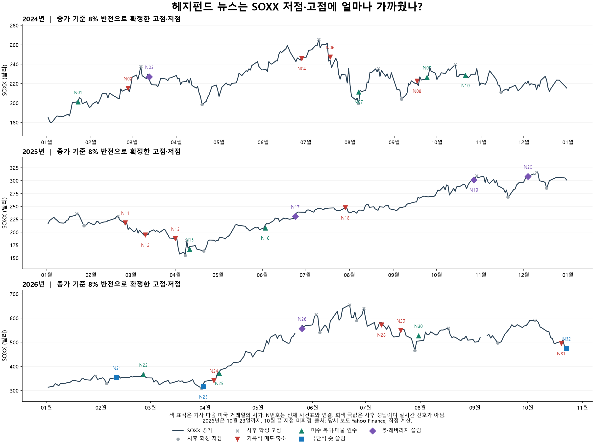

# SOXX 2024·2025·2026: 최초 헤지펀드 뉴스 가설의 저점·고점 판단력

기준: 2026-10-23 미국 정규장 종가까지. 분석일: 2026-10-25. **사후 뉴스 사례 연구이며 실제 매매 기록이나 전방 검증이 아니다.**

**결론: “기록적으로 많이 팔았다”를 곧바로 바닥으로 읽는 해석은 약했다. 실제 매수 복귀·숏 청산·매물 인수 보도는 이후 반등 방향에 더 유용했지만, 정확한 바닥 식별과 실행 가능한 수익은 별개의 문제였다. 고점 경고가 맞은 사례도 있으나 시점을 일반화하기에는 표본이 작다.**

최초 사용자 요약의 관측 가능한 부분—헤지펀드 청산, 숏 쏠림, 매수 재개, 주가·국채금리 동반 하락—을 검사했다. 고점 검사는 롱·레버리지 쏠림을 반대로 해석한 확장이다. 국채 숏·AI 롱이 실제 같은 펀드의 짝거래였는지, 언론과 공모했는지는 이 자료로 식별하지 못한다. 처음 요약의 원방송·원문 링크가 없어 문홍철 본인의 정확한 표현도 확인한 것은 아니다.

**평가 방법과 표본**

- 가격: 2024년 252일, 2025년 250일, 2026년 204일, 총 706 미국 거래일. Yahoo Finance의 분할 반영·배당 미포함 OHLC. SOXX 주 대상, QQQ·SPY 대조. XNYS 휴장일 적용.
- 뉴스: Google News RSS 검색 15회로 659행·644개 고유 제목을 수집한 뒤 보완 검색과 본문 확인으로 32건을 선정했다. **전체 제목을 전수 판독해 뽑은 완전한 뉴스 표본이 아니다.** 동일 월간 TMT 매도 재보도 1건을 빼면 31건, 같은 종류의 5거래일 내 후속 보도를 묶으면 29개 신호다. 이 중 5일 평가 완료는 27개다.
- 기사 결과표를 만들기 전에 날짜·분류·포함 여부를 동결했다. 다만 이전 7월 사례 분석과 알려진 시장 경로를 이미 보았으므로 맹검이 아니다. 이 표본의 비율을 미래의 바닥 확률로 쓰지 않는다.
- 진입 기준은 확인한 기사 **뉴욕 날짜 다음 정규장 시가**, 주 평가 끝은 진입일 포함 **5번째 거래일 종가**다. 초판의 해당 문장을 확인하지 못한 2026-04-01/02 수정 기사는 수정일 4/2를 썼다. 7/31 오전 싱가포르 보도는 뉴욕 7/30 밤이므로 다음 장은 7/31이다.
- 실제 저점·고점 정답은 종가가 반대 방향으로 8% 움직여 확정된 극값이다. 12%도 확인했다. 기사 다음 장이 그 극값의 ±5거래일 안이면 근접으로 집계한다. **극값은 사후 정답이며 신호로 사용하지 않는다.** 마지막 미확정 저점은 제외했다.
- 대조군은 같은 연도의 모든 거래일 및 직전 20일 고점 대비 낙폭 구간(0~5%, 5~10%, 10% 이상)이 같은 거래일이다. 수익률만 양수라고 유용하다고 판정하지 않는다.
- 시험 범위: 뉴스 4종류, 주가·금리 조건 1종류, 주가 하락만인 대조 1종류. 기간 1·3·5·10·20일(주 판단 5일), 극값 문턱 8%·12%, 근접 창 ±5일. 임계값 최적화 0회. 추가로 D/S와 금리 조건의 교집합 1개를 설명용으로 계산했으며 등록된 독립 전략처럼 평가하지 않았다.
- 수수료는 사용자 조건에 따라 0원이나 스프레드·슬리피지는 미반영이다. 미국 종가는 사용자의 KST 08~24시 주문 가능 시간 밖이므로 본표는 예측력 평가다. 5번째 장 **시가**까지의 비교도 별도 남겼다. 배당 포함 수익률·연속 투자 CAGR·실현손익이 아니다.



**주 결과: 방향을 맞혔는가, 극값에 가까웠는가**

| 기사 종류 | 5일 방향 적중 | 평균 SOXX 변화 | 낙폭 맞춘 대조 방향 적중 | 극값 ±5일 | 그중 극값 이전·당일 / 이후 |
|---|---:|---:|---:|---:|---:|
| 기록적 매도·디레버리징 → 저점 | 5/11 (45.5%) | -1.46% | 60.1% | 2/11 | 1 / 1 |
| 극단적인 숏 쏠림 → 저점 | 2/2 (100.0%) | +5.18% | 61.7% | 2/2 | 0 / 2 |
| 매수 복귀·숏 청산·매물 인수 → 회복 | 7/9 (77.8%) | +1.61% | 59.2% | 3/9 | 1 / 2 |
| 롱·레버리지 쏠림 → 고점 | 1/5 (20.0%) | +1.23% | 40.3% | 3/5 | 2 / 1 |

T의 방향 적중은 주가 하락이다. T의 평균 변화가 +1.23%라는 것은 고점 경고 이후에도 평균적으로 더 올랐다는 뜻이다. R의 7/9 상승은 저점 7개를 맞혔다는 뜻이 아니다. R의 실제 저점 근접은 3/9이고 2개는 저점이 지난 뒤였다.

R은 낙폭을 맞춘 대조군 평균 +0.94%보다 +0.67%p 높았지만, 표본은 9개뿐이다. 상승 비율의 기술적 Wilson 95% 구간은 약 45~94%로 넓고 뉴스가 같은 국면에 몰려 독립표본 가정도 약하다. 2026년 R만 보면 2/3 상승·평균 +0.23%로, 같은 해 낙폭 대조 평균 +1.12%보다 낮다. 3개년 평균을 현재 장세에 그대로 붙일 수 없다.

R의 5번째 장 시가까지는 상승 6/9, 평균 +0.99%다. 5일 종가 수익률을 실제 체결 가능한 수익률로 부르지 않는다. 관찰 기간 중 최저 장중 가격은 R 평균 −3.59%, 최악 −9.64%였다. 최종적으로 오른 경우에도 중간 손실이 있었다.

**연도별 분리**

| 연도 | 기록적 매도 D | 매수 복귀 R | 숏 쏠림 S | 롱·레버리지 T |
|---|---|---|---|---|
| 2024 | 3/4 · +0.90% | 4/4 · +1.79% | 해당 표본 없음 | 1/1 · -4.53% |
| 2025 | 1/4 · -4.89% | 1/2 · +3.31% | 해당 표본 없음 | 0/3 · +2.66% |
| 2026 | 1/3 · -0.01% | 2/3 · +0.23% | 2/2 · +5.18% | 0/1 · +2.68% |

숫자는 방향 적중/평가 완료 기사 수 · 평균 5일 SOXX 변화다. 2024·2025에 S 사례가 없는 것은 실제로 그런 보도가 없었다는 뜻이 아니라 이번 검증 표본에 없다는 뜻이다.

**처음 뉴스와 비교할 핵심 사례**

| 기사 | 다음 장부터 5일 | 판단 |
|---|---:|---|
| 2024-07-17 [미국 주식 5일 매도 2022년 이후 최대](https://www.investing.com/news/stock-market-news/hedge-funds-shed-risk-in-tech-megacap-selloff-goldman-says-3523914) | -7.17% | 청산이 컸지만 바닥까지 14거래일이나 남았다. 기록적 매도=바닥은 실패. |
| 2024-08-06 [급락 중 기술주 저가 매수](https://www.marketscreener.com/news/latest/Hedge-funds-buy-the-dip-amid-market-bloodbath-says-Goldman-47569424/) | +4.80% | 다음 장이 종가 저점 당일. 매수 복귀가 저점 부근의 유효한 단서였던 사례. |
| 2025-03-31 [기술주 매도 6개월 최대](https://ca.investing.com/news/economy-news/hedge-funds-flee-techs-stocks-before-tariffs-take-hold-says-goldman-sachs-3930487) | -13.97% | 저점까지 5거래일 이내였지만 5일 −13.97%, 장중 최대 −20.88%. 저점 근접과 손실 회피는 다르다. |
| 2025-04-10 [관세 유예 후 일부 숏커버](https://whbl.com/2025/04/10/hedge-funds-miss-most-of-the-relief-rally-in-equities/) | -0.26% | 4/8 저점 뒤였지만 5일 −0.26%; 10일 +10.68%. 기간을 바꾸어 성공으로 고르지 않고 둘 다 표시. |
| 2025-10-24 [AI 하드웨어 노출 기록적 수준](https://www.investing.com/news/economy-news/hedge-funds-boost-ai-tech-bets-to-highest-since-2016-goldman-sachs-says-4306845) | +1.70% | 기사 다음 장에서 2거래일 뒤 10/29 고점. 5일은 +1.70%지만 20일 −10.15%: 중기 고점 경고로는 맞았다. |
| 2025-12-03 [주식 총레버리지 최고권](https://www.investing.com/news/stock-market-news/hedge-funds-double-down-using-nearrecord-leverage-in-quest-to-boost-returns-4388757) | +2.76% | 다음 장에서 4거래일 뒤 12/10 고점. 5일 +2.76%, 10일 −7.34%, 20일 +1.90%. 시간창에 민감. |
| 2026-02-24 [기술주 매수 복귀](https://www.investing.com/news/economy-news/hedge-funds-creep-back-into-tech-stocks-after-weeks-of-selling-4520708) | -8.58% | 매수 복귀라는 같은 종류의 기사였지만 5일 −8.58%. 매수 전환도 실패한다. |
| 2026-03-30 [과도한 매도·숏 이후 반등 가능성](https://newsdig.tbs.co.jp/articles/withbloomberg/2565069?display=1) | +10.19% | 3/30 저점 다음 날 평가 시작. 5일 +10.19%. 선행 예측보다 저점 직후 반등 단서. |
| 2026-04-08 [미국 주식 숏 청산 2020년 이후 최대](https://newsdig.tbs.co.jp/articles/withbloomberg/2587814?display=1) | +8.23% | 3/30 저점에서 7거래일 뒤 평가 시작. 바닥을 놓친 대신 반등 지속 단서. |
| 2026-07-20 [미국 기술주 8주 축소 기록적](https://www.bloomberg.com/news/articles/2026-07-20/goldman-says-hedge-funds-sell-us-tech-stocks-at-record-pace) | -5.99% | 7/29 종가 저점보다 6거래일 앞서 시작. 그 사이 주가가 더 하락했다. |
| 2026-07-30 [Citadel의 대규모 매물 인수](https://www.businesstimes.com.sg/international/global/citadel-buys-most-hedge-fund-situational-awareness-stock-holdings-after-ai-share-rout-sources) | +1.03% | 저점 2거래일 뒤 평가. 매물 인수는 유효한 회복 단서였으나 시장 개장 갭을 공짜 수익으로 잡을 수 없다. |

7월 매물 인수 보도 뒤 계산은 7/31 시가 **527.10달러 → 8/6 종가 532.52달러 = +1.03%**다. 7/29 종가 465달러부터의 상승이나 7/31 종가 504.89달러부터의 상승을 이 신호의 수익으로 가져오지 않았다. 다음 개장 전에 이미 반등한 몫을 제거한 결과다. 이 구간 중 최저가는 485.71달러, 시가 대비 −7.85%였다.

**고점 경고에 대한 추가 확인 — 주 통계와 분리**

주 결과를 산출한 뒤, 이전 자료 목록에 있던 6월 경고의 원문을 더 확인했다. [2026-06-21 BeInCrypto 기사](https://beincrypto.com/165-billion-stock-selloff-goldman-leverage/)는 GS 순레버리지 4년 최고와 JPM의 분기말 매도 예상 시나리오를 함께 전했다. 다음 미국 거래일 6/22는 실제 종가 고점이었고, 그날 시가부터 5일 **−9.79%**, 20일 **−19.85%**였다. **잘 맞은 경고 사례가 실제로 있다.** 다만 원 은행 노트 미확인인 2차 보도이고, 분기말 연기금 매도 전망을 헤지펀드 실제 청산량으로 읽어서는 안 된다. 가격 결과를 본 뒤 추가 검증한 사례이므로 앞 표의 적중률에 섞지 않았다. 따라서 주 표본의 2026년 고점 포착 0/7을 전체 뉴스가 실패했다는 증거로 해석해서도 안 된다.

또한 [GS 공식 2026-05-22 설명](https://www.goldmansachs.com/insights/articles/how-hedge-funds-are-trading-semiconductor-stocks)은 반도체 이익 실현, 지수·ETF 숏 증가, 총레버리지 사상 최고가 함께 관측됐다고 설명하면서 순레버리지는 비교적 평탄했다고 밝혔다. 총레버리지 최고만으로 “매수 쏠림의 꼭대기”라고 읽기 어려운 직접 근거다. 이 자료 역시 주 통계에 사후 추가하지 않았다.

**주가와 국채 금리가 함께 하락하는 조건**

5거래일 SOXX 변화<0, 미국 10년 금리 변화<0이 처음 함께 켜진 뒤 다음 장부터 평가했다. 같은 조건이 이어진 모든 날을 별개 성공으로 세지 않았으며 신호 간 최소 5거래일 간격을 뒀다.

| 연도 | 방향 적중 | 평균 5일 변화 |
|---|---:|---:|
| 2024 | 9/14 (64.3%) | +0.18% |
| 2025 | 16/22 (72.7%) | +1.55% |
| 2026 | 8/12 (66.7%) | +2.23% |
| 합계 | 33/48 (68.8%) | +1.32% |

같은 연도·낙폭의 대조군 상승 비율은 59.8%, 평균 +0.59%였다. 주가 하락만의 첫 발생을 쓰면 상승 37/59(62.7%), 평균 +0.79%다. 두 조건의 첫 발생 날짜가 달라 이는 단순한 독립 효과 추정이 아니다. 주가·금리 조건이 실제 저점 ±5일에 있던 경우는 13/48(27.1%)였다. **반등 쪽 보조 단서일 수 있으나 바닥 날짜를 특정하는 힘은 약하다.**

뉴스 D/S와 이 조건이 겹친 완료 사례는 4건(2024-07-17, 2025-02-24, 2025-03-31, 2026-07-20)이며 5일 후 모두 하락, 평균 −8.76%였다. 이는 설명용 교집합 검사다. “금리도 떨어지고 헤지펀드도 많이 팔았으니 청산 종료”라는 결합 해석은 이 사례들에서는 맞지 않았다.

특정 금리 4.8%가 보편적인 종료선이었다는 근거도 없다. 8% 기준으로 확정된 SOXX 저점 당시 10년 금리는 2024년 3.710~4.615%, 2025년 4.106~4.528%, 2026년 4.275~4.961%였다. 2026년 7월 저점은 4.622%였다. 원문 4.8%는 특정 국면 전망으로 따로 검증해야 한다.

**실제 전환점을 얼마나 놓쳤는가**

| 연도 | 확정 저점 / 표본 뉴스가 ±5일에 있었던 저점 | 확정 고점 / 표본 뉴스가 ±5일에 있었던 고점 |
|---|---:|---:|
| 2024 | 4개 / 1개 | 4개 / 1개 |
| 2025 | 5개 / 2개 | 5개 / 2개 |
| 2026 | 6개 / 3개 | 7개 / 0개 |

합계 저점 15개 중 6개, 고점 16개 중 3개에만 동결 뉴스 표본이 근접했다. 12% 반전으로 바꾸면 저점 8개 중 4개, 고점 9개 중 2개다. 이것은 **수집한 표본의 포착률**이며 당시 공개 뉴스 전체의 포착률이 아니다. 보도 하나가 두 개의 가까운 극값 창에 들어갈 수 있어 기사별 근접 건수와 극값별 포착 건수는 다르다.

중복 군집 처리를 하지 않아도 큰 결론은 같다. D는 6/12 상승, R 7/9 상승, S 2/2 상승, T 2/6 하락이다. 임계값·군집 처리의 유리한 버전만 고르지 않았다.

**현재 10월 자료와 뉴스 시스템에 남길 해석**

- 10/19 기록적 기술주 매도는 D에 해당한다. 청산 진행을 보여 주지만, 그 자체를 완료·바닥으로 바꾸지 않는다.
- 10/22 숏 쏠림은 S에 해당한다. 반등 연료가 될 수 있으나 완료 과거 사례는 이번 표본에서 2개뿐이다. 10/23까지는 해당 뉴스 후 5일 평가가 끝나지 않았다.
- 매수 복귀·실제 숏 청산·매물 인수는 R로 별도 기록한다. 방향 판단에 상대적으로 나았으나 “전체 청산 종료”나 “바닥 확정”으로 올리지 않는다. 기사 내 다른 증권사 표본의 반대 흐름도 보존한다.
- 높은 레버리지·반도체 쏠림은 고점 위험 경고로 남길 이유가 있다. 2025년 10월과 2026년 6월의 유효 사례처럼 이후 청산 촉발 요인을 함께 읽되, 레버리지 수준 하나로 날짜를 정하지 않는다. 이 결합 해석 자체의 독립 검증은 아직 하지 않았다.
- 11/15 청산 완료·AI 재매수 전망은 2026-10-25 현재 미래라 성패를 채점하지 못한다. 2024·2025는 미국 중간선거 해가 아니므로 3년 사례를 그 선거 주장 검증으로 바꿀 수 없다. 코어위브 CDS/회사채의 일관된 과거 시계열도 미확보여서 시험하지 않았다.
- 이번 결과를 연구 근거로 저장했으며 자동 점수·비중·주문 규칙을 바꾸지 않았다. 뉴스의 종류를 구분해 기록하는 근거는 되지만, 검증된 바닥 확률 모델은 아니다.

**전체 기사 결과표**

D/S/R은 상승, T는 하락을 기대했다. 근접 극값은 종류에 맞는 가장 가까운 8% 극값이다. 거리 −는 극값 이전, +는 이후이며 모두 거래일이다. 평가 미완료 10월 기사는 거리를 해석하지 않는다.

| ID | 뉴욕 기사 날짜 | 분류 | 다음 장 | 5일 | 10일 | 20일 | 가까운 극값·거리 | 주 통계 | 기사 |
|---|---|---|---|---:|---:|---:|---|---|---|
| N01 | 2024-01-22 | R | 2024-01-23 | +0.09% | +0.20% | +1.85% | 2023-12-06 · +31일 | 포함 | [미국 기술주 매수 전환](https://www.investing.com/news/economy/hedge-funds-uturn-on-tech-sell-everything-else--goldman-3279264) |
| N02 | 2024-02-26 | D | 2024-02-27 | +6.30% | +4.56% | +4.31% | 2024-04-19 · -37일 | 포함 | [기술주 매도 8개월 최대](https://www.streetinsider.com/General%2BNews/Hedge%2Bfunds%2Bcall%2Btime%2Bon%2Btech%2Brally%2C%2Bbanks%2Bsay/22832889.html) |
| N03 | 2024-03-12 | T | 2024-03-13 | -4.53% | -1.84% | -2.89% | 2024-03-07 · +4일 | 포함 | [주식 레버리지 사상 최고권](https://www.investing.com/news/economy/hedge-funds-ramp-up-leverage-to-near-record-highs-to-juice-returns-3333666) |
| N04 | 2024-06-27 | D | 2024-06-28 | +3.62% | +5.71% | -6.70% | 2024-08-07 · -27일 | 포함 | [6월 TMT 기록적 순매도](https://www.investing.com/news/stock-market-news/hedge-funds-aggressively-sold-tech-stocks-in-june--goldman-sachs-3499347) |
| N05 | 2024-07-01 | D | 2024-07-02 | +5.82% | +6.77% | -10.04% | 2024-08-07 · -25일 | 같은 자료 중복 | [6월 TMT 기록적 순매도 재보도](https://www.investing.com/news/stock-market-news/hedge-funds-dump-tech-stocks-at-fastest-pace-since-2016-bank-shows-3504609) |
| N06 | 2024-07-17 | D | 2024-07-18 | -7.17% | -4.86% | -10.64% | 2024-08-07 · -14일 | 포함 | [미국 주식 5일 매도 2022년 이후 최대](https://www.investing.com/news/stock-market-news/hedge-funds-shed-risk-in-tech-megacap-selloff-goldman-says-3523914) |
| N07 | 2024-08-06 | R | 2024-08-07 | +4.80% | +9.72% | +1.28% | 2024-08-07 · +0일 | 포함 | [급락 중 기술주 저가 매수](https://www.marketscreener.com/news/latest/Hedge-funds-buy-the-dip-amid-market-bloodbath-says-Goldman-47569424/) |
| N08 | 2024-09-16 | D | 2024-09-17 | +0.85% | +3.57% | +7.70% | 2024-09-06 · +7일 | 포함 | [세계 주식 9주 매도·속도 5개월 최대](https://ca.finance.yahoo.com/news/hedge-funds-switch-buying-banks-071331325.html) |
| N09 | 2024-09-23 | R | 2024-09-24 | +1.78% | +1.72% | +1.05% | 2024-09-06 · +12일 | 포함 | [미국 기술주 매수 4개월 최대](https://www.streetinsider.com/Reuters/Hedge%2Bfunds%2Bsnap%2Bup%2BUS%2Btech%2Bstocks%2Bamid%2Bfalling%2Brates%2C%2Bsays%2BGoldman%2BSachs/23748732.html) |
| N10 | 2024-10-20 | R | 2024-10-21 | +0.50% | -3.44% | -7.54% | 2024-11-15 · -19일 | 포함 | [기술주 3주 순매수·숏커버](https://www.tbsnews.net/world/global-economy/hedge-funds-snap-tech-stocks-fastest-pace-five-months-971151) |
| N11 | 2025-02-24 | D | 2025-02-25 | -7.92% | -11.00% | -6.02% | 2025-01-27 · +20일 | 포함 | [TMT 포지션 축소 6개월 최대](https://finance.yahoo.com/news/hedge-funds-exit-tech-media-132803047.html) |
| N12 | 2025-03-10 | D | 2025-03-11 | +5.10% | +5.54% | -17.09% | 2025-04-08 · -20일 | 포함 | [개별주 포지션 축소 2년 최대](https://www.investing.com/news/stock-market-news/hedge-funds-cut-risk-in-stocks-at-largest-amount-in-two-years-goldman-sachs-says-3919038) |
| N13 | 2025-03-31 | D | 2025-04-01 | -13.97% | -7.50% | -2.64% | 2025-04-08 · -5일 | 포함 | [기술주 매도 6개월 최대](https://ca.investing.com/news/economy-news/hedge-funds-flee-techs-stocks-before-tariffs-take-hold-says-goldman-sachs-3930487) |
| N14 | 2025-04-07 | D | 2025-04-08 | +3.44% | -0.49% | +11.41% | 2025-04-08 · +0일 | 5일 내 같은 종류 군집 | [마진콜 우려·포지션 대거 청산](https://www.investing.com/news/stock-market-news/hedge-funds-capitulate-investors-brace-for-margin-calls-in-market-rout-3969776) |
| N15 | 2025-04-10 | R | 2025-04-11 | -0.26% | +10.68% | +16.15% | 2025-04-08 · +3일 | 포함 | [관세 유예 후 일부 숏커버](https://whbl.com/2025/04/10/hedge-funds-miss-most-of-the-relief-rally-in-equities/) |
| N16 | 2025-06-02 | R | 2025-06-03 | +6.87% | +9.27% | +14.16% | 2025-04-21 · +30일 | 포함 | [세계 주식·AI 기술주 매수 확대](https://www.investing.com/news/economy-news/hedge-funds-buy-stocks-at-quickest-pace-since-nov-2024-goldman-sachs-says-4075189) |
| N17 | 2025-06-23 | T | 2025-06-24 | +3.53% | +5.54% | +5.63% | 2025-04-09 · +51일 | 포함 | [총레버리지 5년 최고](https://www.investing.com/news/economy-news/hedge-fund-leverage-reaches-fiveyear-high-buying-bank-stocks-goldman-sachs-says-4105124) |
| N18 | 2025-07-28 | D | 2025-07-29 | -2.79% | -1.97% | +0.49% | 2025-04-21 · +68일 | 포함 | [기술주 매도 12개월 최대](https://www.investing.com/news/economy-news/hedge-funds-ditch-tech-and-buy-essentials-goldman-sachs-says-4154628) |
| N19 | 2025-10-24 | T | 2025-10-27 | +1.70% | -2.34% | -10.15% | 2025-10-29 · -2일 | 포함 | [AI 하드웨어 노출 기록적 수준](https://www.investing.com/news/economy-news/hedge-funds-boost-ai-tech-bets-to-highest-since-2016-goldman-sachs-says-4306845) |
| N20 | 2025-12-03 | T | 2025-12-04 | +2.76% | -7.34% | +1.90% | 2025-12-10 · -4일 | 포함 | [주식 총레버리지 최고권](https://www.investing.com/news/stock-market-news/hedge-funds-double-down-using-nearrecord-leverage-in-quest-to-boost-returns-4388757) |
| N21 | 2026-02-09 | S | 2026-02-10 | +0.16% | +2.41% | -4.16% | 2026-02-04 · +4일 | 포함 | [미국 개별주 숏 증가 기록적](https://alphatack.com/goldman-says-hedge-funds-add-record-shorts-on-us-stocks-in-rout/) |
| N22 | 2026-02-24 | R | 2026-02-25 | -8.58% | -7.48% | -6.88% | 2026-02-04 · +14일 | 포함 | [기술주 매수 복귀](https://www.investing.com/news/economy-news/hedge-funds-creep-back-into-tech-stocks-after-weeks-of-selling-4520708) |
| N23 | 2026-03-30 | S | 2026-03-31 | +10.19% | +27.14% | +39.01% | 2026-03-30 · +1일 | 포함 | [과도한 매도·숏 이후 반등 가능성](https://newsdig.tbs.co.jp/articles/withbloomberg/2565069?display=1) |
| N24 | 2026-04-02 | D | 2026-04-06 | +13.20% | +21.72% | +36.38% | 2026-03-30 · +4일 | 포함 | [세계 주식 매도 13년 최대](https://www.investing.com/news/stock-market-news/hedge-funds-face-worst-monthly-drawdown-in-over-four-years-goldman-sachs-tells-clients-4594474) |
| N25 | 2026-04-08 | R | 2026-04-09 | +8.23% | +16.29% | +36.51% | 2026-03-30 · +7일 | 포함 | [미국 주식 숏 청산 2020년 이후 최대](https://newsdig.tbs.co.jp/articles/withbloomberg/2587814?display=1) |
| N26 | 2026-05-25 | T | 2026-05-26 | +2.68% | +2.60% | +8.33% | 2026-06-03 · -6일 | 포함 | [기술주 보유 노출 기록적](https://www.investing.com/news/economy-news/hedge-fund-tech-positions-hover-near-record-highs-goldman-sachs-says-4708371) |
| N27 | 2026-06-01 | T | 2026-06-02 | -2.34% | +7.40% | +9.50% | 2026-06-03 · -1일 | 5일 내 같은 종류 군집 | [순레버리지·롱숏 비율 최고권](https://finance.yahoo.co.jp/news/detail/5d212e6084b6002ab369111f5447078e4a688ca0) |
| N28 | 2026-07-09 | D | 2026-07-10 | -7.25% | -3.63% | -6.90% | 2026-06-26 · +9일 | 포함 | [AI 롱 청산·레버리지 최저권](https://www.investing.com/news/stock-market-news/ai-selloff-drives-quant-funds-worst-performance-since-august-4784336) |
| N29 | 2026-07-20 | D | 2026-07-21 | -5.99% | -7.54% | +1.82% | 2026-07-29 · -6일 | 포함 | [미국 기술주 8주 축소 기록적](https://www.bloomberg.com/news/articles/2026-07-20/goldman-says-hedge-funds-sell-us-tech-stocks-at-record-pace) |
| N30 | 2026-07-30 | R | 2026-07-31 | +1.03% | +4.48% | -0.32% | 2026-07-29 · +2일 | 포함 | [Citadel의 대규모 매물 인수](https://www.businesstimes.com.sg/international/global/citadel-buys-most-hedge-fund-situational-awareness-stock-holdings-after-ai-share-rout-sources) |
| N31 | 2026-10-19 | D | 2026-10-20 | 미완료 | 미완료 | 미완료 | 평가 중 | 포함 | [미국 기술주 매도 10년 최대](https://www.bloomberg.com/news/articles/2026-10-19/hedge-funds-cut-tech-at-fastest-pace-in-a-decade-goldman-says) |
| N32 | 2026-10-22 | S | 2026-10-23 | 미완료 | 미완료 | 미완료 | 평가 중 | 포함 | [숏 비중 5년 99백분위](https://www.bloomberg.com/news/articles/2026-10-22/hedge-funds-pile-into-shorts-as-goldman-flags-stock-squeeze-risk) |

**전체 실제 고점·저점 — 사후 정답표**

| 날짜 | 종류 | 종가 | 8% 반전 확인일 | ±5일 동결 뉴스 ID |
|---|---|---:|---|---|
| 2024-03-07 | 고점 | 237.75 | 2024-03-18 | N03 |
| 2024-04-19 | 저점 | 198.39 | 2024-04-26 | 없음 |
| 2024-07-10 | 고점 | 265.49 | 2024-07-17 | 없음 |
| 2024-08-07 | 저점 | 199.29 | 2024-08-13 | N07 |
| 2024-08-21 | 고점 | 235.34 | 2024-09-03 | 없음 |
| 2024-09-06 | 저점 | 203.93 | 2024-09-13 | 없음 |
| 2024-10-14 | 고점 | 239.80 | 2024-10-31 | 없음 |
| 2024-11-15 | 저점 | 211.21 | 2025-01-06 | 없음 |
| 2025-01-22 | 고점 | 235.81 | 2025-01-27 | 없음 |
| 2025-01-27 | 저점 | 212.55 | 2025-02-19 | 없음 |
| 2025-02-20 | 고점 | 231.07 | 2025-02-27 | 없음 |
| 2025-04-08 | 저점 | 154.86 | 2025-04-09 | N13,N15 |
| 2025-04-09 | 고점 | 183.62 | 2025-04-10 | 없음 |
| 2025-04-21 | 저점 | 163.64 | 2025-04-24 | N15 |
| 2025-10-29 | 고점 | 309.60 | 2025-11-17 | N19 |
| 2025-11-20 | 저점 | 268.10 | 2025-11-26 | 없음 |
| 2025-12-10 | 고점 | 316.33 | 2025-12-17 | N20 |
| 2025-12-17 | 저점 | 285.23 | 2026-01-02 | 없음 |
| 2026-01-29 | 고점 | 361.13 | 2026-02-04 | 없음 |
| 2026-02-04 | 저점 | 330.38 | 2026-02-11 | N21 |
| 2026-02-25 | 고점 | 368.00 | 2026-03-03 | 없음 |
| 2026-03-30 | 저점 | 309.79 | 2026-04-01 | N23,N24 |
| 2026-06-03 | 고점 | 615.68 | 2026-06-05 | 없음 |
| 2026-06-05 | 저점 | 539.77 | 2026-06-11 | 없음 |
| 2026-06-22 | 고점 | 655.01 | 2026-06-24 | 없음 |
| 2026-06-26 | 저점 | 589.94 | 2026-06-30 | 없음 |
| 2026-06-30 | 고점 | 640.76 | 2026-07-02 | 없음 |
| 2026-07-29 | 저점 | 465.00 | 2026-07-30 | N30 |
| 2026-08-17 | 고점 | 559.12 | 2026-08-24 | 없음 |
| 2026-09-14 | 저점 | 497.40 | 2026-09-21 | 없음 |
| 2026-10-05 | 고점 | 589.51 | 2026-10-14 | 없음 |

**재현·검증·자료 한계**

[동결 사건 목록](events.json), [정의](protocol.json), [동결 지문](freeze.json), [가격 스냅샷](prices.csv), [가격 출처·지문](prices_meta.json), [전체 통계](metrics.json), [계산 코드](analyze.py), [그림 코드](plot.py). 기사 원문 저장본과 RSS 전체 목록은 로컬 `data/derived/analysis/news_turning_points_20261025/` 및 조사 작업 폴더에 남겼으며 공개 원문 복제본을 보고서에 싣지 않았다.

```powershell
py research/news_turning_points_20261025/analyze.py
py research/news_turning_points_20261025/plot.py  # matplotlib 필요
py -m unittest
```

시각·휴장일·누락 가격 검증, 끝 미확정 극값 제외, 동결 지문 확인, 주가가 급반전하는 합성 경로의 극값 정의 확인, 대표 10건의 시가/5번째 종가 수익률 독립 재계산을 통과했다. 저장한 가격은 2026-07-29 종가 465.00달러·장중 저가 464.08달러를 구분한다. 분석 함수는 배당 미포함 가격을 사용하므로 배당조정 차트와 소폭 다를 수 있다.

검색으로 찾은 기사 선택 편향, 기사 분류자의 사후 지식, PB 고객 표본의 차이, 같은 장세의 종속성, 원 은행 보고서 전체 미확보가 남는다. 2024→2025→2026 표를 나누었으나 2024년 당시 규칙을 등록하고 이후 실시간으로 검증한 것이 아니다. 긍정 사례·부정 사례와 미포착 극값을 모두 남겼으며 유리한 기간을 최종 규칙으로 고르지 않았다.
